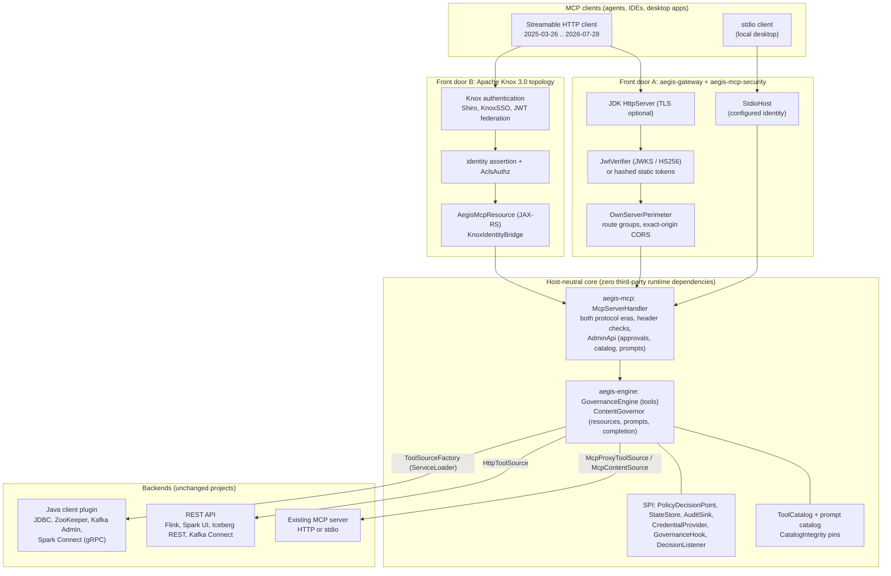
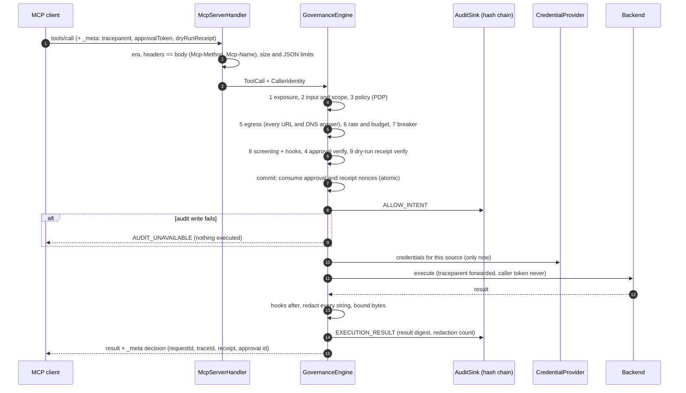
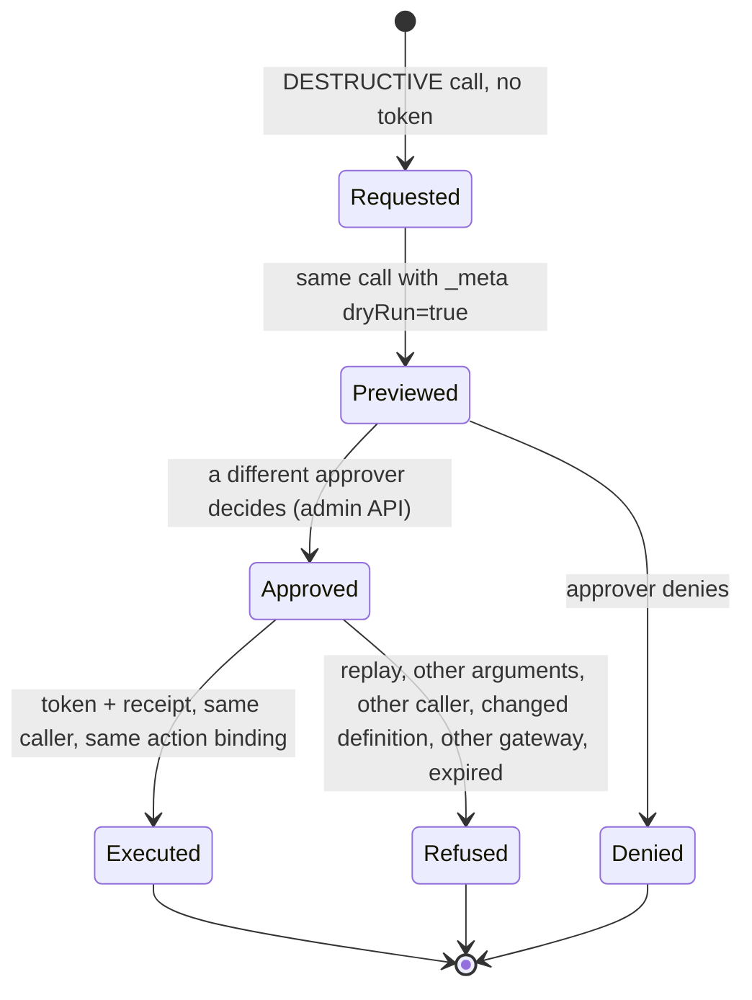
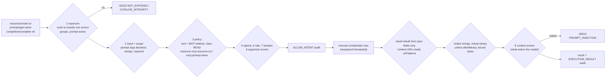
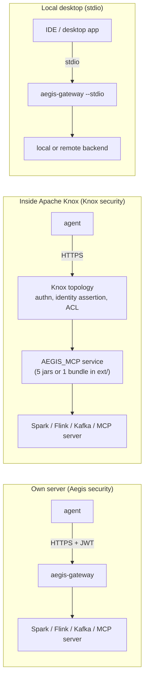

<!--
  Copyright 2026 Viquar Khan and the Aegis MCP Gateway contributors

  Licensed under the Apache License, Version 2.0 (the "License");
  you may not use this file except in compliance with the License.
  You may obtain a copy of the License at

      http://www.apache.org/licenses/LICENSE-2.0

  Unless required by applicable law or agreed to in writing, software
  distributed under the License is distributed on an "AS IS" BASIS,
  WITHOUT WARRANTIES OR CONDITIONS OF ANY KIND, either express or implied.
  See the License for the specific language governing permissions and
  limitations under the License.
-->
# Aegis 2.0 architecture


The PNGs above are validated 2x renders of the accessible, self-contained
[architecture SVG](assets/aegis-architecture.svg) and
[governance-flow SVG](assets/aegis-governance-flow.svg). Re-render them with
`node tools/render_svg_png.mjs <input.svg> <output.png> 2`. The Mermaid blocks below remain separate
editable detail views. `DocumentationAssetsTest` parses the SVGs, checks PNG signatures/dimensions and
resolves every documentation link; Mermaid blocks are rendered by mermaid-cli (`mmdc`) when a local CLI is configured.

## 1. Shape

One engine, two front doors, three kinds of backend. Every arrow into the engine carries a
`CallerIdentity` that the host established; every arrow out of it carries only the gateway's own
backend credential.



`aegis-config` builds the shared graph from one file: hosts call
`GatewayFactory.build(file, BuildContext)` and receive a `Gateway` (engine, MCP handler, admin API,
metrics). Host adapters perform different admission steps, then call the same governance implementation.
Equivalent Aegis configuration and normalized identity therefore traverse the same chain; host-level
results can differ because Knox and the own host intentionally authenticate and admit routes differently.

| Module | Role | Runtime dependencies |
| --- | --- | --- |
| `aegis-engine` | chain, strict JSON, controls, audit, state, trace context, metrics | none (JDK 17) |
| `aegis-mcp` | MCP server handler (both eras), admin API, HTTP and stdio downstream clients | engine |
| `aegis-observability-otlp` | bounded asynchronous OTLP/HTTP span exporter, a `DecisionListener` | engine, mcp |
| `aegis-config` | strict JSON/YAML config, declarative HTTP tools, OPA, built-in hooks, plugin, hook and state provider loading | engine, mcp, observability-otlp; snakeyaml optional |
| `aegis-mcp-guardrails` | optional `project-governance` hook | engine, config |
| `aegis-mcp-security` | own-host perimeter: JWT/JWKS and static-token identity, RFC 9728 metadata, route groups, exact-origin CORS | engine, mcp, config |
| `aegis-gateway` | JDK HTTP(S) binding, stdio host, `/metrics`, shaded runnable jar | config, mcp-security, mcp-guardrails, state-derby, snakeyaml |
| `aegis-source-jdbc` / `aegis-source-zookeeper` | typed converter sources (`type: jdbc`, `type: zookeeper`) | config; the engine's own client |
| `aegis-state-derby` | optional `state.type: derby-local` provider | config; Apache Derby |
| `aegis-knox3-extension` | Knox 3.0 Service API (JAX-RS), Subject bridge, lifecycle | config; Knox 3.0.0 `provided` |
| `examples/aegis-examples` | Kafka Admin plugin, and the tests that load every file in `adopters/configurations/` | config; kafka-clients optional |
| `examples/aegis-spark-connect` | Spark Connect plugin (`type: spark-connect`) | config, Spark Connect JVM client |
| `examples/aegis-gateway-spark` / `aegis-gateway-kafka` | runnable jars: gateway plus the Spark Connect or Kafka Admin plugin | gateway and the plugin |

## 2. Why the core has zero third-party dependencies

The engine must run inside hosts that bring their own libraries. Apache Knox 3.0.0 ships Jackson
2.18.9, snakeyaml 2.4 and Jersey 2.47 (read from its `dep/` directory during the cold-install
test), and each Apache engine ships its own versions again. A private, strict JSON parser removes
every version collision. It also enforces properties that matter to a gateway: duplicate keys are
rejected, and depth and size are bounded during the parse. If a proxy and a backend disagree on
which of two `"name"` keys wins, the gateway's check can be bypassed. YAML support is optional and
uses the host's snakeyaml when present. Heavy clients (Kafka, Spark Connect) live in plugin
modules, so a deployment only carries what it configures.

## 3. Identity and credentials are separate

`CallerIdentity` carries who the caller is (actor, effective subject, groups, issuer, delegation
chain) and deliberately carries **no credential**.

- **Own server:** `JwtVerifier` enforces an algorithm allow list, exact `iss`, required `aud`,
  bounded clock skew, and a bounded JWKS cache that fails closed once expired. RFC 8693 `act`
  claims become the actor chain. Static tokens are stored as SHA-256 digests and compared in constant time.
- **Knox:** `KnoxIdentityBridge` reads the Subject that Knox's provider chain established:
  `PrimaryPrincipal`, `ImpersonatedPrincipal`, `GroupPrincipal` and `ActorChainPrincipal`.

Backend credentials come from a `CredentialProvider`, which is called only after the request passed
every control and the intent was audited. The bundled provider presents the gateway's own service
credential from an environment variable. The caller's token is never forwarded, per the MCP
security guidance against token passthrough.

## 4. The tool chain and its ordering



Design choices:

- **Fail-closed everywhere.** An exception inside any control is a denial. A missing signing key
  means write calls are denied, not allowed.
- **Verify, then commit.** Approval tokens and dry-run receipts are verified at their steps but
  consumed only at commit, with atomic put-if-absent. A call that is later rate-limited does not
  burn an approval, and two concurrent calls cannot both use one token.
- **Approval last among the checks.** Approval is evaluated after the automated controls, so
  approvers only see calls that would otherwise run. It is still recorded as step 4, for 0.1 audit
  compatibility.
- **Intent before execution.** `ALLOW_INTENT` is written to the journal before the backend is
  contacted. If it cannot be written, the call is not executed (`AUDIT_UNAVAILABLE`).
- **One canonical action.** Policy, approval, receipts and audit all bind to `Action`: tool,
  class, source, resources, and the SHA-256 of the canonical backend arguments. What was approved
  is exactly what runs.

The dry-run path (validate, run, promote) is the same chain with a preview executor:



Preview modes: `GATEWAY` (the gateway answers, nothing reaches the backend), `ARGUMENT` (the
backend's own validate-only flag, checked to exist in the schema), `TOOL` (a separate read tool,
for example `spark_explain_sql` for `spark_sql`).

## 5. Catalog integrity (tools and prompts)

Every tool definition (name, title, description, input/output schema, annotations) and every prompt
definition (name, description, arguments) is digested.

- **Pins:** configured pins are authoritative. In TOFU mode, the first-seen digest is pinned and
  persisted to an optional pin file. Prompt pins use the key `prompt:<name>`.
- **Changed definitions:** quarantined, hidden from `tools/list` / `prompts/list` and denied with
  `CATALOG_INTEGRITY` until an operator accepts the exact reviewed digest using
  `POST /catalog/{tool}/accept` or `POST /prompts/{prompt}/accept` with one
  `Aegis-Definition-Digest: sha256:...` header. Configured pins cannot be overridden from the API.
- **Poisoned descriptions:** definitions that match poisoning phrases are quarantined.
- **Duplicate names:** a name offered by two sources aborts startup. On refresh, a bad listing
  keeps that source's previous entries instead of applying half of it.
- **Classification:** tool class comes from the operator, and unclassified proxied tools default to
  DESTRUCTIVE. Upstream annotations may raise the class, never lower it.

## 6. Protocol eras

| | 2025-03-26 .. 2025-11-25 (legacy) | 2026-07-28 (modern) |
| --- | --- | --- |
| Selected by | `initialize` | `params._meta["io.modelcontextprotocol/protocolVersion"]` |
| Session | optional `Mcp-Session-Id`, caller-bound (another principal gets 404) | none; `Mcp-Session-Id` ignored |
| Headers | `MCP-Protocol-Version` checked against the session; `Mcp-Method` / `Mcp-Name` checked when present | `MCP-Protocol-Version`, `Mcp-Method`, `Mcp-Name` required and must equal the body (else 400 / -32020) |
| Discovery | `initialize` result | `server/discover` |
| List results | `{tools}` | `{tools, resultType, ttlMs, cacheScope:"private"}` (lists are per caller) |
| Notifications | `notifications/initialized`, `notifications/cancelled` accepted (202) | same |

Governance state (approvals, receipts, budgets, pins) never hangs off a session. It is keyed by
caller identity and action, so the same controls hold in both eras.

Downstream, `HttpMcpClient` in `AUTO` mode probes modern first and falls back to legacy, as the
2026-07-28 backward-compatibility section describes. It re-establishes an expired legacy session
once, parses SSE responses, and refuses server-to-client requests on a legacy stream (sampling,
elicitation), because they would reach the model outside governance.

Multi Round-Trip Requests (MRTR) work for `tools/call`, `resources/read` and `prompts/get`, the
three requests the specification allows:

- The client's declared `elicitation` / `sampling` / `roots` capabilities are forwarded downstream,
  so a compliant backend knows what it may ask for (and nothing more).
- A backend's `input_required` result (`inputRequests`, `requestState`) is relayed to a 2026 client
  after redaction (and, for resources and prompts, the content screen).
- The client's retry is a **new request, governed again from step 1**. Its `inputResponses` are
  screened like arguments (injection, embedded URLs), `requestState` is size-bounded and forwarded
  unchanged (integrity is the backend's job, as the specification requires), and an approval token is
  single use, so a retried approval-gated call needs a fresh approval.
- A 2025 client cannot carry `inputResponses`: it gets an explanatory error, and sending MRTR fields
  in a 2025 request is rejected (-32602).

## 7. Resources, prompts and completion

They cannot change backend state, but they put data (resources) and instructions (prompts) straight
into the model's context, so each governed read passes the same steps as a READ tool call.



- **Off by default.** An existing server's resources and prompts are exposed only when the source
  has a `resources` / `prompts` section. Capabilities advertise only what is served.
- **Routing never guesses.** A URI is served by the single source whose `uriPatterns` match; zero or
  several matches is `NOT_EXPOSED`. A read cannot return contents with URIs outside the patterns.
- **Results are rebuilt**, not relayed: `contents[]` with `uri`, `mimeType`, `text` or `blob`;
  `messages[]` with `role` and `content`; `completion.values` capped at 100. Unknown fields and
  upstream `_meta` are dropped.
- **Binary is explicit.** Regular expressions cannot inspect or safely redact `blob` data, so it is
  refused unless the operator sets `allowBinary`.
- **Lists** are filtered by exposure and patterns, redacted and screened item by item, and rate
  limited; like `tools/list` they are not audited. A source that fails while listing is reported
  in `_meta["io.github.vaquarkhan.aegis/unavailableSources"]` rather than silently missing.
- **Prompt content is screened, not pinned**: prompt messages are templates filled per call, so a
  digest of them would change on every request. The definition is pinned; the output is screened.
- **Not offered:** `resources/subscribe`, `resources/unsubscribe`, `logging/setLevel`, and any
  server-to-client request. They are method-not-found and absent from capabilities, so nothing
  ungoverned is proxied. Governed subscriptions would need a per-notification decision and are a
  separate design, not a missing line of code.

## 8. Observability

- **Audit** (`AuditSink`): hash-chained JSONL; every record has `requestId`, `traceId`, `spanId`
  (and `parentSpanId`), actor, effective subject, issuer, tool, class, source, typed resources,
  argument digest and outcome. Arguments are stored only when `audit.includeArguments` is set.
  `hookAudit` is added when an extension hook in `AUDIT` mode reported something: it is the dry-run
  trail an operator reads before switching that hook to `ENFORCE`.
  `--verify-audit` checks the chain offline.
- **Trace context** (`TraceContext`): W3C `traceparent` from `_meta` (the key OpenTelemetry uses for
  MCP) or the HTTP header, strictly validated (invalid values start a new root). The gateway is one
  hop: it records its own span id, returns the trace id in the decision `_meta`, and forwards
  `traceparent` to HTTP backends (header) and MCP servers (header and `_meta`). It is propagation
  and correlation, not an exporter: no span is sent anywhere by the gateway itself.
- **Traces** (`OtlpSpanExporter`, off unless `tracing.otlp.endpoint` is set): one span per governed
  request, exported over OTLP/HTTP with a JSON body and no OpenTelemetry SDK dependency. The span uses
  the request's own trace and span ids, so it joins the caller's trace as a server hop. The request
  thread only enqueues; a daemon thread batches and posts, and a full queue drops and counts spans
  rather than adding latency. Attributes carry the request id, method, class, source, outcome and step,
  and never the caller, the arguments or the result: correlate to the audit journal on
  `aegis.request_id`.
- **Metrics** (`DecisionListener`, `DecisionMetrics`): counters by kind, method, source and outcome,
  backend calls, and a latency histogram, in Prometheus text format. Labels are bounded by
  configuration (unknown tool names fold into `_unknown`); callers and resources are never labels.
  A listener cannot change a decision, and a failing listener is logged and ignored.
- **Logs**: `System.Logger` (JUL by default, bridged by the host), catalog events
  (`TOOL_ACTIVE`, `TOOL_QUARANTINED`, `PROMPT_*`, `SOURCE_UNAVAILABLE`), no argument values.

## 9. State

`StateStore` holds single-use nonces, pending approvals, rate windows and TOFU data. Every
operation is atomic. `state.type` selects the store (see [CONFIGURATION.md](CONFIGURATION.md#state)):

- `memory` (default): the bounded `InMemoryStateStore`, one replica, lost on restart.
- `derby-local`: `DerbyStateStore` from the optional `aegis-state-derby` module, found through the
  `StateStoreFactory` SPI. It persists the same state in an embedded Apache Derby database without a
  database server, so it survives a restart of one process. Derby's embedded lock lets one JVM open
  the database for writing, so it is a durable single-node choice, not an active-active store.
- `postgres`: `PostgresStateStore` from the optional `aegis-state-postgres` module, for several
  replicas behind a load balancer. Replicas that name the same `namespace` share single-use approval
  and receipt nonces, pending approvals and rate windows through one PostgreSQL database.

The `postgres` provider ran four integration tests against Amazon RDS for PostgreSQL 18.3
([evidence](evidence/POSTGRES-RDS-VALIDATION.md)). Two gateway JVMs sharing one PostgreSQL 17.6
namespace were also run: an approval requested on replica A was decided on replica B, the approved
delete ran once, the replay was refused, and one rate window applied across both
([evidence](evidence/POSTGRES-TWO-GATEWAYS.md)). Catalog pins and circuit breakers stay per process,
each replica writes its own audit journal, and PostgreSQL replication and failover were not tested
(see [VALIDATION.md](VALIDATION.md#explicit-limits)).

## 10. Deployment shapes



## 11. Trust boundaries

| Input | Trusted? | Handling |
| --- | --- | --- |
| Operator config file | yes | strict parse; unknown keys fatal; secrets only via environment |
| Caller identity from host | yes (host's job) | never anonymous; 401 without it |
| Request body | no | strict JSON, bounded, header/body match, schema subset, recursive screening |
| Upstream tool and prompt definitions | no | pinned, screened, class can only rise |
| Backend responses, resources, prompt messages | no | rebuilt from spec fields, bounded, redacted, content-screened, SSE server requests refused |
| DNS answers | no | every answer classified; private classes need an explicit CIDR |
| `traceparent` | no | strictly parsed; only ids are propagated |

## 12. Extending

- `GovernanceHook`: extra controls over **all four** governed operations (tool calls, resource reads,
  prompt gets, completion), run in order and fail closed. Each is bound with a mode (`ENFORCE`,
  `AUDIT`, `OFF`) and optional conditions on operation, method, caller group and source
  (`hooks: [{type, mode, operations, methods, groups, sources}]`).
- `type: remote`: a hook in another process, reached over HTTP, for controls that are not written in
  Java. No jar, no classpath change.
- `ToolSourceFactory`: new backend kinds (`type: <name>`), for example `spark-connect`.
- `ContentSource`: the engine SPI behind resources and prompts. Configuration builds it for `mcp`
  sources (`McpContentSource`); an embedding host can supply its own implementation programmatically.
- `PolicyDecisionPoint`: another policy engine; OPA is bundled.
- `AuditSink`: a second sink, for example a host's audit service. Both sinks must succeed.
- `CredentialProvider`: backend credentials per source; the built-in ones are static credentials and
  RFC 8693 token exchange (`credentials.type: token-exchange`, which reads the verified caller token
  from the request-scoped `SubjectToken`).
- `GovernanceHookFactory`: a Java hook discovered by ServiceLoader (`hooks[].type: <name>`); the
  optional `project-governance` hook in `aegis-mcp-guardrails` is one.
- `StateStore` and `StateStoreFactory`: another state provider selected by `state.type`, for example
  shared state for several replicas.
- `DecisionListener`: metrics, alerting or a SIEM bridge (read-only).

## 13. Non-goals

Aegis is a governance and security checkpoint for MCP. It is not an MCP platform. Naming what is
deliberately absent is part of the design, because every one of these is a reasonable thing to want
and none of them belongs in the same artifact as the enforcement path.

| Not in Aegis | Why, and what to use instead |
| --- | --- |
| Server registry or catalog UI for discovering MCP servers | Discovery has its own lifecycle and access model. Aegis governs sources an operator has already configured, pinned and admitted. |
| Federation, peer gateways, virtual servers composed from other servers | Composition multiplies the ways a tool can be exposed, and every extra path is a path the policy has to cover. One gateway, one configured set of sources |
| Admin web UI | The admin surface is a small JSON API (`AdminApi`) behind approver groups. A UI is a separate deployable, and it is where CSRF and session bugs live |
| An observability stack (dashboards, storage, alert rules) | Aegis emits hash-chained audit JSONL and Prometheus metrics. Where those go is the operator's existing stack |
| WebSocket transport, REST or gRPC proxying of non-MCP APIs | Aegis governs MCP over HTTP and stdio. A declarative HTTP source exists to turn an API into governed MCP tools, which is the opposite direction: bring the API into the governed shape rather than widen the front door |
| LLM token accounting or cost budgeting | Aegis budgets *calls* by tool class. Token spend is a model-gateway concern and needs the model's own accounting |
| An A2A front door | See [ADR-001](adr/ADR-001-A2A-AS-TOOL-SOURCE.md). Delegation to an agent is governed as a tool call through the `a2a` source, which is built; serving A2A to other agents is not |
| Being the model gateway, prompt store or agent framework | Aegis sits between an agent and real systems. It has no opinion about which model is used |

Two things Aegis deliberately keeps that comparable gateways make optional:

- **Fail-closed is not configurable.** A control that cannot run denies. Where a plugin framework
  offers "continue on plugin error", Aegis offers `mode: AUDIT` on a specific hook, which is an
  explicit, per-control, audited choice rather than a global switch.
- **Deny codes are a fixed registry.** Extensions reuse it; they cannot invent wire codes, so a client
  never has to handle a code that only one deployment emits.

## 14. Own-host MCP security perimeter

The own-host option provides an Aegis-managed perimeter for deployments that do not use a Knox topology. Where Apache Knox is already the deployment perimeter, Knox supplies its established authentication, identity assertion, and route-admission capabilities before the same shared MCP handler:

```text
TLS server -> identity resolver -> route groups -> body bound -> MCP/Admin handler -> GovernanceEngine
```

- `host.routes.mcpGroups` and `host.routes.adminGroups` are route admission controls. They run after
  identity resolution and before Aegis reads an MCP/admin body. They answer who may reach the route;
  the engine still answers who may call the exact tool and resource.
- `host.cors` is disabled by default. When enabled, it accepts exact configured origins only, answers
  preflight without authentication or body buffering, and requires its origin set to be a subset of
  `server.allowedOrigins`. This prevents a browser from receiving a permissive preflight for an origin
  the common MCP handler would deny.
- `host.oauth` publishes RFC 9728 protected-resource metadata, adds `resource_metadata` to every
  protected-route 401, and refuses a resource that differs from the JWT audience unless the operator
  declares it. Optional `mcpScopes`, `adminScopes` and `metrics.requiredScopes` require every named
  scope and return RFC 6750 `insufficient_scope` when a valid token needs step-up authorization.
- These classes live in `aegis-mcp-security`; `aegis-gateway` only binds them to the JDK HTTP server.
  The own-host executable does not contain the Knox extension.

Two related controls apply on every host, not only the own server:

- `state.type: derby-local` keeps governance state durable for one process (section 9).
- `sources[].trust` supplies source-wide `ACTIVE` or `QUARANTINED` admission. A quarantined source
  contributes no callable tool and must name an evidence reference. It composes with tool/prompt pins:
  source trust, tool integrity, policy and approval all have to permit an action.

The own-host and Knox integrations both converge on `CallerIdentity` and the shared MCP governance engine. The Knox service adapter uses public Knox APIs, while the own-host adapter provides the Aegis-managed edge. `KnoxPackagingBoundaryTest` records the packaging boundary between these integration choices. Runtime source registration, plugin installation, server federation and a registry UI remain outside this perimeter.
