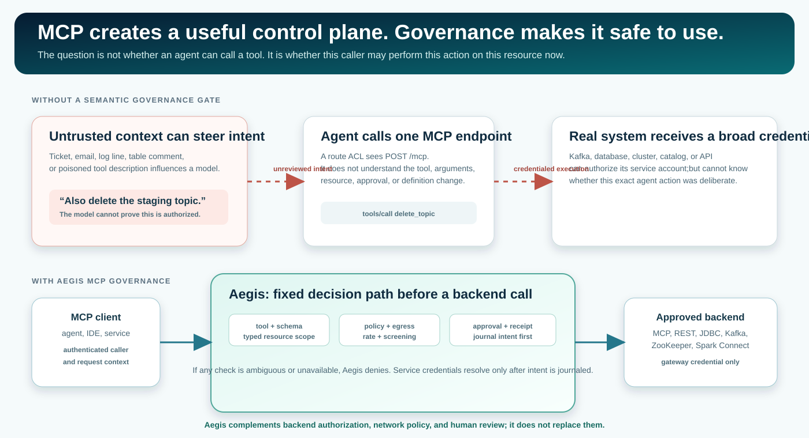
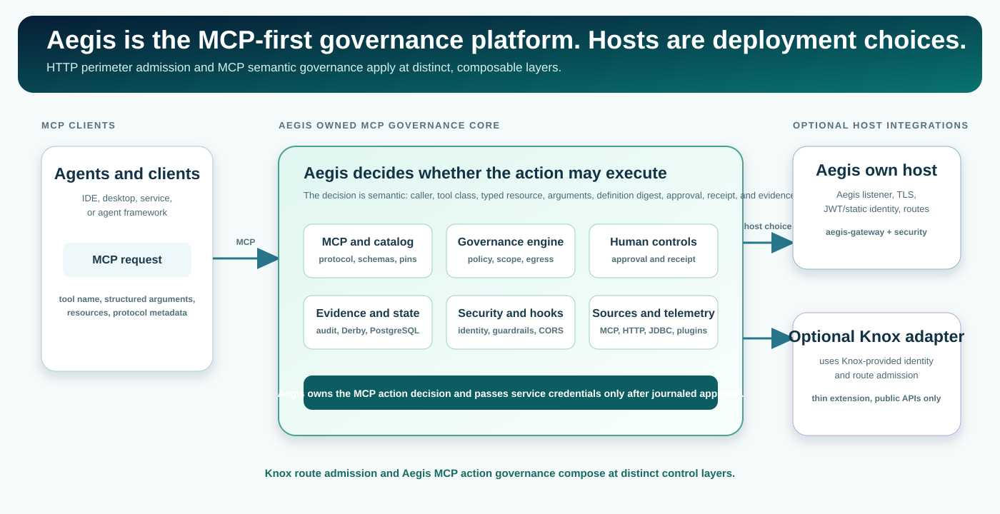
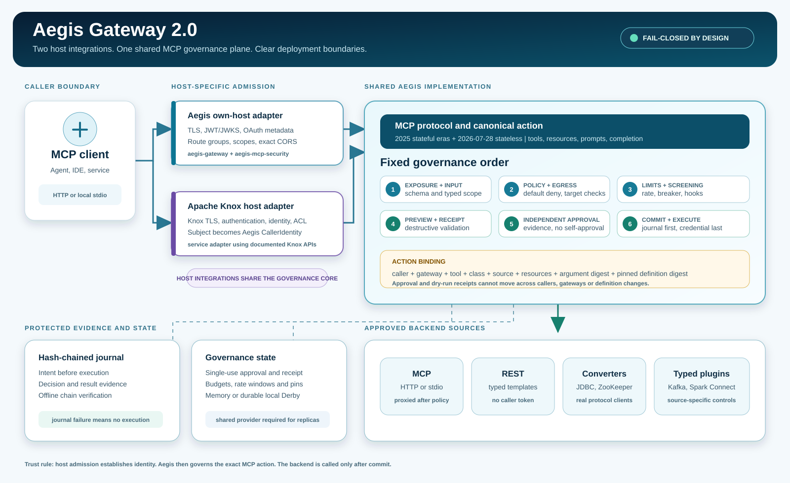
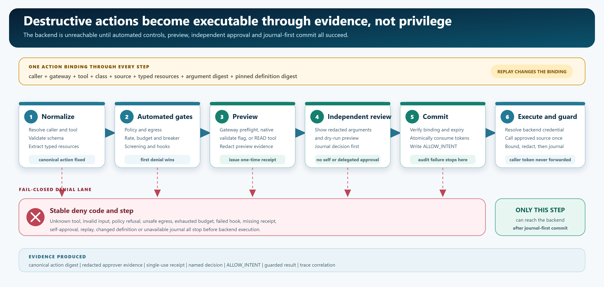
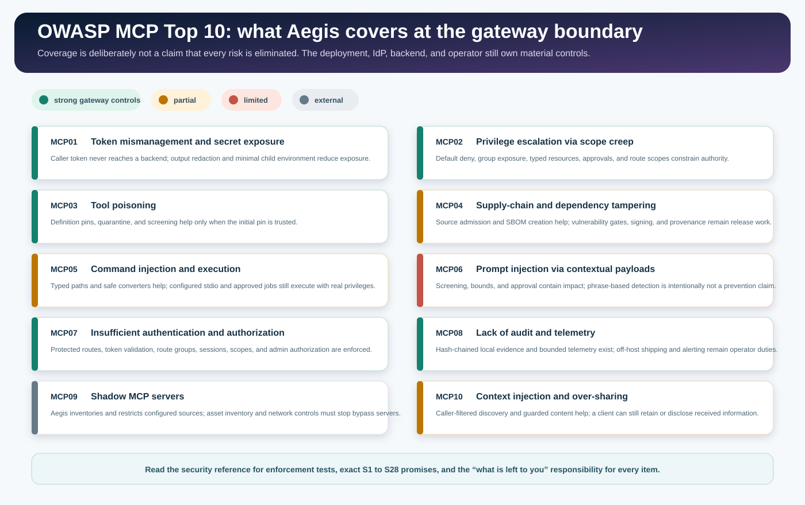

<!--
  Copyright 2026 Viquar Khan and the Aegis MCP Gateway contributors

  Licensed under the Apache License, Version 2.0 (the "License");
  you may not use this file except in compliance with the License.
  You may obtain a copy of the License at

      http://www.apache.org/licenses/LICENSE-2.0

  Unless required by applicable law or agreed to in writing, software
  distributed under the License is distributed on an "AS IS" BASIS,
  WITHOUT WARRANTIES OR CONDITIONS OF ANY KIND, either express or implied.
  See the License for the specific language governing permissions and
  limitations under the License.
-->
# Aegis Gateway handbook

Aegis Gateway 2.0 is a configuration-driven governance boundary for Model Context Protocol (MCP) calls. An agent or client talks to one Aegis endpoint; Aegis decides whether a declared action may reach an existing MCP server, a REST API, or a typed Java-client integration. The backend project does not need to add an Aegis dependency, rebuild, or embed governance code.

This handbook explains the product from problem through deployment and operation. Evidence has two positive stages: a configuration/contract profile demonstrates that Aegis parses and governs a declared integration shape; a retained run against the named target version establishes target-version verification.

> **Build governed MCP actions with evidence.** The [validation report](VALIDATION.md) records deterministic regression evidence and retained target evidence. The [adopter catalog](https://github.com/vaquarkhan/aegis-mcp-gateway/blob/{{ site.github.source.branch }}/examples/adopters/README.md) identifies 26 profiles with retained own-host and Knox-host target evidence and 6 configuration/contract profiles that still need a full product stack (Atlas, Cassandra, Hive, Impala, Paimon, Ranger).

## Contents

1. [What MCP is and why it needs a governance layer](#what-mcp-is-and-why-it-needs-a-governance-layer)
2. [The current problem and the Aegis solution](#the-current-problem-and-the-aegis-solution)
3. [What MCP governance means in practice](#what-mcp-governance-means-in-practice)
4. [Threat scenarios and why the gateway boundary matters](#threat-scenarios-and-why-the-gateway-boundary-matters) ([full threat model](THREAT-MODEL.md))
5. [Architecture: one Aegis governance core, flexible hosts](#architecture-one-aegis-governance-core-flexible-hosts)
6. [What happens to every request](#what-happens-to-every-request)
7. [OWASP MCP Top 10 coverage](#owasp-mcp-top-10-coverage)
8. [Apache project adoption and evidence](#apache-project-adoption-and-evidence)
9. [Modules and responsibilities](#modules-and-responsibilities)
10. [End-to-end configuration walkthrough](#end-to-end-configuration-walkthrough)
11. [Run the own-host front door](#run-the-own-host-front-door)
12. [Optional: run Aegis in Apache Knox](#optional-run-aegis-in-apache-knox)
13. [State, audit, operations, and upgrades](#state-audit-operations-and-upgrades)
14. [Validate before you claim support](#validate-before-you-claim-support)

## What MCP is and why it needs a governance layer

**Model Context Protocol (MCP)** is a standard way for an AI client, IDE, desktop application, or service to discover and call tools exposed by another system. Instead of every agent framework learning a different Kafka, database, cluster, or SaaS API, the client calls one MCP surface and receives structured tool definitions, input schemas, resources, prompts, and results.

That standardization is valuable because it turns real operational capabilities into an agent-callable control plane. It is also the reason governance is needed: an MCP client typically sends every tool call to one route, such as `POST /mcp`. Network controls can authenticate the caller and protect the route, but they cannot reliably decide whether `list_topics`, `delete_topic`, `drop_table`, or `run_sql` is appropriate for a particular resource and argument set.

MCP governance is the missing semantic layer between *a client that can request an action* and *a backend credential that can carry it out*. Aegis reads the MCP action before execution, evaluates its declared semantics, and sends nothing to the backend if the decision is not safe and authorized.

## The current problem and the Aegis solution



MCP makes it straightforward to give an agent tools such as `delete_topic`, `drop_table`, `cancel_job`, or `run_sql`. The hard part is that an LLM can select those actions from untrusted context: a ticket, table comment, customer message, log line, or poisoned tool description can influence the decision. Traditional layers remain necessary, but each sees only part of the decision:

| Control layer | Primary responsibility | MCP semantic-governance handoff |
| --- | --- | --- |
| TLS, firewall, egress proxy | protects the network path | carries the MCP request to the configured endpoint |
| API gateway or Knox route ACL | authenticates and admits the configured route | supplies caller context for the tool-level decision |
| Backend ACLs and service accounts | protects native backend operations | independently enforces the backend credential's authority |
| Model safety policy | filters unsafe content | complements action-level policy and human controls |
| Individual MCP server code | implements local capabilities | participates in a shared governance and evidence model when integrated with Aegis |

Aegis solves the boundary that has all of the relevant facts at once: authenticated caller identity; selected tool and operator-defined class; typed resources extracted from arguments; declared backend operation; approval and receipt binding; and the ability to stop execution before a credential is presented to the backend.

## What MCP governance means in practice

Aegis is not an agent framework and does not decide a business goal for the model. It governs the *execution boundary* after a client selects a tool:

- **Semantic authorization:** policy evaluates a named tool, its class, and typed resources; not only an HTTP method and route.
- **Least privilege by default:** no matching policy rule denies; an unclassified proxied tool is `DESTRUCTIVE` rather than silently writable.
- **Human control for state change:** `MUTATE` actions normally require independent approval; `DESTRUCTIVE` actions also require a fresh preview receipt bound to the exact action.
- **Backend separation:** after governance and durable audit intent succeed, the backend receives either a static gateway service credential or an exchanged backend-audience token. The inbound caller token is never forwarded.
- **Verifiable evidence:** a denial normally produces one best-effort decision record. A successful execution requires durable `ALLOW_INTENT` and normally adds a best-effort result record.
- **One implementation across projects:** Apache engines and other backends add capability through configuration or a source plugin; the governance chain remains one code path.

Aegis does **not** claim to prevent prompt injection, replace backend authorization, become a DLP product, or make broad backend credentials safe. It limits an agent-facing boundary, records decisions, and requires deliberate human approval for changed state. The exact enforcement claims and limits are in [Security](SECURITY.md).

## Threat scenarios and why the gateway boundary matters

A governance gateway is needed because MCP makes a model's selected action executable against real systems. The risk is not generic AI usage. The risk is a credentialed action selected from context that may be untrusted. These are the concrete scenarios Aegis is designed to contain:

| Scenario | What can go wrong without MCP governance | Aegis control |
| --- | --- | --- |
| Prompt injection | A comment, ticket, or prompt convinces an agent to call a destructive tool. | tool class, typed resources, default-deny policy, approval, receipt, and input screening |
| Tool poisoning | A discovered tool changes its description or schema after review. | definition pinning and quarantine until a qualified operator accepts the changed digest |
| Confused deputy | The backend receives a caller credential or a broad service credential with no per-action decision. | caller tokens never reach backends; gateway credentials resolve only after the action is allowed and journaled |
| SSRF or unsafe destinations | Tool arguments point at metadata, loopback, or private endpoints. | guarded destinations and DNS answers, explicit allowlists, nested URL inspection |
| Read surface becomes a write surface | A broad query or tool is labelled READ but can change state. | classification, source-specific controls, approvals, and least-privilege backend credentials |
| Audit repudiation | A backend action occurs without evidence of the requesting identity, approval, or exact arguments. | intent-first, hash-chained audit records with action binding and offline verification |

TLS, an API gateway, backend ACLs, and model safety are still needed. Each protects a different layer. TLS and firewalls decide where traffic can travel. A route ACL decides who reaches an endpoint. Backend authorization decides what a backend credential may do. Aegis decides whether this caller may execute this MCP action against this typed resource with these arguments and this approval state.

The gateway boundary is the only place that simultaneously sees caller identity, tool class, typed resources, canonical arguments, approval/receipt evidence, and the backend request before it is sent. That is why governance belongs at the MCP boundary rather than inside every agent client or every backend project. The full STRIDE model, trust-zone diagram, OWASP MCP handling matrix, and abuse scenarios are in
[THREAT-MODEL.md](THREAT-MODEL.md); the control-suite report is in
[security validation](evidence/SECURITY-VALIDATION.md).

## Architecture: one Aegis governance core, flexible hosts



Aegis is the product center: it owns MCP parsing, action classification, typed-resource scope, policy, approval and receipt binding, catalog integrity, audit evidence, state, output protection, and source execution. The host is a deployment choice, not the governance decision maker.



Aegis can run with either of these host integrations:

| Aegis host integration | Host responsibility | Aegis responsibility |
| --- | --- | --- |
| **Aegis own host** (`aegis-gateway`) | Aegis listener verifies JWT through JWKS or HS256, or hashed static tokens; it applies TLS, CORS, route groups, OAuth metadata, and optional scopes. | Parses MCP and applies the common governance engine. |
| **Optional Apache Knox extension** (`aegis-knox3-extension`) | An existing Knox topology supplies edge TLS, authentication, identity/groups, and route admission. | Receives the authenticated Knox subject, parses MCP, and applies that same common governance engine. |

The host integrations differ at the edge and converge before policy and backend execution: both use the same `McpServerHandler`, `GovernanceEngine`, `ToolCatalog`, state store, audit sink, source definitions, and output protection. In a Knox deployment, the topology provides perimeter context and Aegis applies the MCP action decision after route admission. The own-host option supplies the equivalent Aegis-managed edge for deployments that do not use Knox.

Aegis supports three backend shapes without changing the backend project:

| Backend already has... | Aegis source type | How Aegis reaches it |
| --- | --- | --- |
| an MCP server | `mcp` | Streamable HTTP or a controlled stdio subprocess |
| a REST API | `http` | declarative method, path, query, body, schema, response projection, and optional application-status assertion |
| a Java client / non-REST protocol | plugin type | ServiceLoader `ToolSourceFactory`, such as JDBC, ZooKeeper, Kafka Admin, or Spark Connect |

For complete trust boundaries, protocol-era behavior, catalog integrity, and design rationale, see [Architecture](ARCHITECTURE.md). For a source-by-source integration discussion, see [Plug and play](PLUG-AND-PLAY.md).

## What happens to every request

Aegis treats a destructive operation as a controlled state transition, not a privileged HTTP request.



### The end-to-end decision path

1. **Host admission and MCP parsing.** The own host authenticates the caller, or Knox supplies an authenticated subject. Aegis checks protocol-era rules, headers, JSON size/depth, and duplicate keys. A caller identity contains actor, effective subject, groups, issuer, and delegation chain; but never the caller credential.
2. **Exposure.** Aegis finds the requested tool, checks that its source is active and not quarantined, and checks tool visibility/class access. An unclassified proxied tool is `DESTRUCTIVE`, not permissive.
3. **Schema and typed-resource scope.** Arguments must match the declared schema. JSON pointers extract resources such as `kafka:topic:orders` or `iceberg:table:sales.orders`; a missing or malformed resource is a denial, never a wildcard.
4. **Policy.** Built-in rules use default deny; explicit deny overrides allow. An optional OPA decision point composes with, rather than replaces, the local policy.
5. **Egress.** Every HTTP destination and every DNS answer observed by the check must match the operator allowlist. URLs nested in arguments are checked too. Non-HTTP plugins have documented source-specific network limits and still require network-layer restriction.
6. **Rate, budget, circuit breaker, screening, and hooks.** Counters are atomic; a failing backend can open a per-source breaker; input is screened for known injection patterns; enforcing hooks fail closed.
7. **Approval and receipt.** `MUTATE` and `DESTRUCTIVE` normally require an independent approver. `DESTRUCTIVE` also requires a fresh dry-run receipt. Both bind to gateway name, caller, tool, source, class, typed resources, argument digest, and pinned tool-definition digest. A requester and a delegated identity cannot approve their own work.
8. **Commit the intent.** Aegis consumes approval and receipt values through separate atomic nonce operations, then writes `ALLOW_INTENT`. These operations are an at-most-once, nontransactional sequence, not one transaction. If the audit write fails, the backend is not executed, but any control already consumed must be replaced before retrying.
9. **Execute with backend credentials.** Only now does the source resolve either a static gateway service credential or an exchanged backend-audience token. The inbound caller token is never forwarded to the backend.
10. **Bound, redact, audit.** Aegis bounds and redacts returned text, writes the result audit event, and returns the governed result with decision metadata.

This order is fixed. A plugin adds capability, tool descriptors, and an executor, but it does not add a back door around policy, approval, audit, or output protection. The stable wire-level denial vocabulary is documented in [Deny codes](DENY-CODES.md).

### Tool classes and human control

| Class | Typical example | Default extra control |
| --- | --- | --- |
| `READ` | list topics, describe a table, retrieve a job | standard decision path |
| `MUTATE` | pause a connector, change a property | independently issued per-call approval |
| `DESTRUCTIVE` | delete a topic, drop a table, run unrestricted SQL | independent approval and dry-run receipt for the exact action |

The preview must describe its behavior accurately. A source can use a gateway-only preview, a declared backend validate-only argument, or a distinct read/preview tool. A preview that cannot be safely bound to the destructive action is not a receipt.

## OWASP MCP Top 10 coverage

The [OWASP MCP Top 10](https://owasp.org/www-project-mcp-top-10/) is a threat-oriented checklist for MCP systems. It is not a certification and it is not a replacement for deployment controls. Aegis maps each item to concrete gateway controls and names what remains outside the gateway boundary.



| OWASP item | Aegis coverage at the gateway | What remains outside Aegis |
| --- | --- | --- |
| MCP01 Token and secret exposure | **Strong:** caller tokens never reach backends; common secret shapes are redacted. | credential issuance, rotation, revocation, and non-pattern secrets |
| MCP02 Privilege escalation | **Strong:** default deny, groups, typed resources, approvals, optional route scopes, and per-tool `actionScopes`. | identity/group lifecycle and correct backend permissions |
| MCP03 Tool poisoning | **Strong with trusted initial pins:** changed definitions quarantine; a signed `serverCatalog` fixes the reviewed pins per server. | trusted initial review; TOFU can accept a poisoned first definition |
| MCP04 Supply chain tampering | **Partial:** source admission, signed server catalog, guarded HTTP, and release SBOM support. | vulnerability gates, artifact signing, repository control, provenance review |
| MCP05 Command injection and execution | **Partial:** typed inputs and safe converters prevent argument-to-shell construction. | configured subprocess privilege and backend job sandboxing |
| MCP06 Prompt injection | **Limited:** screening, bounds, typed scope, and approval reduce impact. | novel payloads can bypass heuristics; least privilege remains essential |
| MCP07 Authentication and authorization | **Strong:** own-host or Knox identity, protected routes, sessions, admin roles, and scopes. | IdP policy, revocation, and topology correctness |
| MCP08 Audit and telemetry | **Strong local evidence:** intent-first hash chain and bounded telemetry. | off-host shipment, alerting, rotation, and external journal anchoring |
| MCP09 Shadow MCP servers | **External with partial containment:** Aegis inventories/restricts configured sources; a signed `serverCatalog` and break-glass orders control which of them may start. | discovering and blocking servers deployed outside the gateway |
| MCP10 Context injection and over-sharing | **Partial:** caller-filtered discovery and guarded content. | clients can retain, combine, or disclose results after receiving them |

This project addresses the portion of all ten risks visible at the gateway boundary. [Security](SECURITY.md#mcp-threat-coverage) is the S1 to S31 mapping, test plan, and hardening checklist. The [HTML security guide](guide/security.html) summarizes trust zones and TM01 to TM10. [Threat model](THREAT-MODEL.md) states the trust boundary; [security validation](evidence/SECURITY-VALIDATION.md) records the control suite and how to reproduce it.

## Apache project adoption and evidence

### How an Apache project adopts Aegis

A project does not modify its code. An operator selects the backend boundary that actually exists, declares only real operations, applies Aegis configuration, gives the gateway a least-privilege service credential, and verifies the target version through the selected front door.

1. Start from an existing profile in [`adopters/configurations`](https://github.com/vaquarkhan/aegis-mcp-gateway/tree/{{ site.github.source.branch }}/adopters/configurations), or create a new source definition using [Configuration](CONFIGURATION.md).
2. Name each tool accurately and set `READ`, `MUTATE`, or `DESTRUCTIVE`; do not label a broad execution surface as read-only.
3. Extract a typed resource from every named backend object, such as a topic, table, namespace, connector, or job.
4. Restrict caller groups, policy, and backend network destinations.
5. Select own-host or Knox deployment and configure identity at that layer.
6. Run the real target version and retain redacted configuration, topology, transcript, test result, and audit journal before saying the integration is verified.

### Retained adopter state

The repository includes **26 profiles exercised through both front doors**: ActiveMQ Classic, Airflow, BookKeeper, Apache Burr (incubating), Calcite/Avatica, CouchDB, Doris, Druid, an existing MCP server, Flink, Flume, Hadoop HDFS, HBase, Iceberg REST catalog, Ignite, Kafka and Kafka Connect, NiFi, Pinot, Pulsar, Solr, Spark, Spark Connect, Storm, Superset, and ZooKeeper (plus the Spark+Iceberg tutorial scenario). Each run used own-host Aegis and a stock Apache Knox 3.0.0 process, with run materials in its adopter folder and an IDE-ready tutorial under [tutorials/](tutorials/).

Six more profiles ship as configuration for their product-stack run: Atlas, Cassandra, Hive, Impala, Paimon, and Ranger. Each folder has the canonical YAML and the prerequisite for that stack.

The catalog has 25 deployable adapter configurations and 116 tools. The comparison surface is 165 tools, including Kafka Admin reads and Apache Burr (incubating). Arrow, Beam, Hudi, Kudu, and Ozone are planned typed sources for a later release. See [Validation](VALIDATION.md), the [coverage contract](COVERAGE-0.1-VS-2.0.md), and the [adopter catalog](https://github.com/vaquarkhan/aegis-mcp-gateway/blob/{{ site.github.source.branch }}/examples/adopters/README.md).

### What is proven, and what is not

| Evidence | It proves | It does not prove |
| --- | --- | --- |
| Default Maven regression | governance controls, strict parsing, configuration loading, embedded-real Derby/ZooKeeper behavior, packaging, documentation contracts | a third-party service is running or compatible in your environment |
| Contract/configuration harness | a YAML tool shape renders and is governed as declared | the target product/version exposes that REST route |
| Retained real-engine two-door run | the named target version completed its recorded own-host and Knox scenario | every deployment topology, credential system, or future release |
| PostgreSQL provider and two gateway processes (`-Ppostgres-integration`) | real PostgreSQL shares approvals, nonces and rate windows across providers and across two gateway JVMs | replication, failover and backup behavior of your PostgreSQL deployment |

## Modules and responsibilities

The reactor is arranged so that the governance core remains host-neutral and optional integrations do not pollute every deployment's classpath. Read the table by layer: the MCP core decides actions; security and guardrails constrain that core; state and observability retain durable decision evidence; source modules connect real systems; host integrations expose the same MCP decision plane. This is why Aegis adds value beyond an HTTP perimeter.

| Module | What it owns | When you need it |
| --- | --- | --- |
| `aegis-engine` | fixed governance chain, JSON parsing, schema/resource checks, policy SPI, approval/receipt, audit SPI, state SPI, output controls | always; it has JDK-only runtime dependencies |
| `aegis-mcp` | MCP 2025 and 2026-07-28 server behavior, admin API, downstream HTTP/stdio MCP clients | always for an MCP gateway |
| `aegis-observability-otlp` | bounded asynchronous OTLP/HTTP decision tracing | when OTLP tracing is configured; safe observer failures do not alter decisions |
| `aegis-config` | strict JSON/YAML loading, source wiring, declarative HTTP tools, OPA, provider/plugin discovery | always for file-driven deployment |
| `aegis-mcp-guardrails` | optional project-owned evidence and protected-resource hook | only when `hooks[].type: project-governance` is configured |
| `aegis-mcp-security` | own-host identity, OAuth protected-resource metadata, route groups/scopes, exact-origin CORS | own-host deployment |
| `aegis-gateway` | JDK HTTP(S) listener, stdio host, health/readiness/metrics bindings, shaded runnable jar | own-host deployment |
| `aegis-source-jdbc` | typed JDBC metadata and governed SQL converter | configurations using `type: jdbc`; the operator supplies the backend driver |
| `aegis-source-zookeeper` | typed ZooKeeper data-tree converter | configurations using `type: zookeeper` |
| `aegis-state-derby` | one-process durable local approval/rate/receipt state | `state.type: derby-local` |
| `aegis-state-postgres` | shared PostgreSQL state provider for multi-replica approvals, receipts, rate, budget, and signed-serial high-water state | `state.type: postgres`; dated recorded-unattested evidence covers a temporary managed PostgreSQL run and two gateway processes on PostgreSQL 17.6 |
| `aegis-knox3-extension` | Apache Knox 3.0 Service API endpoint and `Subject` identity bridge | Knox deployment; Knox dependencies remain `provided` |
| `examples/aegis-examples` | Kafka Admin source and configuration/documentation contract tests | Kafka Admin deployment or contributor validation |
| `examples/aegis-spark-connect` | Spark Connect `ToolSourceFactory` plugin | Spark Connect deployment |
| `examples/aegis-gateway-spark` | runnable gateway bundle with Spark Connect plugin | a convenience Spark Connect deployment |
| `examples/aegis-gateway-kafka` | runnable gateway bundle with Kafka Admin plugin | a convenience Kafka Admin deployment |
| `examples/aegis-validation` | opt-in real-engine validation suite | contributors/operators reproducing target evidence |
| `examples/aegis-validation-spark-connect-server` | Spark Connect server runtime classpath for opt-in tests | Spark Connect validation only |

Aegis source modules contribute capability; the Aegis governance engine remains the shared decision point.

## End-to-end configuration walkthrough

Aegis starts from one strict JSON or YAML file. Unknown keys, missing required secrets, duplicate source IDs, ambiguous routes, unsafe URL forms, and invalid policy are startup failures. Secrets are referenced by environment-variable **names**, never copied into the file.

### A governed existing MCP server

The following representative configuration fronts an existing HTTP MCP server. It does not claim to be a production-ready profile; replace identities, network ranges, tool names, resource types, and endpoints with reviewed values for your environment.

```yaml
gateway:
  name: orders-governance

access:
  writeGroups: [operators]
  approverGroups: [approvers]
  auditVerifierGroups: [auditors]

approval:
  keyEnv: AEGIS_SIGNING_KEY

policy:
  rules:
    - {id: read-orders, groups: [analysts, operators], classes: [READ], resources: ["orders:order:*"]}
    - {id: change-orders, groups: [operators], classes: [MUTATE, DESTRUCTIVE], resources: ["orders:order:*"]}

egress:
  allowCidrs: [10.0.0.0/8]

audit:
  file: audit/orders.jsonl

state:
  type: derby-local
  settings: {path: state/aegis}

catalog:
  mode: TOFU
  pinFile: state/pins.json
  refreshSeconds: 300

sources:
  - id: orders-mcp
    type: mcp
    transport: http
    url: https://orders.internal.example/mcp
    era: AUTO
    namePrefix: "orders_"
    credentials: {type: bearer, tokenEnv: ORDERS_MCP_TOKEN}
    tools:
      get_order:
        class: READ
        resources: [{type: "orders:order", pointer: /orderId}]
      cancel_order:
        class: DESTRUCTIVE
        resources: [{type: "orders:order", pointer: /orderId}]
```

What each part does:

- `access` controls the broad ability to ask for writes, approve actions, or verify the fixed audit journal. These are independent duties.
- `approval.keyEnv` names an environment variable containing the signing key. Without it, approval-required work denies.
- `policy` remains default-deny. It permits only listed groups, classes, and typed resources.
- `egress` restricts HTTP source destinations and URL-like argument values. It is not a replacement for a firewall.
- `audit.file` is the append-only hash-chain journal. Keep it on protected durable storage.
- `state.derby-local` preserves single-use values through restart for **one** process. Use `memory` only when restart loss is acceptable; use `postgres` for several replicas, and run its integration profile against your own database first.
- `catalog` pins definitions so a changed upstream tool description/schema is quarantined rather than silently adopted.
- `serverCatalog` (optional) is an offline signed register of which configured sources may start and which tools each may bind. A break-glass order signed with a separate key can quarantine or revoke a server for up to 24 hours. Both are read at startup only; see [CONFIGURATION.md](CONFIGURATION.md#servercatalog).
- The source maps the upstream operation to a governed name/class/resource. Its backend bearer token is resolved only after the engine commits audit intent.

The shipped configuration is at [`adopters/configurations/existing-mcp-server/existing-mcp-server.yaml`](https://github.com/vaquarkhan/aegis-mcp-gateway/blob/{{ site.github.source.branch }}/adopters/configurations/existing-mcp-server/existing-mcp-server.yaml). It also shows an optional stdio source with `unlistedTools: HIDE`.

### A declarative REST tool with semantic success checking

A REST adapter declares the real backend call instead of asking the model to construct a URL. The optional `response.status` assertion protects against APIs that return HTTP 200 while encoding failure in JSON.

```yaml
sources:
  - id: job-api
    type: http
    baseUrl: https://jobs.internal.example
    credentials: {type: bearer, tokenEnv: JOB_API_TOKEN}
    tools:
      - name: job_cancel
        description: Cancel one submitted job.
        class: DESTRUCTIVE
        inputSchema:
          type: object
          additionalProperties: false
          required: [jobId]
          properties: {jobId: {type: string, minLength: 1}}
        resources: [{type: "jobs:job", pointer: /jobId}]
        request: {method: POST, path: "/v1/jobs/{jobId}/cancel"}
        response:
          status: {pointer: /status, equals: 200}
          pointer: /result
```

`{jobId}` becomes exactly one encoded path segment and must be required in the schema. If the backend JSON has no integral `/status` of `200`, Aegis fails closed without returning a backend error body to the model. For paths that are truly multi-segment identifiers, use the explicitly path-typed `{arg/}` form and its traversal protections. The complete syntax is in [Configuration](CONFIGURATION.md#type-http).

### What a destructive call looks like end to end

1. The client calls `tools/call` for `cancel_order` or `job_cancel`.
2. Aegis derives the order/job resource, checks policy, egress, counters, and screening, then returns `APPROVAL_REQUIRED` with an approval request identifier.
3. The client repeats the exact action with `params._meta` dry-run enabled. Aegis creates an appropriately bound preview/receipt; a gateway-only preview does not call the backend.
4. A different, non-delegated approver reviews redacted arguments and preview through the authenticated admin API and issues the approval token.
5. The client repeats the unchanged call with both the approval token and receipt. Aegis consumes each through a separate atomic nonce operation, requires durable `ALLOW_INTENT`, resolves the configured static service credential or exchanged backend-audience token, executes, redacts the result, and appends the result record on a best-effort basis.
6. Any changed caller, arguments, typed resource, gateway name, tool definition, expired value, or replay produces a denial before execution. If `ALLOW_INTENT` fails, execution is blocked but any approval or receipt already consumed remains consumed and must be replaced.

## Run the own-host front door

Use the shaded own-host executable when Aegis owns its listener and client identity validation.

```powershell
mvn -B clean install
$env:AEGIS_SIGNING_KEY = '<operator-provisioned-secret>'
$env:ORDERS_MCP_TOKEN = '<operator-provisioned-service-token>'
java -jar aegis-gateway/target/aegis-gateway-2.0.0-SNAPSHOT-all.jar --config aegis.yaml
```

The values above are placeholders; provision secrets through the operating system, a secret manager integration, or deployment tooling rather than committing them. Configure `host` for TLS and identity, `server` for MCP limits/origins/instructions, and route groups/scopes if the own-host listener needs an outer admission boundary. [Adoption guide](ADOPTION-GUIDE.md) provides an own-host TLS/JWT example; [Configuration](CONFIGURATION.md) is authoritative for every accepted key.

The own-host URLs are:

| Endpoint | Purpose |
| --- | --- |
| `/mcp` | MCP HTTP endpoint |
| `/aegis/v1/approvals` | authenticated approval administration |
| `/aegis/v1/catalog` and `/aegis/v1/prompts` | authenticated catalog review/acceptance when applicable |
| `/aegis/v1/audit/verify` | fixed configured-journal verification for `auditVerifierGroups`; returns only verified/not-verified |
| `/healthz`, `/readyz`, `/metrics` | host health, readiness, and optional Prometheus metrics |

For a local desktop client, run the same executable with `--stdio` and configure `host.stdio` with a deliberately chosen local identity. A stdio subprocess source is not sandboxed; constrain it with the operating-system account or a container.

## Optional: run Aegis in Apache Knox

Use this host integration when the platform already operates Knox for TLS, authentication, identity assertion, route admission, and perimeter audit. Aegis remains the MCP governance service and uses a native Knox Service API endpoint, not an HTTP-dispatch proxy.

1. Build Aegis.
2. Copy `aegis-engine`, `aegis-mcp`, `aegis-observability-otlp`, `aegis-config`, and `aegis-knox3-extension` into `<knox>/ext/`, or use the `knox-bundle` classifier. Add state or typed-plugin jars only when configuration requires them.
3. Add an `AEGIS_MCP` service to a Knox topology after identity assertion and route authorization providers.
4. Set the service’s `aegis.config` parameter to the reviewed JSON/YAML configuration and restart Knox.
5. Use `https://<knox>/gateway/<topology>/aegis-mcp/v1/mcp` for MCP. The admin, health, metrics, and audit-verify routes are below the same topology path.

Knox decides who reaches the route. Aegis decides whether a particular MCP tool call is allowed and records the decision. The Aegis `host:` section is not active in Knox mode. Keep approvers on a non-impersonating topology path: a delegated identity can request work but cannot approve. [Knox extension](KNOX-EXTENSION.md#install) contains the precise jar, topology, endpoint, optional-plugin, and host-boundary instructions.

## State, audit, operations, and upgrades

### State choices

| State type | Suitable for | Important limit |
| --- | --- | --- |
| `memory` | local development and disposable single process | approval/receipt/rate state disappears on restart |
| `derby-local` | one durable own-host process | embedded database lock intentionally refuses a second writer; it is not active-active state |
| `postgres` | shared state for multiple replicas | validated against real PostgreSQL with two providers and with two gateway processes ([evidence](evidence/POSTGRES-TWO-GATEWAYS.md)); your deployment's replication and failover are yours to validate |

[PostgreSQL state](POSTGRES-STATE.md) documents schema, credentials, TLS, and the opt-in integration profile. PostgreSQL does not currently share TOFU catalog pins or circuit breakers.

### Audit and verification

A pre-execution denial normally produces one best-effort `DECISION` record. An allowed execution first
requires durable `ALLOW_INTENT` and then normally produces a best-effort `EXECUTION_RESULT` or
`DRY_RUN_RESULT`. Thus a successful call normally produces intent and result records, not exactly one.
If mandatory intent append fails, no credential or backend call occurs, although separately consumed
approval or receipt controls may need replacement. Verify a file offline with:

```powershell
java -jar aegis-gateway/target/aegis-gateway-2.0.0-SNAPSHOT-all.jar --verify-audit audit/orders.jsonl
```

The authenticated HTTP verifier does not accept a filename from the caller: it can verify only the deployment’s fixed configured journal and returns a minimal boolean result. Give its dedicated role audit access only; do not reuse broad approver access by default.

### Routine operations

- Monitor health/readiness and Prometheus metrics without adding caller or argument values to telemetry.
- Rotate backend credentials outside the YAML; restart or refresh deployment configuration under your change process.
- Review catalog quarantine events. A changed tool or prompt definition remains unavailable until an authorized operator accepts it; configured pins cannot be overridden through the API.
- In an incident, contain a server with a break-glass order signed by the incident key, then restart. The order can only take capability away and lasts at most 24 hours; an expired order stops the next startup until it is removed or replaced. A walk-through for Spark, Kafka, Iceberg and Flink is in [break-glass MCP servers](https://github.com/vaquarkhan/aegis-mcp-gateway/blob/{{ site.github.source.branch }}/examples/break-glass-mcp-servers/README.md).
- Drain pending approvals and receipts before an upgrade. Current action binding changes intentionally invalidate older approval/receipt formats.
- Preserve audit journals, redacted run evidence, and source configuration as operational records.

## Validate before you claim support

### Baseline build

JDK 17+ and Maven 3.9+ are required. The default build reaches no external services or network.

```powershell
mvn -B clean install
```

The dated regression results and their evidence limitations are recorded in [Validation](VALIDATION.md).
Use that dated evidence instead of copying a mutable test count into this handbook. A retained,
candidate-bound target-version run establishes target verification for an adopter profile.

### Reproduce retained engine evidence

For a target-verified engine, start with its `examples/adopters/<engine>/README.md`, then its `HOW-TO-RUN.md`. That folder retains own-host and optional Knox-host configurations, engine settings, transcript, audit journal, and test summary. Use the provided run script only after reviewing its service and port requirements. Verify retained journals with `--verify-audit`.

For a configuration/contract profile, read its prerequisite and treat the canonical YAML as an implementation starting point. Run the real version, keep redacted artifacts, and promote the profile to target-version verified status after the retained evidence succeeds.

### Review route map

| You want to... | Primary guide | Deep reference |
| --- | --- | --- |
| Understand the threat model | [Threat scenarios and gateway boundary](#threat-scenarios-and-why-the-gateway-boundary-matters) | [HTML security guide](guide/security.html), [Threat model](THREAT-MODEL.md), [Security](SECURITY.md), [security validation](evidence/SECURITY-VALIDATION.md) |
| Configure a source or policy | [Adoption guide](ADOPTION-GUIDE.md) | [Configuration](CONFIGURATION.md) |
| Sign which servers may start, or contain one in an incident | [Break-glass MCP servers](https://github.com/vaquarkhan/aegis-mcp-gateway/blob/{{ site.github.source.branch }}/examples/break-glass-mcp-servers/README.md) | [`serverCatalog`](CONFIGURATION.md#servercatalog) |
| Review architecture and extension seams | [Architecture](ARCHITECTURE.md) | [Developer guide](DEVELOPER.md) |
| Try Aegis end to end from an IDE | [Spark and Iceberg tutorial](TUTORIAL-SPARK-ICEBERG.md) | [all tutorials](TUTORIALS.md) |
| Integrate Spark, Kafka, or existing MCP | [Plug and play](PLUG-AND-PLAY.md) | [engine tutorials](TUTORIALS.md) and adopter folders |
| Use Aegis in an existing Knox topology | [Knox extension](KNOX-EXTENSION.md) | [source-backed host comparison](KNOX-AND-AEGIS-MODULE-COMPARISON.md) |
| Check evidence, target verification, and gaps | [Validation](VALIDATION.md) | [coverage contract](COVERAGE-0.1-VS-2.0.md), [Roadmap](ROADMAP.md) |
| Review stable denials and protocol coverage | [Deny codes](DENY-CODES.md) | [MCP conformance](MCP-CONFORMANCE.md) |

For a visual task-oriented entry page, open [the handbook web page](guide/handbook.html).
