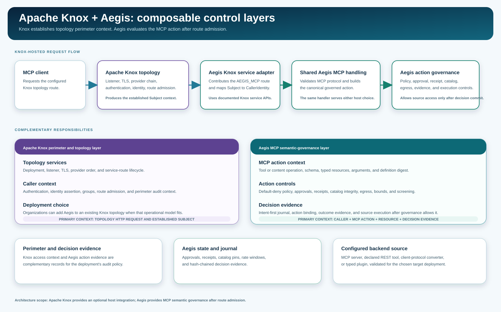

<!--
  Copyright 2026 Viquar Khan and the Aegis MCP Gateway contributors

  Licensed under the Apache License, Version 2.0 (the "License");
  you may not use this file except in compliance with the License.
  You may obtain a copy of the License at

      http://www.apache.org/licenses/LICENSE-2.0

  Unless required by applicable law or agreed to in writing, software
  distributed under the License is distributed on an "AS IS" BASIS,
  WITHOUT WARRANTIES OR CONDITIONS OF ANY KIND, either express or implied.
  See the License for the specific language governing permissions and
  limitations under the License.
-->
# Apache Knox and Aegis: composable deployment layers

Apache Knox and Aegis serve complementary roles in a deployment that exposes MCP
capabilities. Organizations already using Knox can retain its topology, perimeter,
identity, and route-admission model while adding Aegis at the `AEGIS_MCP` service
route for MCP semantic governance. Aegis can also use its own host where that is the
appropriate deployment choice.



## Layer responsibilities

| Deployment layer | Apache Knox contribution | Aegis contribution | Handoff |
| --- | --- | --- | --- |
| HTTP perimeter | Topology deployment, listener, TLS, provider chain, authentication, identity assertion, and route admission. | Receives the established caller context when hosted in a Knox topology. | Knox admits the configured `AEGIS_MCP` service route. |
| MCP protocol | Carries the admitted HTTP request through the topology. | Validates MCP and JSON-RPC semantics, protocol-era rules, tools, resources, prompts, and completion requests. | The JAX-RS service adapter translates the request to the shared Aegis MCP handler. |
| Action governance | Supplies the trusted perimeter context for the request. | Evaluates tool exposure, schema, typed resources, policy, approval, receipt, catalog integrity, egress, and content controls. | Aegis makes the action decision before backend execution. |
| Evidence | Retains topology and perimeter access context. | Records governed decision evidence, action binding, approvals, receipts, and execution outcomes. | The evidence layers can be operated together according to the deployment's audit policy. |
| Backend access | Hosts the service route and its provider configuration. | Resolves the configured source credential only after the action is allowed and journaled. | Native backend authorization remains an important independent control. |

## Knox-hosted request flow

```text
MCP client
  -> Apache Knox connector and topology
  -> configured Knox providers for authentication, identity, and route admission
  -> AEGIS_MCP native service adapter
  -> KnoxIdentityBridge maps the established Subject to CallerIdentity
  -> shared McpServerHandler and GovernanceEngine
  -> configured Aegis source and backend
```

The Aegis Knox module is a service adapter for this handoff. It contributes the
`AEGIS_MCP` service role, maps the Knox `Subject` into Aegis caller context, and
uses the shared Aegis protocol and governance modules. This lets the same Aegis
semantic controls run with either host choice.

## Practical deployment choices

Choose the Knox host integration when a team already operates a Knox topology and
wants MCP access to participate in that perimeter. Choose the Aegis own host when
a standalone MCP endpoint is the simpler operational fit. Both paths apply the
same Aegis action-governance controls after their respective admission step.

For Knox configuration and installation, see [KNOX-EXTENSION.md](KNOX-EXTENSION.md).
For retained API and packaging boundary evidence, see
[evidence/KNOX-PROVENANCE.md](evidence/KNOX-PROVENANCE.md). The evidence records
what was inspected for the extension; it is not a compatibility certification for
every Knox release or topology.

## Source anchors and scope

This guide is based on the local Knox source checkout at
`7d4e4facc09318354d51bcee9b2f8d248dfca638` and the local Aegis 2.0 source tree.
The relevant implementation anchors are:

| Topic | Local source anchor |
| --- | --- |
| Knox deployment construction | `apache-knox/gateway-server/.../deploy/DeploymentFactory.java` |
| Knox service contribution pattern | `apache-knox/gateway-provider-jersey/.../JerseyServiceDeploymentContributorBase.java` |
| Aegis Knox service adapter | `aegis-knox3-extension/.../AegisKnoxServiceContributor.java` |
| Aegis JAX-RS request translation | `aegis-knox3-extension/.../rs/AegisMcpResource.java` |
| Aegis Subject mapping | `aegis-knox3-extension/.../KnoxIdentityBridge.java` |
| Shared MCP protocol handler | `aegis-mcp/.../server/McpServerHandler.java` |
| Shared action governance | `aegis-engine/.../GovernanceEngine.java` |

The extension's API-level tests run against Knox 3.0.0. A current cold-install
run with the release artifact layout remains the appropriate target-specific
integration evidence before making a release compatibility claim.
