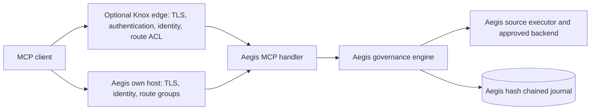

<!--
  Copyright 2026 Viquar Khan and the Aegis MCP Gateway contributors

  Licensed under the Apache License, Version 2.0 (the "License");
  you may not use this file except in compliance with the License.
  You may obtain a copy of the License at

      http://www.apache.org/licenses/LICENSE-2.0

  Unless required by applicable law or agreed to in writing, software
  distributed under the License is distributed on an "AS IS" BASIS,
  WITHOUT WARRANTIES OR CONDITIONS OF ANY KIND, either express or implied.
  See the License for the specific language governing permissions and
  limitations under the License.
-->
# Apache Knox host integration for Aegis

For organizations that operate Apache Knox, the Aegis Knox extension connects the Knox topology perimeter to Aegis MCP semantic governance. Knox continues to provide its established topology, identity, and route-admission capabilities; the Aegis service adapter receives that caller context and applies the configured MCP action controls. Aegis also offers an own-host option for deployments that prefer a standalone MCP endpoint.

## What each side does

| Concern | Knox (topology providers) | Aegis (the `AEGIS_MCP` service) |
| --- | --- | --- |
| Authentication | ShiroProvider / KnoxSSO / JWT federation (Knox's own JWKS validation) | reads the resulting Subject; never re-authenticates |
| Identity assertion, groups | identity-assertion provider (e.g. `group.principal.mapping`) | maps `PrimaryPrincipal`, `ImpersonatedPrincipal`, `GroupPrincipal`, `ActorChainPrincipal` |
| Route authorization | `AclsAuthz` on `AEGIS_MCP` (who may reach MCP at all) | - |
| Per tool, per argument, per call | not applicable (`AclsAuthz` authorizes at route level by design) | the whole Aegis chain |
| Audit | Knox audit (`gateway-audit.log`): access, authentication, authorization | Aegis hash-chained journal: governed call decisions, execution intent/results and administrative changes |

Security is layered in Knox mode. Knox owns the network perimeter, authentication, identity assertion
and route admission. Aegis still owns MCP parsing and every per-tool governance control. The `host:`
section of the Aegis config (JWT, TLS, listener, CORS and OAuth route scopes) is not used in Knox mode.

Approvers must be non-delegated. If an identity-assertion provider maps the authenticated user to
a different effective user (an `ImpersonatedPrincipal`), or a token exchange sets an actor chain,
that caller can request calls but cannot approve them. Give approvers a topology path without
impersonation.

See [KNOX-AND-AEGIS-MODULE-COMPARISON.md](KNOX-AND-AEGIS-MODULE-COMPARISON.md) for the source-backed
module-by-module boundary, provider-chain path and limitations.

## Host boundary, packaging, and provenance

The integration has a focused and testable adapter boundary:



| Responsibility | Optional Knox host | Aegis MCP platform |
| --- | --- | --- |
| Listener, TLS, authentication, identity assertion, route admission | Knox topology providers | Aegis own host provides these when Knox is not used |
| MCP protocol, tool schema, typed resources, policy, approval, receipt, catalog integrity, egress, output controls | Knox carries the admitted request through its topology service route | Aegis engine and MCP modules evaluate the MCP action after route admission |
| Evidence | perimeter access/security audit | intent-first decision journal, approval evidence, metrics, and optional tracing |
| Backend access | hosts and services have their own route configuration | Aegis source executor resolves its service credential after governance allows execution |

The extension contains the Knox-specific service bridge: a service contributor, JAX-RS resource, lifecycle integration, and `Subject` to `CallerIdentity` mapping. The shared Aegis modules supply MCP semantics for both host choices. Knox dependencies are `provided` scope, and `KnoxPackagingBoundaryTest` retains packaging-boundary evidence for the integration artifacts.

Together, Knox and Aegis offer a layered deployment: Knox establishes topology perimeter context, and Aegis applies MCP-specific controls such as canonical action handling, per-tool and per-resource policy, definition pinning, independent approval, dry-run receipts, guarded egress, bounded results, and decision evidence. An organization can adopt the combination while continuing to operate each layer according to its own established practices.

For the source-backed module-by-module comparison and provider path, see [KNOX-AND-AEGIS-MODULE-COMPARISON.md](KNOX-AND-AEGIS-MODULE-COMPARISON.md). Local packaging/provenance evidence is in [KNOX-PROVENANCE.md](evidence/KNOX-PROVENANCE.md).

## Install

1. Build: `mvn -B clean install` in `aegis-gateway-2.0`.
2. Copy into `<knox>/ext/`:
   - `aegis-engine-2.0.0-SNAPSHOT.jar`
   - `aegis-mcp-2.0.0-SNAPSHOT.jar`
   - `aegis-observability-otlp-2.0.0-SNAPSHOT.jar`
   - `aegis-config-2.0.0-SNAPSHOT.jar`
   - `aegis-knox3-extension-2.0.0-SNAPSHOT.jar`

   None of these bundles Knox, Jersey, Jackson or servlet classes. Knox 3.0.0 artifacts are
   `provided` scope only. Alternatively copy the single file
   `aegis-knox3-extension/target/aegis-knox3-extension-2.0.0-SNAPSHOT-knox-bundle.jar`, which holds
   those base Aegis modules. When `state.type: postgres` is configured, also copy
   `aegis-state-postgres-2.0.0-SNAPSHOT.jar` and `postgresql-42.7.12.jar`, or use the bundle, which
   contains both. See [POSTGRES-STATE.md](POSTGRES-STATE.md) for credential and TLS requirements.

   Always install `aegis-observability-otlp`, because `aegis-config` links against it. With tracing
   off, the other four jars happen to load without it, since the JVM resolves the exporter class only
   when a span exporter is created. A configuration that sets `tracing.otlp.endpoint` then fails with
   `NoClassDefFoundError`. Both behaviours were reproduced with `GatewayFactory.build` on a plain
   JVM classpath.

   Add these only when the configuration uses them:

   | Configuration | Extra jars in `ext/` |
   | --- | --- |
   | `state.type: derby-local` | `aegis-state-derby-2.0.0-SNAPSHOT.jar` and Apache Derby `derby-10.16.1.1.jar` |
   | `hooks[].type: project-governance` | `aegis-mcp-guardrails-2.0.0-SNAPSHOT.jar` |
   | `type: spark-connect` or `type: kafka-admin` sources | the plugin module from `examples/` and its client (`kafka-clients` for Kafka) |
3. Restart Knox. Service contributors are discovered by ServiceLoader at startup.
4. Add the service to a topology:

```xml
<provider>
  <role>identity-assertion</role><name>Default</name><enabled>true</enabled>
  <param><name>group.principal.mapping</name><value>alice=analysts;bob=operators;carol=approvers</value></param>
</provider>
<provider>
  <role>authorization</role><name>AclsAuthz</name><enabled>true</enabled>
  <param><name>AEGIS_MCP.acl</name><value>alice,bob,carol;*;*</value></param>
</provider>
...
<service>
  <role>AEGIS_MCP</role>
  <param><name>aegis.config</name><value>/etc/knox/conf/aegis/aegis.json</value></param>
</service>
```

Endpoints (topology `T`):

- MCP: `https://<knox>/gateway/T/aegis-mcp/v1/mcp`
- Admin: `https://<knox>/gateway/T/aegis-mcp/v1/admin/approvals`, `.../admin/audit/verify` (only `access.auditVerifierGroups`; fixed journal; no journal details), `.../admin/catalog`, `.../admin/prompts` (when prompts are enabled)
- Health: `https://<knox>/gateway/T/aegis-mcp/v1/health`
- Metrics (Prometheus text, when `metrics.enabled`): `https://<knox>/gateway/T/aegis-mcp/v1/metrics`,
  behind the same provider chain as MCP, so the topology's ACL decides who may scrape it.

## Lifecycle

- The gateway is built lazily on the first request. A broken Aegis config therefore never blocks
  topology deployment: only the Aegis route answers 503, the rest of the topology works, and
  nothing falls back to ungoverned access.
- The contributor registers `AegisKnoxLifecycle` (a `ServletContextListener`). When Knox undeploys
  or redeploys the topology, it closes the gateway: the audit journal, any stdio child processes,
  and the refresh thread.
- The chain continues across restarts. The journal's last record is verified on open.

## Validated on stock Knox 3.0.0

The [cold-install record](evidence/knox-3.0.0-cold-install/README.md) covers the official `knox-3.0.0.zip` with its
SHA-512 checked, Shiro plus demo LDAP, `AclsAuthz`, and real HTTPS requests. Evidence is in
`docs/evidence/knox-3.0.0-cold-install/`. That transcript was captured with the earlier four-jar
layout, before the hook and OTLP work; its [provenance note](evidence/knox-3.0.0-cold-install/README.md#provenance-which-code-this-was-captured-against)
lists what changed since. The extension's own tests run on every build against the current jars.

The real-engine suite also runs each adopter through a stock Knox 3.0.0 process with the current
`knox-bundle` jar in `ext/`. On 2026-10-03 all 16 scenarios passed this way, each covering Knox
authentication and `AclsAuthz`, Aegis denial of a reader's destructive call, independent approval,
the dry-run receipt, the real change and the refused replay (see the
[ZooKeeper example](../examples/adopters/zookeeper/README.md) and claims matrix H10).

## Knox 3.1 and the Jakarta namespace

This extension targets the released Knox 3.0.0 API (`javax.servlet` 4.0.1, `javax.ws.rs` 2.0). Knox
trunk (3.1.0-SNAPSHOT) uses `jakarta.servlet` 6.0, `jakarta.ws.rs` 3.1 and Jersey 3, so a javax build
does not load there. A Jakarta build is planned so the extension can load on Knox 3.1;
[ADR-002](adr/ADR-002-KNOX-3.1-JAKARTA-TARGET.md) records the decision.

## Integration questions

These are design choices on the Knox side of the integration, best settled on the Knox developer list.

1. **ActorChainPrincipal.** Is taking `sub` from each entry of `getActorChain()` the intended
   reading of the 3.0.0 interface? Should `getCurrentActor()` rather than `PrimaryPrincipal` be the
   Aegis actor when a token exchange happened?
2. **Audit integration.** Should Aegis decisions also go to Knox's audit service (an extra
   `AuditSink`) so operators have one audit stream? Which audit API is stable for extensions?
3. **Credentials.** For per-caller backend credentials, is a Knox token-exchange `CredentialProvider`
   the right direction? (KNOX-3478 is not in 3.0.0, so 2.0 ships only service credentials.)
4. **Per-topology tool lists.** Aegis supports per-tool `allowedGroups` in its own configuration.
   Would a topology parameter that narrows those lists per topology be useful?
