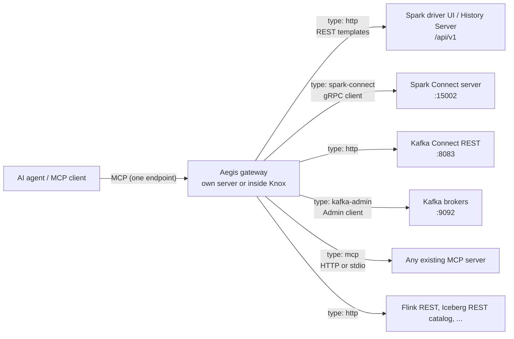
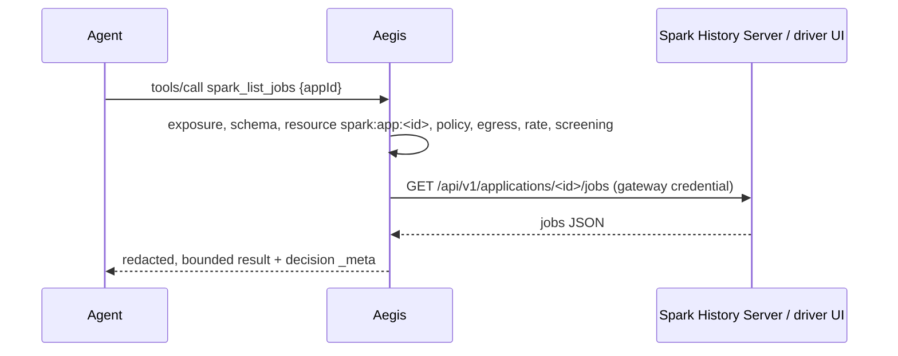
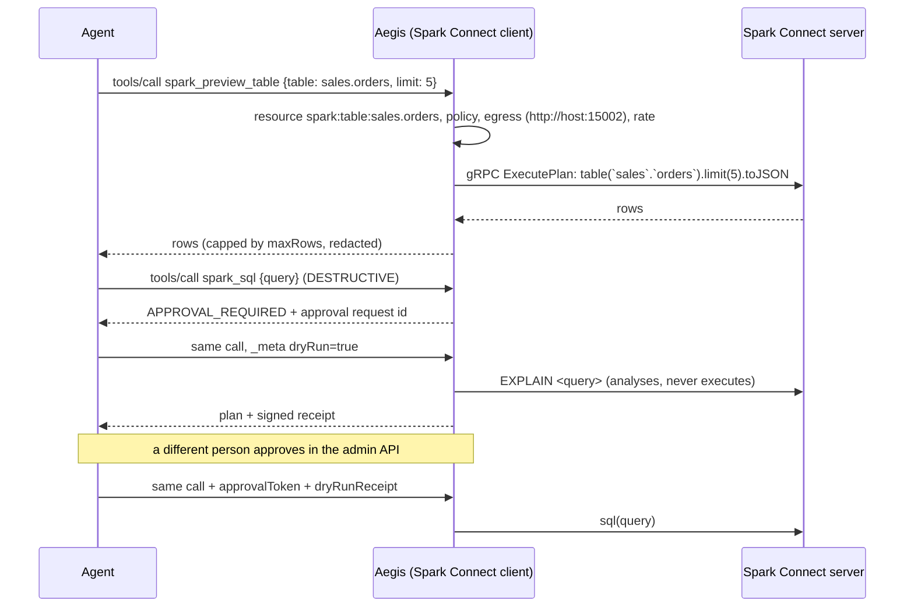
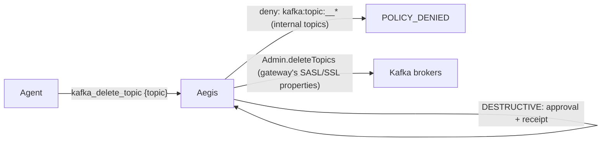

<!--
  Copyright 2026 Viquar Khan and the Aegis MCP Gateway contributors

  Licensed under the Apache License, Version 2.0 (the "License");
  you may not use this file except in compliance with the License.
  You may obtain a copy of the License at

      http://www.apache.org/licenses/LICENSE-2.0

  Unless required by applicable law or agreed to in writing, software
  distributed under the License is distributed on an "AS IS" BASIS,
  WITHOUT WARRANTIES OR CONDITIONS OF ANY KIND, either express or implied.
  See the License for the specific language governing permissions and
  limitations under the License.
-->
# Plug and play: Spark, Spark Connect, Kafka, Kafka Connect (and anything else)

A project does not change its code, its dependencies or its release to be governed by Aegis. It
writes (or copies) one configuration file. Aegis connects to the project the way any client would,
and the agent only ever talks to Aegis.



Three ways in, picked by what the project already has:

| The project has | Source type | Code in the project | Shipped example |
| --- | --- | --- | --- |
| an MCP server | `mcp` (URL or stdio command) | none | `adopters/configurations/existing-mcp-server/existing-mcp-server.yaml` |
| a REST API | `http` (method, path, query, body templates) | none | `adopters/configurations/spark/spark.yaml`, `adopters/configurations/flink/flink.yaml`, `adopters/configurations/iceberg/iceberg.yaml`, `adopters/configurations/kafka/kafka.yaml` (Connect) |
| only a Java client | a `ToolSourceFactory` plugin jar | none (the plugin lives in Aegis) | `kafka-admin`, `spark-connect` |

Whatever the type, the operator decides every tool's class (READ, MUTATE, DESTRUCTIVE), the typed
resources it touches, who may see it, and how it is previewed. Upstream hints can only raise a class.

## Apache Spark (classic): the monitoring REST API



Config: [`adopters/configurations/spark/spark.yaml`](../adopters/configurations/spark/spark.yaml). Point
`baseUrl` at a History Server (`:18080`) or a running driver (`:4040`). The destructive
`spark_kill_submission` uses the standalone master's REST submission server, which exists only in
standalone cluster mode with `spark.master.rest.enabled=true`; leave that source out on YARN or Kubernetes.

Validated against a real Spark 4.0 driver (`RealSparkTest`) and in the tutorial.

## Apache Spark Connect: data and SQL, governed



Config: [`adopters/configurations/spark-connect/spark-connect.yaml`](../adopters/configurations/spark-connect/spark-connect.yaml).
Needs the `examples/aegis-spark-connect` jar (or the ready `aegis-gateway-spark-*-all.jar`).

- Spark runs in its own process; the gateway is a Spark Connect **client**, so there is no classpath
  coupling with Spark and no Spark code runs in the gateway.
- READ by construction: `spark_list_databases`, `spark_list_tables`, `spark_describe_table`,
  `spark_preview_table`, `spark_explain_sql`. Table names are validated and back-quoted, so an
  argument can never become SQL.
- DESTRUCTIVE: `spark_sql` (any SQL can write) and `spark_drop_table`, previewed with
  `spark_explain_sql` and `spark_describe_table`.
- Spark sees the gateway's service identity (`userId`, optional token over TLS); who asked is in the
  Aegis audit record, joined by trace id.

Validated against a real Spark 4.0.1 Spark Connect server in its own JVM (`RealSparkConnectServerTest`)
and end to end in [TUTORIAL-SPARK-AND-SPARK-CONNECT.md](TUTORIAL-SPARK-AND-SPARK-CONNECT.md).

## Apache Kafka: brokers through the Admin client



Config: the `kafka-admin` source in [`adopters/configurations/kafka/kafka.yaml`](../adopters/configurations/kafka/kafka.yaml).
`kafka_create_topic` uses Kafka's own validate-only mode as its dry run (`ARGUMENT validateOnly`).
SASL/SSL client properties go in a separate `clientPropertiesFile`, so no secret sits in the Aegis file.
The Admin client connects to the configured bootstrap servers directly; the executor reports no
HTTP URL, so this plugin does not pass through the gateway's HTTP egress check (stated in the
source's Javadoc).

## Kafka Connect: connectors over REST

Config: the `kafka-connect` source in the same `kafka.yaml`: `connect_list_connectors`,
`connect_connector_status` (READ), `connect_pause_connector` (MUTATE), `connect_delete_connector`
(DESTRUCTIVE). Validated against a real Kafka 3.9.1 Connect worker (`RealKafkaTest`, needs
`AEGIS_KAFKA_CONNECT_URL`).

## An existing MCP server (any project)

```yaml
sources:
  - id: engine-mcp
    type: mcp
    url: https://engine.internal:9000/mcp
    era: AUTO                      # 2026-07-28 first, falls back to the 2025 handshake
    namePrefix: "engine_"
    credentials: {type: bearer, tokenEnv: ENGINE_MCP_TOKEN}
    tools:
      list_jobs: {class: READ}
      delete_job: {class: DESTRUCTIVE, resources: [{type: "engine:job", pointer: /jobId}]}
    resources: {uriPatterns: ["file:///reports/*"], allowedGroups: [analysts]}   # optional, off by default
    prompts: {names: ["summarize_*"]}                                           # optional, off by default
```

Unlisted tools default to DESTRUCTIVE, so nothing becomes callable by accident; `unlistedTools: HIDE`
exposes only the listed ones.

## An A2A agent (any project that publishes an agent card)

```yaml
sources:
  - id: inventory-agent
    type: a2a                       # aegis-source-a2a on the classpath or in Knox ext/
    credentials: {type: bearer, tokenEnv: A2A_AGENT_TOKEN}
    settings: {cardUrl: "https://inventory-agent.internal.example/.well-known/agent-card.json"}
    tools:
      inventory_agent: {class: MUTATE}   # classify by the strongest thing the agent can do
```

One A2A 1.0 agent becomes one tool; Aegis is the A2A client and offers no A2A endpoint. The agent's
host must be in `egress.allowHosts`. Profile and limits:
[adopters/configurations/a2a](../adopters/configurations/a2a/README.md).

## Where Aegis runs

| Choice | When | How |
| --- | --- | --- |
| Own server | no Knox, or a dedicated MCP edge | `java -jar aegis-gateway-*-all.jar --config aegis.yaml` (add `examples/aegis-spark-connect` or use `examples/aegis-gateway-spark`) |
| Inside Apache Knox 3.0 | Knox already fronts the cluster | five jars (or one bundle) in `ext/`, `AEGIS_MCP` service in a topology: [KNOX-EXTENSION.md](KNOX-EXTENSION.md) |
| stdio | a desktop client launching a local gateway | `--stdio` with `host.stdio` identity |
| Container or Kubernetes | a cluster deployment of the own server | the repository `Dockerfile` and [`charts/aegis`](../charts/aegis/README.md) (StatefulSet; the image is built in CI, not published) |

The same configuration file works in all three; only the host section differs.
