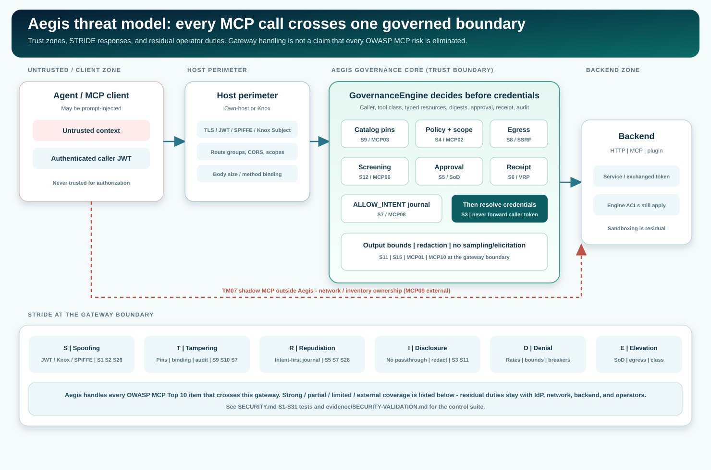

<!--
  Copyright 2026 Viquar Khan and the Aegis MCP Gateway contributors

  Licensed under the Apache License, Version 2.0 (the "License");
  you may not use this file except in compliance with the License.
  You may obtain a copy of the License at

      http://www.apache.org/licenses/LICENSE-2.0

  Unless required by applicable law or agreed to in writing, software
  distributed under the License is distributed on an "AS IS" BASIS,
  WITHOUT WARRANTIES OR CONDITIONS OF ANY KIND, either express or implied.
  See the License for the specific language governing permissions and
  limitations under the License.
-->
# Aegis threat model

This document is the product threat model for Aegis as an MCP governance gateway. It is written for
security reviewers, operators, and release evidence. It describes the system under review, trust
zones, data flows, assets, actors, entry points, STRIDE analysis, abuse scenarios with
preconditions and expected outcomes, OWASP MCP and MCP-spec handling, residual risk, assumptions,
and how tests prove each control. A concise HTML summary for GitHub Pages is
[guide/security.html](guide/security.html).

**What "handle" means:** every OWASP MCP Top 10 item and every MCP specification security best
practice that can appear on a call through Aegis has an enforced gateway control, a documented
partial containment, or an explicit external owner. Property promises S1-S31 live in [SECURITY.md](SECURITY.md). The detailed test
record is [SECURITY-VALIDATION.md](evidence/SECURITY-VALIDATION.md).

## 1. Purpose and method

| Item | Value |
| --- | --- |
| Method | Asset-centric + STRIDE per trust zone, then abuse-case elaboration |
| Boundary | Everything that processes MCP after host identity is established, until a source presents a backend credential |
| Out of band | Classic OWASP Web Top 10 certification, model evaluation, backend product ACLs |
| Evidence class | Deterministic control tests, optional real-engine / IdP runs, claims matrix status |
| Review trigger | Identity, approval/receipt binding, egress DNS, catalog trust, credentials, audit format, SPI, deny codes, or a new socket-opening source |

This model is maintained as product documentation. A change to a control that this document names
must update the matching S-property row, the claims matrix, and a re-run of the security suite
before a release claim.

## 2. Scope

| In scope | Out of scope |
| --- | --- |
| MCP tool, resource, prompt, and completion calls that pass through Aegis | Model training, fine-tuning, embedding integrity, RAG corpus poisoning |
| Own-host and Knox front-door admission into the common governance engine | Agents, IDEs, or MCP clients that never call Aegis |
| Catalog pinning, approvals, receipts, egress, audit, hooks, output bounds | Backend-internal authorization beyond the gateway credential |
| Declarative HTTP, MCP proxy, stdio, and typed plugin sources as capability only | Discovery or shutdown of shadow MCP servers outside this gateway |
| Operator configuration, secret sources, fail-closed control failures | Host OS hardening, container runtime sandbox design, SIEM product choice |

## 3. System under review

### 3.1 Logical components

1. **MCP client / agent.** Selects a tool and supplies arguments. Context may be prompt-injected.
2. **Host perimeter.** Own-host (`aegis-gateway` + `aegis-mcp-security`) or Apache Knox 3.0.0 topology
   plus `aegis-knox3-extension`. Authenticates the caller and admits the route.
3. **MCP protocol handler.** Parses JSON-RPC, enforces era rules, sessions, size/depth, duplicate keys.
4. **GovernanceEngine.** Fixed control order: exposure, schema, typed resources, policy, egress,
   rate/budget/breaker, screening, hooks, approval, receipt, intent journal, then execute.
5. **Catalog integrity.** Pins tool and prompt definitions; quarantines changes.
6. **State store.** Nonces for approvals/receipts, rate and budget windows (`memory`, `derby-local`,
   or `postgres`).
7. **Audit sink.** Hash-chained journal; optional checkpoints; verify API.
8. **Sources.** HTTP, MCP proxy/stdio, JDBC, ZooKeeper, Kafka Admin, Spark Connect, A2A, plugins.
9. **Backends.** Production engines that see only the gateway (or exchanged) credential after allow.

### 3.2 Trust zones

| Zone | Components | Trust posture |
| --- | --- | --- |
| Z1 Client | Agent, IDE, MCP client, untrusted documents in context | Untrusted for authorization |
| Z2 Host perimeter | TLS, JWT/JWKS/static/SPIFFE, Knox Subject, CORS, route groups, scopes | Trusted only after successful verification |
| Z3 Governance core | Catalog, policy, egress, screening, approval, receipt, hooks, audit | Fail-closed decision plane; single product trust root for MCP action |
| Z4 Source adapters | HTTP executor, MCP client, plugins | Capability only; must not bypass Z3 |
| Z5 Backend | Kafka, Spark, Iceberg, JDBC targets, etc. | Trusted for own responses; ACLs still required |
| Z6 Operator / IdP / network | Config, pins, secrets, inventory, firewall | External residual owners |

Cross-zone rule: a call may not present a backend credential until Z3 has written `ALLOW_INTENT`
(or denied). Caller tokens never enter Z5 for protected backends (S3/S29).

### 3.3 Data flows (DFD narrative)

| Flow | From | To | Data | Control before leave |
| --- | --- | --- | --- | --- |
| F1 | Z1 | Z2 | HTTP/MCP request, Authorization | TLS (if configured), method/path admission |
| F2 | Z2 | Z3 | CallerIdentity (no raw token), MCP body | Identity, route groups, scopes, CORS, body limits |
| F3 | Z3 | Z3 | Action binding digests | Schema, typed resources, policy, egress, screening |
| F4 | Z3 | Z6 (approver) | Redacted args + dry-run preview | SoD; journal decision before effect |
| F5 | Z3 | Z3 | ALLOW_INTENT record | Hash-chain append must succeed |
| F6 | Z3 | Z4/Z5 | Backend request + service/exchanged credential | Only after F5 |
| F7 | Z5 | Z3 | Result bytes | Bounds, redaction, hooks, no sampling/elicitation |
| F8 | Z3 | Z1 | Governed result + decision metadata | Private tools/list cache scope |

Attackers may try to skip F3-F5 (confused deputy), poison catalog before F3 (MCP03), smuggle URLs in
arguments (SSRF), or reach Z5 without Z3 (shadow MCP, TM07).

## 4. Assets

| ID | Asset | Sensitivity | Impact if lost |
| --- | --- | --- | --- |
| A1 | Backend service credentials | Critical | Broad mutate/destroy on production engines |
| A2 | Caller tokens / exchanged tokens | Critical | Impersonation, confused deputy |
| A3 | Tool and prompt definitions | High | Agent steering, tool poisoning |
| A4 | Approval and dry-run nonces | High | Replay of mutate/destructive actions |
| A5 | Typed resource scope bindings | High | Cross-tenant or cross-object access |
| A6 | Audit journal and checkpoints | High | Loss of accountability |
| A7 | Catalog pins / signed manifests / signed server catalog and break-glass orders | High | Unauthorized callable surface |
| A8 | Configuration and secret mounts | Critical | Full gateway compromise at start-up |
| A9 | Rate/budget/breaker state | Medium | Abuse amplification or false open |
| A10 | Session identifiers (2025 era) | Medium | Cross-caller session confusion |

## 5. Actors

| Actor | Capabilities | Motive examples |
| --- | --- | --- |
| Untrusted model / agent context | Chooses tools and arguments from mixed context | Accidental or injected misuse |
| Authenticated low-privilege caller | Valid token, limited groups | Curious analyst, compromised laptop |
| Authenticated privileged caller | Broader groups; still not an approver by default | Insider misuse |
| Approver | May decide MUTATE/DESTRUCTIVE for others | Rubber-stamp risk |
| Malicious upstream MCP server | Changes tool schemas/descriptions; returns hostile content | Rug-pull, exfiltration |
| Network attacker | On-path or local network | Token theft, SSRF pivot |
| Host owner / admin | Filesystem and process control | Journal rewrite, config change |
| Operator error | Misconfigures egress, TOFU, or groups | Accidental over-privilege |

## 6. Entry points

| Entry | Auth | Notes |
| --- | --- | --- |
| `POST /mcp` (own host) | Required (JWT/static/SPIFFE) | Primary MCP surface |
| Knox MCP route | Knox provider chain | Same GovernanceEngine after Subject bridge |
| Admin API (`/aegis/v1/...`) | Approver groups + Origin | Approvals, catalog accept, audit verify |
| `/metrics` | Optional group gate | Must not expose arguments |
| OAuth metadata / health / ready | Public by design | Metadata URL scheme restricted |
| stdio host | Process boundary | Operator-configured child only |
| Remote hooks / OPA / OTLP | Egress-checked at start-up | Optional data path if includeArguments |

## 7. STRIDE by trust zone

### 7.1 Spoofing

| Zone | Threat | Control | Test proof |
| --- | --- | --- | --- |
| Z2 | Forged JWT, `alg: none`, wrong `iss`/`aud`, skew abuse | S1, S2, S24, S26 | `JwtVerifierTest`, `GatewayHostTest` |
| Z2 | Missing client cert / wrong SPIFFE ID | SPIFFE mTLS mapping | `SpiffeMutualTlsTest`, `SpiffeIdentityTest` |
| Z2 | Anonymous MCP | No anonymous mode | `GatewayHostTest`, `KnoxExtensionTest` |
| Z3 | Delegated identity treated as approver | SoD folding | `SeparationOfDutiesTest` |

Residual: valid stolen tokens; IdP group mistakes; Knox topology misconfig.

### 7.2 Tampering

| Zone | Threat | Control | Test proof |
| --- | --- | --- | --- |
| Z3 | Tool definition change after review | S9 pin/quarantine; signed manifest; signed `serverCatalog` pins and source digests (S22) | `GovernanceEngineTest`, `SignedCatalogManifestTest`, `SignedCatalogManifestFlowTest` |
| Z2/Z3 | Header/body disagree; duplicate JSON keys | S10 | `McpServerHandlerTest`, `JsonTest` |
| Z3 | Journal rewrite / second writer | S7, S28 writer lock | `HashChainFileAuditSinkTest`, `AdminApiTest` |
| Z3 | Remote schema `$ref` fetch | S30 deny | `SchemaRefTest` |
| Z4 | A2A card redirects endpoint | S31 origin rule | `A2aToolSourceTest` (module suite) |

Residual: TOFU first pin; host-local journal without external checkpoint head. A signed manifest,
`serverCatalog` or break-glass order is protected from rollback when it carries a `serial` and the
state store is durable: the state store advances one high-water mark atomically, so a candidate that
arrives after a higher serial is refused across replicas. An unnumbered file signed by the same key can be put back. Without the host
trust anchor (`--require-server-catalog`), the review key is named by the configuration it protects,
so the configuration owner can remove or replace it.

### 7.3 Repudiation

| Zone | Threat | Control | Test proof |
| --- | --- | --- | --- |
| Z3 | Execute without evidence | Intent-before-execute S7 | `GovernanceEngineTest`, `ContentGovernanceTest` |
| Z3 | Approval without journal | Journal-first decisions S5 | `SeparationOfDutiesTest`, `AdminApiTest` |
| Z3 | Fake verify response | Restricted verify API S28 | `AdminApiTest` |

Residual: approver rubber-stamping; redaction hiding a detail the human needed.

### 7.4 Information disclosure

| Zone | Threat | Control | Test proof |
| --- | --- | --- | --- |
| Z3/Z5 | Caller token to backend | S3, S29 | `GovernanceEngineTest`, `GatewayHostTest`, `TokenExchangeCredentialsTest` |
| Z3 | Secrets in tool results | S11 redaction/bounds | `OutputGuardTest`, `ControlsTest` |
| Z3 | Server-initiated sampling | S15 refuse | `ExistingMcpServerProxyTest` |
| Z3 | Metrics leak arguments | S18 | `ObservabilityTest` |
| Z3 | Hook sees args by default | S20 opt-in | `RemoteHookTest` |

Residual: heuristic redaction; client retention after delivery (MCP10).

### 7.5 Denial of service

| Zone | Threat | Control | Test proof |
| --- | --- | --- | --- |
| Z2/Z3 | Huge body / deep JSON | S10 limits; 413 path | `JsonTest`, `GatewayHostTest` transport binding |
| Z3 | Call floods | Rates, budgets, breakers | `ControlsTest`, `GovernanceEngineTest` |
| Z3 | Hook hang | Fail-closed timeout S19 | `HooksTest`, `RemoteHookTest` |

Residual: network-layer DoS; breakers are per replica unless shared state is used for rates only.

### 7.6 Elevation of privilege

| Zone | Threat | Control | Test proof |
| --- | --- | --- | --- |
| Z3 | Unlisted tool as writable | Default `DESTRUCTIVE` | `GovernanceEngineTest` |
| Z3 | Self-approval / name folding | S5 SoD | `SeparationOfDutiesTest` |
| Z3 | READ SQL that mutates | sql-readonly hook | `ControlsTest` / hook tests |
| Z3 | SSRF to metadata | S8 egress + nested URL | `ControlsTest`, `ExistingMcpServerProxyTest` |
| Z3 | Quarantined source still callable | S22 | `GatewayFactoryTest`, `ServerCatalogConfigTest` |
| Z3 | Unlisted or edited server starts | S22 (`serverCatalog`) | `SignedServerCatalogTest`, `ServerCatalogConfigTest`, `ServerCatalogFlowTest` |
| Z2 | CORS / route widen | S21 | `OwnServerPerimeterTest`, `GatewayHostTest` |

Residual: novel injection phrasing; stdio child privilege; DNS check/connect race; backend job
sandboxing.

## 8. Abuse scenarios (detailed)

Each scenario lists preconditions, attacker steps, expected gateway outcome, and proof tests.

### TM01 Prompt-injected destructive call

- **Maps to:** MCP06, ASI01/ASI02, LLM01/LLM06
- **Preconditions:** Caller has group access to a DESTRUCTIVE tool; context contains hostile text.
- **Steps:** Agent calls delete/drop with attacker-chosen resource.
- **Expected:** Screening may catch known phrases (S12). Even if screening misses, policy, typed
  resources, approval, and dry-run receipt still gate execution (S4/S5/S6).
- **Proof:** `ControlsTest` (screening), `GovernanceEngineTest` (approval/receipt),
  `SeparationOfDutiesTest`.
- **Residual:** Novel phrasing; human must still read the approval payload.

### TM02 Tool poisoning / rug-pull

- **Maps to:** MCP03, ASI04, LLM03
- **Preconditions:** Upstream MCP or HTTP descriptor changes description/schema after first use.
- **Steps:** Server returns a new digest for the same tool name.
- **Expected:** Definition quarantined until a non-delegated approver accepts (S9/S17). With
  `REQUIRE_PINS`, unsigned tools never activate. With a signed `serverCatalog`, run-time acceptance
  is refused and only pins in the signed catalog can activate a definition (S22).
- **Proof:** `GovernanceEngineTest`, `ExistingMcpServerProxyTest`, `SignedCatalogManifest*`,
  `GatewayFactoryTest`, `SignedServerCatalogTest`, `ServerCatalogConfigTest`.
- **Residual:** TOFU mode can pin a poisoned first definition.

### TM03 Confused deputy

- **Maps to:** MCP spec confused deputy; MCP01/MCP02
- **Preconditions:** Gateway holds a broad backend credential; caller is authenticated.
- **Steps:** Caller invokes a destructive tool; route ACL alone would allow any method.
- **Expected:** Body-level authorization runs before credential resolve; caller token never
  forwarded (S3). Knox `AclsAuthz` is proven body-blind; Aegis still denies.
- **Proof:** `KnoxAclRouteScopeTest`, `GovernanceEngineTest`, `GatewayHostTest` (`auth=null` at
  backend).
- **Residual:** Backend ACLs still required for defense in depth.

### TM04 SSRF via nested URL or redirect

- **Maps to:** MCP spec SSRF; MCP05 partial
- **Preconditions:** Tool arguments or upstream redirect can name an HTTP URL.
- **Steps:** Point at `169.254.169.254` or a private IP not on the allow list.
- **Expected:** `EgressGuard` denies destination and DNS answers; redirects not followed (S8).
- **Proof:** `ControlsTest`, `ExistingMcpServerProxyTest` redirect case.
- **Residual:** DNS rebinding between check and connect; brokers a Kafka cluster advertises in its
  metadata; JDBC and ZooKeeper sockets (Kafka Admin and Spark Connect endpoints are checked per call,
  `KafkaAdminEgressTest`).

### TM05 READ tool carries a mutate

- **Maps to:** ASI02, MCP05
- **Preconditions:** Tool classed READ with free-text SQL (or similar).
- **Steps:** Submit `DROP` / `INSERT` through the READ tool.
- **Expected:** `sql-readonly` hook denies; JDBC execute path is single-statement.
- **Proof:** Hook/`ControlsTest` paths.
- **Residual:** Keyword guard is not a full SQL parser; use read-only DB credentials.

### TM06 Self-approval under alternate spelling

- **Maps to:** MCP02, ASI03, ASI09
- **Preconditions:** Requester is also in an approver group under another Unicode/case form.
- **Steps:** Approve own MUTATE/DESTRUCTIVE action.
- **Expected:** NFKC + case folding refuse requester-as-approver; delegated identities cannot
  approve (S5).
- **Proof:** `SeparationOfDutiesTest` (includes mutant-style regressions noted in claims C02).
- **Residual:** A second compromised human identity in the approver group.

### TM07 Shadow MCP bypass

- **Maps to:** MCP09
- **Preconditions:** Another MCP server is reachable from the agent without Aegis.
- **Steps:** Client talks to the shadow server directly.
- **Expected:** Aegis cannot see or stop that path. For configured sources, egress and quarantine
  still apply (S8/S22). A signed `serverCatalog` stops an unreviewed source from being added to the
  gateway itself, and a break-glass order can contain a configured server during an incident; neither
  finds servers that are outside the gateway's path.
- **Proof:** Not a positive gateway test; documented external ownership.
- **Residual:** Asset inventory and network policy.

### TM08 Context over-sharing after delivery

- **Maps to:** MCP10, LLM02/LLM05
- **Preconditions:** Allowed READ returns sensitive text.
- **Expected at gateway:** Bounds/redaction (S11), filtered discovery, no sampling (S15).
- **Proof:** `OutputGuardTest`, `ContentGovernanceTest`, `ExistingMcpServerProxyTest`.
- **Residual:** Client or model memory after a legitimate allow.

### TM09 Supply chain / plugin tampering

- **Maps to:** MCP04, ASI04
- **Expected at gateway:** Source trust, pin/quarantine, signed `serverCatalog` source digests, egress, release SBOM generation.
- **Proof:** `GatewayFactoryTest`, catalog tests; SBOM from release profile (separate evidence).
- **Residual:** Vulnerability gate, artifact signing, SCANOSS/FOSSA provenance scan (pre-release).

### TM10 Audit truncation or regeneration

- **Maps to:** MCP08
- **Steps:** Shorten or regenerate the journal file on disk.
- **Expected:** Hash chain verify fails; checkpoints refuse reopen when head mismatches (S7/S28).
- **Proof:** `HashChainFileAuditSinkTest`, `AuditCheckpointTest`, `AdminApiTest`.
- **Residual:** Without an off-host head, a host owner can rewrite all local history.

## 9. OWASP MCP Top 10 handling

| Item | Handling | Primary controls | Proof tests (see validation record) |
| --- | --- | --- | --- |
| MCP01 Token mismanagement | Strong | S3, S11, S29 | `GovernanceEngineTest`, `GatewayHostTest`, `TokenExchangeCredentialsTest`, `OutputGuardTest` |
| MCP02 Privilege / scope creep | Strong | S4, S5, S26 (route scopes and per-tool `actionScopes`), typed resources | `GovernanceEngineTest`, `ScopeEnforcementTest`, `SeparationOfDutiesTest` |
| MCP03 Tool poisoning | Strong with pins | S9, S12, S17, S22 | Catalog, signed manifest and signed server catalog tests |
| MCP04 Supply chain | Partial | S9, S22, S8, SBOM | `GatewayFactoryTest`; release SBOM outside this suite |
| MCP05 Command injection | Partial | Typed paths, sql-readonly, no arg-shell | `ControlsTest`, schema/path tests |
| MCP06 Prompt injection | Limited containment | S12, S4, S5 | `ControlsTest`, approval tests |
| MCP07 Authn / authz | Strong | S1, S2, S14, S17, S21, S24, S26 | JWT, perimeter, admin, Knox tests |
| MCP08 Audit / telemetry | Strong local | S7, S18, S28 | Audit + observability tests |
| MCP09 Shadow MCP | External + contain | S8, S22 for configured sources (`serverCatalog`, break-glass) | Containment tests only |
| MCP10 Context over-sharing | Partial | S11, S14, S15 | Output + proxy tests |

### MCP specification security best practices

| Practice | Handling | Proof |
| --- | --- | --- |
| Confused deputy | Handled for gateway-as-deputy | `KnoxAclRouteScopeTest`, S3 order |
| Token passthrough | Handled for protected backends | S3/S24/S29 tests |
| SSRF | Handled with DNS residual | S8 tests |
| Session hijacking | Handled for Aegis sessions | `McpServerHandlerTest` |
| Local MCP / stdio compromise | Partial | Operator-only command + minimal env |
| OAuth authorization URL validation | Handled for published metadata | metadata URL scheme tests |
| Scope minimization | Handled per route (`host.routes.mcpScopes`), per tool (`actionScopes`, own-host JWT only) + policy per tool | `ScopeEnforcementTest`, `GovernanceEngineTest` |

## 10. Assumptions for production handling

1. Mutate/destructive surfaces use `catalog.mode: REQUIRE_PINS`, a signed `catalog.manifest` or a signed `serverCatalog`.
2. Approver groups are small, monitored, and exclude automated requesters.
3. Egress allow lists exclude link-local and cloud metadata ranges unless deliberately required.
4. Journals are shipped off-host; `--verify-audit` (and checkpoints when configured) run on a schedule.
5. Plugin clients (Kafka, Spark Connect, JDBC, ZooKeeper) and stdio children run under network
   policy and least OS privilege.
6. IdP group membership and credential revocation remain correct outside Aegis.
7. No production agent is pointed at a backend MCP server that bypasses Aegis (MCP09).
8. Backend credentials are least privilege per source; READ SQL uses read-only DB roles.

## 11. How we prove the model (summary)

| Layer | What it proves | Where |
| --- | --- | --- |
| Focused S1-S31 suite | Control-suite record for the security properties | [SECURITY-VALIDATION.md](evidence/SECURITY-VALIDATION.md) |
| Property catalogue | Promise to class/test mapping | [SECURITY.md](SECURITY.md#security-properties) |
| Claims matrix | Release evidence classification | [CLAIMS-MATRIX.md](evidence/CLAIMS-MATRIX.md) (G03) |
| Real-engine / two-door | Integration under own-host and Knox | [VALIDATION.md](VALIDATION.md), adopter `results/` |
| Tutorials | Kept two-door walks | [TUTORIALS.md](TUTORIALS.md) |

The next section's companion file is the authoritative narrative of **what was run, how, and what
each test class asserts**. Read [SECURITY-VALIDATION.md](evidence/SECURITY-VALIDATION.md) for the
step-by-step proof record.

## 12. Review cadence

Revisit this model when any of the following change: host perimeter or identity, approval/receipt
binding, egress DNS semantics, catalog trust modes, credential providers, audit format, SPI/deny
taxonomy, or a new source that opens its own sockets. Update the mapped property row and re-run the
security validation suite before promoting a release claim.
