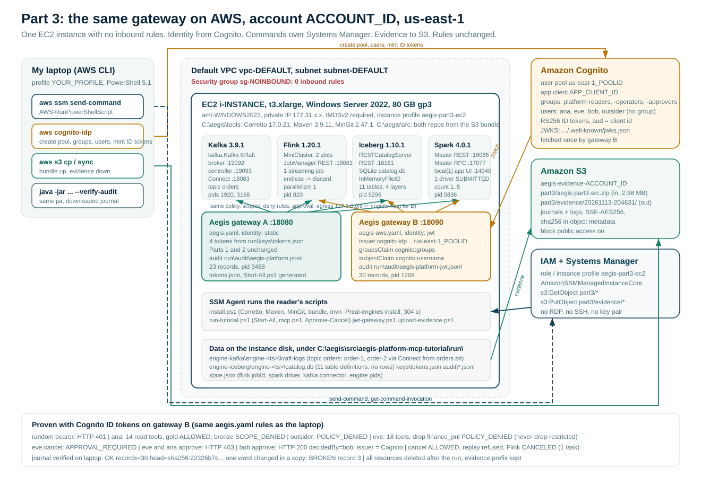

<!--
  Copyright 2026 Viquar Khan and the Aegis MCP Gateway contributors

  Licensed under the Apache License, Version 2.0 (the "License");
  you may not use this file except in compliance with the License.
  You may obtain a copy of the License at

      http://www.apache.org/licenses/LICENSE-2.0

  Unless required by applicable law or agreed to in writing, software
  distributed under the License is distributed on an "AS IS" BASIS,
  WITHOUT WARRANTIES OR CONDITIONS OF ANY KIND, either express or implied.
  See the License for the specific language governing permissions and
  limitations under the License.
-->
# Govern an AI Agent Across a Streaming Lakehouse, Part 3: The Same Gateway on AWS

*By Vaquar Khan. I build and secure data platforms. People kept asking whether the laptop demo meant anything in the cloud, so I ran the same thing on AWS and wrote down exactly what happened, including what did not work the first time.*

*Part 3 of 3. [Part 1](../part1/DZONE-ARTICLE-PART1.md) and [Part 2](../part2/DZONE-ARTICLE-PART2.md) ran one Aegis gateway in front of real Kafka, Flink, Iceberg, and Spark on a laptop, with four demo tokens for identity. This part moves it to AWS without changing a rule: the stack runs on an EC2 instance that has no open ports, identity comes from an Amazon Cognito user pool as signed JWTs, and the audit journal is pulled to S3 and verified from outside. Every output below is from that run, trimmed only of request and trace ids.*

> Series: [Part 1: The incident](../part1/DZONE-ARTICLE-PART1.md) - [Part 2: Inside the governance](../part2/DZONE-ARTICLE-PART2.md) - **Part 3 (you are here)**. Source for this article: [github.com/vaquarkhan/aegis-platform-mcp-tutorial/tree/main/articles/part3](https://github.com/vaquarkhan/aegis-platform-mcp-tutorial/tree/main/articles/part3).

## TL;DR

The laptop tutorial ran unchanged on an EC2 instance that no one can reach from the internet. Then the four static tokens were swapped for Cognito ID tokens and the same `aegis.yaml` produced the same four decisions: gold allowed, bronze `SCOPE_DENIED`, the finance drop `POLICY_DENIED`, the Flink cancel held until bob approved it and refused when replayed. The approval record names the Cognito issuer. The journals were copied to S3 and verified on a different machine. One word changed in a copy, and the verifier named the record.

If you only want the commands, they are in "Build it" below and under `articles/part3/code`. Everything in the recorded run was created with the AWS CLI, tagged `project=aegis-part3`, and deleted at the end.

## Five takeaways

1. **Moving to the cloud changed three things and zero rules.** Where the processes run, who signs the identity, and where the evidence lives. `policy`, `scopes`, `access`, `approval`, and `sources` are byte for byte the Part 2 file.
2. **The gateway never needs an inbound port.** The instance's security group has no inbound rules. Every command in this part went through AWS Systems Manager. The agent reaches the gateway the same way, from inside the network.
3. **Groups travel in the token.** Cognito puts a user's groups in the `cognito:groups` claim. One line, `groupsClaim: cognito:groups`, maps that onto the same `platform-readers`, `platform-operators`, and `platform-approvers` the policy already names. No user list in the gateway.
4. **Separation of duties survives the identity swap.** eve's own Cognito token got HTTP 403 trying to approve her request. ana's did too. bob's got HTTP 200 and the record says `decidedBy: bob` with the Cognito issuer URL. Using the approval twice was refused with `approval token has already been used`.
5. **Evidence should leave the machine that made it.** The journals were uploaded to S3 with their SHA-256 as metadata and verified with the gateway jar on my laptop. Same head hash as the instance printed. A one-word edit broke the chain at record 3.

## What was built



Everything in this part lived in one AWS account and one region, and all of it was created and deleted from the CLI. The table uses placeholders in capitals (`ACCOUNT_ID`, `vpc-DEFAULT`, `us-east-1_POOLID`, and so on) where the run had real values; yours will differ on every line of that kind, and nothing in the articles or scripts depends on the specific ids. Every resource below was deleted at the end; the only thing that still exists is the evidence prefix in S3.

| Piece | Value |
| --- | --- |
| Account, region | `ACCOUNT_ID`, `us-east-1` |
| CLI identity | IAM user `your-admin-user`, profile `YOUR_PROFILE` (admin; a narrower role would do, see the role below for what the instance itself needed) |
| VPC, subnet | default VPC `vpc-DEFAULT`, subnet `subnet-DEFAULT` |
| Security group | `sg-NOINBOUND`, name `aegis-part3-no-inbound`, **0 inbound rules**, default outbound |
| AMI | `ami-WINDOWS2022`, resolved from SSM parameter `/aws/service/ami-windows-latest/Windows_Server-2022-English-Full-Base` |
| Instance | `i-INSTANCE`, `t3.xlarge` (4 vCPU, 16 GB), 80 GB gp3 root, IMDSv2 required, private IP `172.31.x.x`, tags `Name=aegis-part3`, `project=aegis-part3` |
| Instance role | `aegis-part3-ec2`: `AmazonSSMManagedInstanceCore` plus an inline policy with `s3:GetObject` on `part3/*`, `s3:PutObject` on `part3/evidence/*`, `s3:ListBucket` on the `part3/` prefix |
| Access path | AWS Systems Manager `AWS-RunPowerShellScript` only. No key pair, no RDP, no SSH, no public listener |
| Cognito | user pool `us-east-1_POOLID`, app client `APP_CLIENT_ID` (no secret, `ADMIN_USER_PASSWORD_AUTH`), groups `platform-readers`, `platform-operators`, `platform-approvers`, users `ana`, `eve`, `bob`, `outsider` |
| S3 | bucket `aegis-evidence-ACCOUNT_ID`, block public access on, SSE-AES256. In: `part3/aegis-part3-src.zip` (2,976,567 bytes). Out: `part3/evidence/20261113-204631/` |
| Software on the instance | Amazon Corretto 17.0.21, Apache Maven 3.9.11, MinGit 2.47.1, all as zips under `C:\aegis\tools`; both repositories under `C:\aegis\src` |
| Java processes after `Start-All.ps1` | Flink (pid 820), Iceberg (5296), Spark (5836), Kafka broker (1920), Kafka Connect (3168), gateway A (3468). Gateway B added pid 1208 |
| Elapsed | instance launch to SSM online, under 2 minutes; install and Maven build, 7 minutes (build 304 s); `Start-All.ps1`, 67 s first run, 37 s second; whole session about 90 minutes |
| Cost | roughly $0.50 of EC2 (Windows `t3.xlarge` is about $0.33/hr), cents for EBS and S3, nothing for Cognito or SSM at this size |

## How each engine ran on the instance

Nothing was installed for the engines. The Maven build with `-Preal-engines` pulled the real jars into the instance's local repository, and `Start-All.ps1` started them exactly as it does on a laptop (Part 2 explains the launchers). This is what was running, from `state.json` and the engine logs on the instance.

**Kafka 3.9.1.** Two processes. `kafka.Kafka` as a single KRaft node (`process.roles=broker,controller`, `node.id=1`) with the broker listener on `127.0.0.1:19092` and the controller on `127.0.0.1:19093`. Its storage was formatted with `kafka.tools.StorageTool format` first. Log segments landed in `C:\aegis\src\aegis-platform-mcp-tutorial\run\engine-kafka\engine-<timestamp>\kraft-logs`. The second process is `org.apache.kafka.connect.cli.ConnectStandalone` on `127.0.0.1:18083` with a `FileStreamSourceConnector` named `orders-file-source` tailing `orders.txt` from the same folder into the topic `orders`. There is no ZooKeeper. No MSK was involved.

**Flink 1.20.1.** One process, the `FlinkCluster` launcher: a MiniCluster with one TaskManager and two slots, JobManager REST on `127.0.0.1:18081`. It submitted one streaming job, `Source: endless -> Sink: discard`, pinned to parallelism 1, so `/jobs/overview` shows `tasks.total: 1`. Two jobs ran in this part, one per `Start-All.ps1`: `bfd7cf97130ed46aa986cefac1525669` was cancelled through gateway A with the static tokens, `bda81f49d357a4e130ebad187d13eb34` through gateway B with Cognito tokens. Both ended `CANCELED` with `canceled: 1, total: 1`.

**Iceberg 1.10.1.** One process, `org.apache.iceberg.rest.RESTCatalogServer` on `127.0.0.1:18181`. `CATALOG_CATALOG__IMPL` is `JdbcCatalog` over a SQLite file at `run\engine-iceberg\engine-<timestamp>\catalog.db`, and `CATALOG_IO__IMPL` is `InMemoryFileIO`, so the `warehouse` folder next to it stays empty. `Seed-Medallion.ps1` removed the two default namespaces and created the four medallion layers, eleven tables in all, through the REST API. The gateway talks to it with the bearer credential in `ICEBERG_CATALOG_TOKEN`.

**Spark 4.0.1.** One process, the `SparkServices` launcher: a standalone Master with REST submission on `127.0.0.1:16066` and RPC on `17077`, plus a `local[1]` application named `aegis-spark-example` whose UI is on `127.0.0.1:14040`. `Start-All.ps1` then submitted one driver to the Master the way `spark-submit --deploy-mode cluster` does; with no worker attached it stays `SUBMITTED`. The ids from the two runs were `driver-20261113201733-0000` and `driver-20261113204108-0000`. `spark_list_applications` returned `appSparkVersion: 4.0.1`.

Memory is why the instance is a `t3.xlarge`. The launcher gives Spark `-Xmx1G` and Iceberg `-Xmx1G`, and Flink, two Kafka JVMs, Windows itself, and two gateways share the rest. Seven JVMs on 16 GB ran without a single out-of-memory line in the logs. I did not try a smaller size.

## The dataset, and where it was

Same data as Parts 1 and 2, because the point is that nothing changed. It is a governance demo, not a loaded lake.

| Layer | Tables | Rows |
| --- | --- | --- |
| Kafka topic `orders` | one partition | two records, `order-1` and `order-2`, written by Connect from `orders.txt` |
| Iceberg `bronze` | `orders_raw`, `clickstream_raw`, `payments_raw` | schema only |
| Iceberg `silver` | `orders`, `customers`, `payments` | schema only |
| Iceberg `gold` | `daily_revenue`, `customer_ltv`, `product_performance` | schema only, the only tables an analyst may read |
| Iceberg `restricted` | `finance_pnl`, `pii_customer` | schema only, cannot be dropped through the gateway |

Where it sat on the instance, all under `C:\aegis\src\aegis-platform-mcp-tutorial\run\`:

| What | Path on the instance |
| --- | --- |
| Kafka log segments for `orders` | `engine-kafka\engine-<timestamp>\kraft-logs\orders-0\` |
| The two source lines | `engine-kafka\engine-<timestamp>\orders.txt` |
| Iceberg catalog (namespaces, table schemas) | `engine-iceberg\engine-<timestamp>\catalog.db` (SQLite) |
| Iceberg warehouse | `engine-iceberg\engine-<timestamp>\warehouse\`, empty by design |
| Flink job id, Spark driver id, connector name, pids | `state.json` |
| Static tokens for gateway A | `keys\tokens.json` |
| Audit journals | `audit\aegis-platform.jsonl` (gateway A, 23 records), `audit\aegis-platform-jwt.jsonl` (gateway B, 30 records) |

None of that touched an AWS data service. The instance disk was the lake. What AWS held was the identity (Cognito), the control path (SSM), and the copies of the journals (S3). That is deliberate, and the next section says why.

## What AWS can and cannot replace here

Be clear about this before building, because it decides the design. Aegis fronts the engines through their own REST APIs: the Flink JobManager on 18081, the Iceberg REST catalog on 18181, the Spark UI and Master, Kafka Connect on 18083. Three of the managed AWS equivalents do not expose those surfaces. Amazon Managed Service for Apache Flink does not publish the JobManager REST API. The AWS Glue Iceberg REST endpoint signs with SigV4, not a bearer token. Amazon MSK has no HTTP admin API, though the `kafka-admin` plugin in `aegis.yaml` can reach an MSK bootstrap with a SASL properties file. So this part does not swap the engines for managed services. It runs the same four engines on EC2 and moves the parts that really change in a cloud deployment: compute, identity, and evidence storage. Everything in `sources` keeps its loopback `baseUrl`. If you later point `baseUrl` at an engine on another host, that is the only edit, plus adding that host to `egress`.

## Build it

I used the AWS CLI from Windows PowerShell 5.1, profile `YOUR_PROFILE`, region `us-east-1`. Public scripts are under `articles/part3/code`: `cli` runs locally and `remote` is sent through Systems Manager. Replace placeholders or pass the parameters described in each script.

### 1. Put the source where the instance can read it

The published `bundle.py` is stricter than the one used to capture the historical run: it refuses a dirty worktree, includes only files tracked by Git at `HEAD`, and writes `manifest.json` with both repository URLs, commits, and every file hash. Run it from the repository root, then let step 1 upload the resulting zip under a unique run id:

```powershell
cd articles\part3\code
python .\cli\bundle.py --gateway-root C:\path\to\aegis-mcp-gateway --tutorial-root C:\path\to\aegis-platform-mcp-tutorial
.\cli\01-upload-and-iam.ps1 -Bucket YOUR-BUCKET -Profile YOUR_PROFILE
```

Step 1 checks the expected bucket owner, uploads with SSE-AES256 and SHA-256 metadata, creates a unique role/profile, and writes ids only under `%LOCALAPPDATA%\AegisPart3`, with an ACL for the current user. It prints `STEP1_OK` only after every AWS command and metadata check passes.

**Terraform instead of steps 2, 3, and the Cognito pool.** `articles/part3/code/terraform` defines the same resources as HCL, one module per concern: `modules/network` (default VPC lookup and the no-inbound security group), `modules/iam` (the instance role and profile with the two S3 statements), `modules/compute` (the Windows instance with IMDSv2 and an 80 GB gp3 root), and `modules/cognito` (pool, app client, three groups, four users, memberships). The root composes them, takes two inputs, `bucket_name` and a sensitive `user_passwords` map, and prints the instance id and a ready-to-paste `host.identity` block. The module tree passes `terraform init`, `terraform fmt -check -recursive`, and `terraform validate` on Terraform 1.14.3 with locked AWS provider 6.73.0. I ran the article end to end with the CLI scripts, not with Terraform, so Terraform is an infrastructure definition that was statically validated, not a second deployment receipt. Use `terraform destroy` for resources Terraform creates; do not mix its state with `99-teardown.ps1`.

```powershell
cd articles\part3\code\terraform
Copy-Item .\passwords.auto.tfvars.example .\passwords.auto.tfvars
# Replace the four example passwords before continuing.
terraform init
terraform apply -var="bucket_name=YOUR-BUCKET"
terraform output aegis_identity_block
# When finished with the Terraform path:
terraform destroy -var="bucket_name=YOUR-BUCKET"
```

### 2. An instance role with the least it needs

Systems Manager core, read of the bundle prefix, write of an evidence prefix. Nothing else.

```powershell
aws iam create-role --role-name aegis-part3-ec2 --assume-role-policy-document file://trust.json --tags Key=project,Value=aegis-part3
aws iam attach-role-policy --role-name aegis-part3-ec2 --policy-arn arn:aws:iam::aws:policy/AmazonSSMManagedInstanceCore
aws iam put-role-policy --role-name aegis-part3-ec2 --policy-name aegis-part3-s3 --policy-document file://inline.json
aws iam create-instance-profile --instance-profile-name aegis-part3-ec2
aws iam add-role-to-instance-profile --instance-profile-name aegis-part3-ec2 --role-name aegis-part3-ec2
```

`inline.json` allows `s3:GetObject` on `part3/*`, `s3:PutObject` on `part3/evidence/*`, and `s3:ListBucket` limited to the `part3/` prefix.

### 3. A Windows instance with no inbound rules

Windows Server 2022, `t3.xlarge` (the four engines and two gateways need the 16 GB), 80 GB gp3, IMDSv2 required, and a new security group that I never add an inbound rule to.

```powershell
$sg  = aws ec2 create-security-group --group-name aegis-part3-no-inbound --description 'SSM only' --vpc-id $vpc --query GroupId --output text
$ami = aws ssm get-parameter --name /aws/service/ami-windows-latest/Windows_Server-2022-English-Full-Base --query Parameter.Value --output text
aws ec2 run-instances --image-id $ami --instance-type t3.xlarge --subnet-id $subnet --security-group-ids $sg `
  --iam-instance-profile Name=aegis-part3-ec2 `
  --block-device-mappings 'DeviceName=/dev/sda1,Ebs={VolumeSize=80,VolumeType=gp3,DeleteOnTermination=true}' `
  --metadata-options HttpTokens=required,HttpEndpoint=enabled `
  --tag-specifications 'ResourceType=instance,Tags=[{Key=Name,Value=aegis-part3},{Key=project,Value=aegis-part3}]'
aws ec2 describe-security-groups --group-ids $sg --query 'length(SecurityGroups[0].IpPermissions)'
```

```text
0
```

That zero is the whole network story. The instance registered with Systems Manager on its own, and every step from here is `aws ssm send-command` with `AWS-RunPowerShellScript`. The wrapper is `articles/part3/code/cli/ssm.ps1`; it base64-encodes a local script, writes it to `C:\aegis\ssm-script.ps1` on the instance, runs it, and collects the output.

### 4. Install and build on the instance

`articles/part3/code/remote/install.ps1`, sent through SSM. It downloads Amazon Corretto 17, Apache Maven 3.9.11, and MinGit as zips, pulls the bundle from S3, checks its SHA-256, and runs the same Maven command as Part 1.

```text
19:57:46 java: openjdk version "17.0.21" 2026-10-20 LTS  Corretto-17.0.21.0.11
19:57:46 mvn: Apache Maven 3.9.11
19:59:30 bundle sha256=SHA256_OF_YOUR_BUNDLE
19:59:37 mvn -B -Preal-engines -DskipTests install  (this is the slow step)
20:04:41 mvn exit=0 elapsed=304s
20:04:41 artifact aegis-gateway\target\aegis-gateway-2.0.0-SNAPSHOT-all.jar exists=True
20:04:41 artifact examples\aegis-gateway-kafka\target\aegis-gateway-kafka-2.0.0-SNAPSHOT-all.jar exists=True
20:04:41 INSTALL_OK
```

Five minutes. The hash check matters: if the bundle you uploaded is not the bundle the instance built, nothing after this proves anything.

### 5. Run Part 1 and Part 2 unchanged

`articles/part3/code/remote/run-tutorial.ps1` is the reader's commands from the first two parts, nothing more: `Start-All.ps1`, the `mcp.ps1` checks, `Approve-Cancel.ps1`, `--verify-audit`.

```text
=== starting real flink ===     flink ready: jobId=bfd7cf97130ed46aa986cefac1525669
=== starting real iceberg ===   iceberg ready
=== starting real spark ===     spark ready: driver=driver-20261113201733-0000
=== starting real kafka ===     kafka ready: connector=orders-file-source
 Aegis platform MCP is up (Flink + Iceberg + Spark + Kafka)
Start-All elapsed=67s
```

```text
P1 reader gold        ALLOWED  customer_ltv, daily_revenue, product_performance
P1 reader bronze      DENIED:SCOPE_DENIED:step2   resource out of scope: iceberg:namespace:bronze
P1 outsider flink     DENIED:POLICY_DENIED:step3  no policy rule allows this action (default deny)
P1 reader tools/list    14
P1 operator tools/list  18
P2 operator flink     ALLOWED  flink-version 1.20.1, slots-total 2, jobs-running 1
P2 operator drop restricted.finance_pnl   DENIED:POLICY_DENIED:step3  denied by rule never-drop-restricted
P2 operator cancel without approval       DENIED:APPROVAL_REQUIRED:step4
```

```text
2) a non-approver (operator eve) tries to approve: must be refused
   operator approve HTTP 403: {"error":"caller is not in an approver group"}
3) approver (bob) approves apr_6e64b2bd209a59b638fd7b21a9f3582f
   HTTP 200: status=APPROVED decidedBy=bob
5) operator re-calls cancel WITH approval token + dry-run receipt
   outcome: ALLOWED
6) single-use: replay the same approval -> must be refused
   outcome: DENIED:APPROVAL_REQUIRED:step4
7) confirm on Flink
   "state":"CANCELED","tasks":{"canceled":1,"total":1}
verify-audit: OK records=23 head=sha256:3a49f3f2338bf8850572bc6108873323b8826fc05fe78a3e3a64f6193d984c73
```

Same results as the laptop. That is the baseline. Now the part that is new.

## Identity from Amazon Cognito

The static token block in `aegis.yaml` is the one thing you must not take to production. The replacement is a JWT issuer. Cognito is the AWS one, and the gateway only needs its issuer URL, its JWKS, and the name of the claim that carries groups.

### Create the pool from the CLI

`articles/part3/code/cli/03-cognito.ps1`. One uniquely named pool, one app client with no secret and the `ADMIN_USER_PASSWORD_AUTH` flow, three groups named exactly as the policy names them, four users. Passwords are generated and stored only under `%LOCALAPPDATA%\AegisPart3`, whose ACL is restricted to the current user. The script uploads a public issuer/client file and four short-lived ID tokens to this run's encrypted S3 runtime prefix because the SSM-only instance needs them for the JWT proof. It never uploads the permanent passwords, never prints a token, and `99-teardown.ps1` deletes the temporary runtime objects.

```powershell
$pool   = aws cognito-idp create-user-pool --pool-name aegis-part3 --admin-create-user-config AllowAdminCreateUserOnly=true `
            --policies 'PasswordPolicy={MinimumLength=16,RequireUppercase=true,RequireLowercase=true,RequireNumbers=true,RequireSymbols=false}' `
            --user-pool-tags project=aegis-part3 --query UserPool.Id --output text
$client = aws cognito-idp create-user-pool-client --user-pool-id $pool --client-name aegis-gateway --no-generate-secret `
            --explicit-auth-flows ALLOW_ADMIN_USER_PASSWORD_AUTH ALLOW_REFRESH_TOKEN_AUTH --query UserPoolClient.ClientId --output text
foreach ($g in 'platform-readers','platform-operators','platform-approvers') { aws cognito-idp create-group --user-pool-id $pool --group-name $g }
# per user: admin-create-user --message-action SUPPRESS, admin-set-user-password --permanent, admin-add-user-to-group
```

Mint an ID token and look at the claims. This is what the gateway will see.

```powershell
aws cognito-idp admin-initiate-auth --user-pool-id $pool --client-id $client --auth-flow ADMIN_USER_PASSWORD_AUTH `
  --auth-parameters "USERNAME=ana,PASSWORD=..." --query AuthenticationResult.IdToken --output text
```

```text
token ana: iss=https://cognito-idp.us-east-1.amazonaws.com/us-east-1_POOLID aud=APP_CLIENT_ID cognito:groups=platform-readers   token_use=id
token eve: iss=...  cognito:groups=platform-operators
token bob: iss=...  cognito:groups=platform-approvers
token outsider: iss=...  cognito:groups=            (a real user, in no group)
```

Use the ID token, not the access token. Cognito's access token has no `aud` claim, and the gateway requires `audience` to match. The ID token's `aud` is the app client id.

### The only part of aegis.yaml that changes

`articles/part3/code/remote/jwt-gateway.ps1` writes `aegis-aws.yaml` from `aegis.yaml`. It renames the gateway, points the audit at a second journal, adds the Cognito host to egress so the gateway may fetch the JWKS, and replaces `host.identity`. The `policy`, `scopes`, `access`, `approval`, and `sources` sections are copied without a change.

```yaml
egress:
  allowCidrs: [127.0.0.0/8]
  allowHosts: [cognito-idp.us-east-1.amazonaws.com]

host:
  listen: {host: 127.0.0.1, port: 18090}
  identity:
    type: jwt
    jwt:
      issuer: https://cognito-idp.us-east-1.amazonaws.com/us-east-1_POOLID
      audience: APP_CLIENT_ID
      algorithms: [RS256]
      jwksUri: https://cognito-idp.us-east-1.amazonaws.com/us-east-1_POOLID/.well-known/jwks.json
      groupsClaim: cognito:groups
      subjectClaim: cognito:username
```

Two notes. `groupsClaim` defaults to `groups`; Cognito uses `cognito:groups`, so it has to be named. `subjectClaim: cognito:username` makes the actor in the audit read `ana` rather than a UUID. Without that line it still works; the records just carry the `sub`.

The second gateway starts next to the first one, on 18090, against the same running engines:

```text
healthz 18090: {"status":"ok"}
INFO: Aegis gateway listening on http://127.0.0.1:18090/mcp
```

### The same story with real tokens

Each call below carries a Cognito ID token as the bearer. The gateway fetched the JWKS once, verified the RS256 signature, checked `iss` and `aud`, read `cognito:groups`, and then ran the Part 2 rules.

```text
J1  random string as bearer           HTTP 401 {"error":"authentication required"}
J2  ana  tools/list                   14 tools, all reads
J3  ana  iceberg_list_tables gold     ALLOWED  customer_ltv, daily_revenue, product_performance
J4  ana  iceberg_list_tables bronze   DENIED:SCOPE_DENIED:step2  resource out of scope: iceberg:namespace:bronze
J5  outsider flink_get_cluster_info   DENIED:POLICY_DENIED:step3 no policy rule allows this action (default deny)
J6  eve  tools/list                   18 tools
J7  eve  flink_get_cluster_info       ALLOWED  flink-version 1.20.1
J8  eve  iceberg_drop_table restricted.finance_pnl   DENIED:POLICY_DENIED:step3  denied by rule never-drop-restricted
J9  eve  flink_cancel_job             DENIED:APPROVAL_REQUIRED:step4  Approval request apr_62aba7c0... is pending
```

Now the approval, with three different people's tokens.

```text
J10 eve  dry-run                      ALLOWED  approvalRequestId=apr_62aba7c0d60143d46c678e8e3a32e862
J11 eve  POST /approvals/{id}/approve HTTP 403 {"error":"caller is not in an approver group"}
J12 ana  POST /approvals/{id}/approve HTTP 403 {"error":"caller is not in an approver group"}
J13 bob  POST /approvals/{id}/approve HTTP 200
```

bob's approval record, trimmed of the preview body:

```json
{"id":"apr_62aba7c0d60143d46c678e8e3a32e862","status":"APPROVED",
 "actor":"eve","effectiveSubject":"eve",
 "issuer":"https://cognito-idp.us-east-1.amazonaws.com/us-east-1_POOLID",
 "tool":"flink_cancel_job","toolClass":"DESTRUCTIVE","source":"flink",
 "resources":["flink:job:bda81f49d357a4e130ebad187d13eb34"],
 "decidedBy":"bob","decidedAt":"2026-11-13T20:42:25.543036800Z",
 "tokenExpiresAt":"2026-11-13T20:52:25.543036800Z"}
```

The requester, the approver, and the identity provider that vouched for both are all in one record. Then the cancel and the replay:

```text
J14 eve  GET /approvals/{id}          HTTP 200  token=aat1....
J15 eve  flink_cancel_job + token + receipt    ALLOWED
J16 eve  same call again                        DENIED:APPROVAL_REQUIRED:step4  approval token has already been used
J17 Flink /jobs/overview               "state":"CANCELED","tasks":{"canceled":1,"total":1}
```

### How Aegis defended the destructive action on AWS

The cloud changed identity, not governance. The client supplied a Cognito ID token. Aegis verified its RS256 signature against the pool's JWKS, checked `iss` and `aud`, mapped `cognito:username` to the actor and `cognito:groups` to policy groups, and then ran the same controls as Part 2.

| Boundary | AWS evidence |
| --- | --- |
| Network | EC2 security group had 0 inbound rules. Commands arrived through Systems Manager; both gateways listened on loopback. |
| Authentication | a random bearer got HTTP 401; a valid Cognito token was accepted only after issuer, audience, expiry, and signature verification |
| Least privilege | ana's signed token exposed 14 read tools, gold was allowed, bronze was `SCOPE_DENIED` |
| Default deny | outsider had a valid signed token but no `cognito:groups`; the call was `POLICY_DENIED` |
| Absolute deny | eve's valid operator token still could not drop `restricted.finance_pnl`; `never-drop-restricted` won before approval |
| Approval | the cancel was `APPROVAL_REQUIRED`; eve and ana got HTTP 403 trying to approve; bob got HTTP 200 |
| Binding | bob's record names actor eve, tool `flink_cancel_job`, the exact Flink job resource, argument digest, Cognito issuer, and `decidedBy=bob` |
| Execution proof | only eve's re-call with both artifacts was `ALLOWED`; Flink's own API then reported `CANCELED`, one task |
| Replay | the same approval returned `approval token has already been used` |
| Evidence | the 30-record JWT journal verified after S3 download; editing `SCOPE_DENIED` to `ALLOWED` broke record 3 |

This also says what Aegis does not do. It does not scan the model's prose, judge whether a prompt is wise, or replace AWS IAM. It constrains the action after the model chooses a tool and before the tool reaches an engine. IAM controls what the instance role may do in AWS. Aegis controls which MCP caller may invoke which engine action on which resource, and under what approval. Both boundaries were present in this run.

And the journal for this gateway, counted by actor. The names come from `cognito:username`, not from any list in the gateway:

```text
records=30
  "actor":"ana" x6
  "actor":"outsider" x2
  "actor":"eve" x17
OK records=30 head=sha256:22326b7eb1baf9ab49ea5b63a777e49187e2664fbe95bdb1aa425716ff16f1f4
```

bob does not appear as an actor because approving is not a tool call. His decision is inside eve's approval record.

## Evidence that leaves the machine

An audit journal on the box that produced it is a claim. The same file verified somewhere else is evidence. The instance role may write exactly one S3 prefix, so `articles/part3/code/remote/upload-evidence.ps1` copies both journals, the logs, and `state.json` there with the SHA-256 of each as object metadata. The running gateway keeps its journal open, so the script reads it with shared access into a copy first.

```text
uploaded aegis-platform.jsonl      sha256=6386aedb... bytes=19325
uploaded aegis-platform-jwt.jsonl  sha256=68409a69... bytes=26539
STAMP=20261113-204631
```

On my laptop, `articles/part3/code/cli/04-verify-evidence.ps1` syncs that prefix down, compares each file's hash to the metadata, and runs the verifier from the local build of the same gateway jar.

```text
aegis-platform-jwt.jsonl   sha256 local=68409a69d0d6 s3meta=68409a69d0d6 match=True
aegis-platform.jsonl       sha256 local=6386aedbe7a9 s3meta=6386aedbe7a9 match=True
verify aegis-platform.jsonl     : OK records=23 head=sha256:3a49f3f2338bf8850572bc6108873323b8826fc05fe78a3e3a64f6193d984c73
verify aegis-platform-jwt.jsonl : OK records=30 head=sha256:22326b7eb1baf9ab49ea5b63a777e49187e2664fbe95bdb1aa425716ff16f1f4
```

Those two head hashes are the ones the instance printed. Then the script changes one `SCOPE_DENIED` to `ALLOWED` in a copy of the JWT journal:

```text
verify tampered (record 3 SCOPE_DENIED->ALLOWED): BROKEN records=3 error=record 3: record content does not match its hash
```

For a real deployment, point `audit.file` at a volume and ship it with the same pattern, or use the chart's volume. An S3 bucket with Object Lock in compliance mode is the obvious home for the copies.

## What this is not, and what comes next

This is one instance, one gateway process per config, and `state.type: memory`. It proves the policy and identity story on AWS. It does not prove multi-replica. For that the Aegis repository ships a container image and a Helm chart, and the chart refuses more than one replica unless `state.type: postgres` is set, because pending approvals and single-use tokens have to be in one place. On AWS that is RDS for PostgreSQL. The identity block you just saw is the same for a Cognito pool, Entra ID, Okta, or Keycloak: issuer, audience, JWKS, groups claim.

The engines in this run were on the instance. Pointing a source at a real cluster is a `baseUrl` change plus an `egress.allowHosts` entry. Where the managed AWS service hides the engine's REST API, as Managed Flink and Glue Iceberg REST do today, you keep a self-managed endpoint or a small SigV4 proxy in front; the gateway's rules do not know the difference.

## Cost and teardown

The instance ran for a little over an hour. The cost was Windows `t3.xlarge` compute, 80 GB gp3 charged by provisioned time, one in-use public IPv4 address, and small S3 storage and request charges. Cognito and standard Systems Manager operations were within their no-charge allowances at this size. Pricing varies by date and region, so use the AWS calculator rather than the historical dollar estimate as a quote. `99-teardown.ps1` reads the exact ids for one run, prints the deletion plan, and refuses to act without `-Force`. It terminates that instance, deletes that security group, pool, role/profile, bundle and temporary token objects, and verifies absence. It retains the evidence prefix, which continues to incur a small S3 charge.

## Conclusion

Parts 1 and 2 ended with a claim that moving to production is configuration, not a rewrite. This part is that claim run. The processes moved to an instance with no door. The four demo tokens became a Cognito user pool that issues signed JWTs with the users' groups inside. The gateway read those groups with one new line and applied the same file. The same analyst got gold and nothing else. The same finance table could not be dropped. The same cancel waited for a second person, and Cognito's own username is on that record as the person who said yes. The journal left the machine and still verified.

Nothing about the engines knew any of this happened. That is the point of putting governance in front of them.

## Try it

- Previous: [Part 1: The incident](../part1/DZONE-ARTICLE-PART1.md) and [Part 2: Inside the governance](../part2/DZONE-ARTICLE-PART2.md)
- Tutorial, including `articles/part3/code`: [github.com/vaquarkhan/aegis-platform-mcp-tutorial](https://github.com/vaquarkhan/aegis-platform-mcp-tutorial)
- Gateway, branch `aegis-mcp-gateway-2.0-review-ready`: [github.com/vaquarkhan/aegis-mcp-gateway](https://github.com/vaquarkhan/aegis-mcp-gateway)

You need an AWS account, AWS CLI credentials allowed to create and delete the named EC2, IAM, Cognito, S3, and SSM resources, and an existing private S3 bucket. The recorded run used the CLI path below. Run from `articles\part3\code`; every script fails unless the previous one finished:

```powershell
python .\cli\bundle.py --gateway-root C:\path\to\aegis-mcp-gateway --tutorial-root C:\path\to\aegis-platform-mcp-tutorial
.\cli\01-upload-and-iam.ps1 -Bucket YOUR-BUCKET -Profile YOUR_PROFILE
.\cli\02-launch.ps1
.\cli\ssm.ps1 -ScriptPath .\remote\install.ps1 -Label install -TimeoutSeconds 5400
.\cli\ssm.ps1 -ScriptPath .\remote\run-tutorial.ps1 -Label tutorial -TimeoutSeconds 2400
.\cli\03-cognito.ps1
.\cli\ssm.ps1 -ScriptPath .\remote\jwt-gateway.ps1 -Label jwt -TimeoutSeconds 1800
.\cli\ssm.ps1 -ScriptPath .\remote\upload-evidence.ps1 -Label evidence -TimeoutSeconds 600
.\cli\04-verify-evidence.ps1 -GatewayJar C:\path\to\aegis-gateway-kafka-2.0.0-SNAPSHOT-all.jar
.\cli\99-teardown.ps1              # prints the exact deletion plan and stops
.\cli\99-teardown.ps1 -Force       # deletes only this run; keeps evidence
```

The historical output in this article came from the earlier recorded CLI scripts and real AWS run. The public scripts above preserve that sequence but add clean-worktree manifests, private runtime storage, unique run ids, exact-resource teardown, result assertions, and SSM status propagation. They were syntax checked after those safety changes, but the strengthened copies were not redeployed. Terraform was initialized, formatted, and validated only.

*Licensed under Apache-2.0. Aegis is an independent project (io.github.vaquarkhan), not affiliated with the Apache Software Foundation or Amazon Web Services.*
