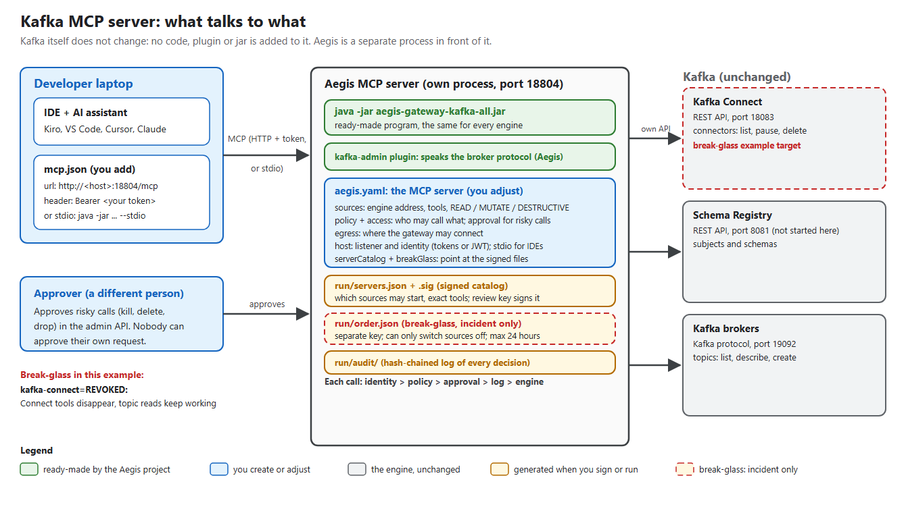

<!--
  Copyright 2026 Viquar Khan and the Aegis MCP Gateway contributors

  Licensed under the Apache License, Version 2.0 (the "License");
  you may not use this file except in compliance with the License.
  You may obtain a copy of the License at

      http://www.apache.org/licenses/LICENSE-2.0

  Unless required by applicable law or agreed to in writing, software
  distributed under the License is distributed on an "AS IS" BASIS,
  WITHOUT WARRANTIES OR CONDITIONS OF ANY KIND, either express or implied.
  See the License for the specific language governing permissions and
  limitations under the License.
-->
# Break-glass MCP servers: Spark, Kafka, Iceberg and Flink

Four independent MCP servers, one folder each. In every folder, `aegis.yaml` **is** the MCP server: the Aegis
gateway jar serves the tools it declares as governed MCP tools in front of a real engine on this machine,
under an offline signed server catalog, with a break-glass block for incidents.

| MCP server | Folder | Configuration | Real engine | MCP endpoint |
| --- | --- | --- | --- | --- |
| Spark | [spark/](spark/README.md) | [spark/aegis.yaml](spark/aegis.yaml) | Spark 4.0.1 application UI and standalone Master | `http://127.0.0.1:18803/mcp` |
| Kafka | [kafka/](kafka/README.md) | [kafka/aegis.yaml](kafka/aegis.yaml) | Kafka 3.9.1 KRaft broker and Connect worker | `http://127.0.0.1:18804/mcp` |
| Iceberg | [iceberg/](iceberg/README.md) | [iceberg/aegis.yaml](iceberg/aegis.yaml) | Iceberg 1.10.1 REST catalog | `http://127.0.0.1:18802/mcp` |
| Flink | [flink/](flink/README.md) | [flink/aegis.yaml](flink/aegis.yaml) | Flink 1.20.1 cluster | `http://127.0.0.1:18801/mcp` |

Each server has its own configuration, port, engine, signed catalog, keys, tokens, audit journal and scripts.
They can run alone or together. They share only the gateway jar and the helper module in [lib/](lib/BreakGlassMcp.psm1).



The engine never changes: no code, plugin or jar is added to it. Each folder's README explains, in plain words,
what is the engine, what is the YAML, what this example added, what the scripts are for, how a developer adds
the server for their team, and how to connect an IDE's AI assistant (Kiro, VS Code, Cursor, or stdio). Diagrams:
[spark](spark/diagram.png), [kafka](kafka/diagram.png), [iceberg](iceberg/diagram.png), [flink](flink/diagram.png).

**With Apache Knox:** the same `aegis.yaml` and signed files can also run inside a Knox 3.0.0 gateway: Knox loads the file
with the same loader, resolves `./run/...` next to it and ignores the `host:` section. The scripts here
start the own host only. The Knox path for these four engines, with a signed catalog, was exercised by the
repository's real-engine tests, which use their own configurations. Knox does the
login, groups and route access; Aegis runs as Knox's `AEGIS_MCP` service and governs each call. Each README has
an "If you go with Apache Knox" section with the steps, a topology example, IDE settings and limits. Diagrams:
[spark](spark/knox-diagram.png), [kafka](kafka/knox-diagram.png), [iceberg](iceberg/knox-diagram.png),
[flink](flink/knox-diagram.png).

## Why the YAML matters

The YAML is the whole server definition; nothing else decides what an MCP client can do:

- `sources:` declares every tool, its class (READ, MUTATE or DESTRUCTIVE), its typed resources and its dry run;
- `access`, `policy`, `approval` and `egress` decide who may call what, which calls need an independent
  approval, and where the gateway may connect;
- `serverCatalog:` names the signed file that says which sources may start, pins each source block's digest
  and the exact tool definitions, and holds the commented `breakGlass:` block an incident responder enables;
- `host:` is the loopback listener and the bearer tokens per person.

Because the signed catalog pins the digest of the `sources:` section, the gateway refuses to start if that
section is edited without re-signing. The end-to-end run proves it.

## Run

Build once from the repository root:

```powershell
mvn -B -Preal-engines -DskipTests install
```

Then either run one server from its folder (`.\Run-EndToEnd.ps1`, `.\Start-McpServer.ps1`,
`.\Stop-McpServer.ps1`; see each README), or all four from here:

```powershell
.\Run-All.ps1                       # or -Servers kafka,spark
.\Stop-All.ps1
```

Each end-to-end run:

1. starts the real engine and seeds it;
2. **review**: serves `aegis.yaml` without its `serverCatalog` section, so every tool is QUARANTINED and
   cannot be called, and saves the approver's `GET /aegis/v1/catalog` reply;
3. **sign** with the gateway jar: `--manifest-keygen`, `--server-catalog-create aegis.yaml ...`,
   `--manifest-sign`, `--server-catalog-verify`;
4. **serve `aegis.yaml` itself**: every reviewed tool ACTIVE, `tools/list`, real reads, the outsider refused,
   and no run-time acceptance (409);
5. **tamper**: one source pointed elsewhere, so start-up is refused;
6. **break-glass**: an order signed with a separate incident key and the `breakGlass` block enabled. Flink
   and Iceberg have one source each, so start-up is refused. Spark loses its Master tools and Kafka its
   Connect tools, while their other reads keep working. An order signed with the review key is refused;
7. **audit**: the journal verifies.

Each server writes `run/RESULT.md`; `Run-All.ps1` also writes `SUMMARY.generated.md`.

## Limits

- Static bearer tokens on loopback, for a demonstration. Use JWT identity and TLS for anything else.
- Flink and Spark run as single-process launchers (a `MiniCluster`; a `Master` plus a `local[1]` application).
  They serve the same REST APIs as standalone clusters, but they are not multi-host clusters.
- Signed files stop edits, not rollback: an older catalog or order signed by the same key still verifies.
  Retire the key to revoke it. See [CONFIGURATION.md](../../docs/CONFIGURATION.md#servercatalog).
- Break-glass only contains. It never activates a server, adds a pin, skips an approval or grants a scope.
- `*/run/` is generated (signed files, keys, tokens, audit, logs) and ignored by Git ([.gitignore](.gitignore)).
  Never copy `run/keys/` to a gateway host.
