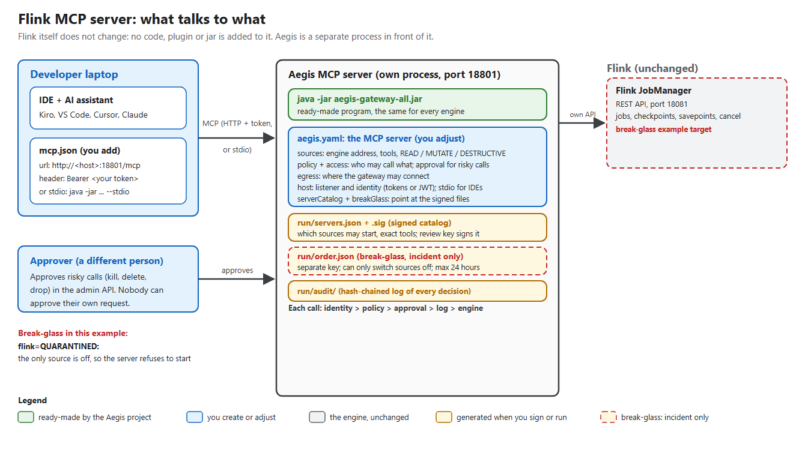
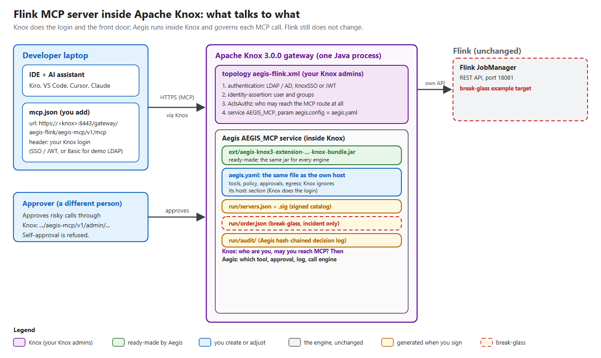
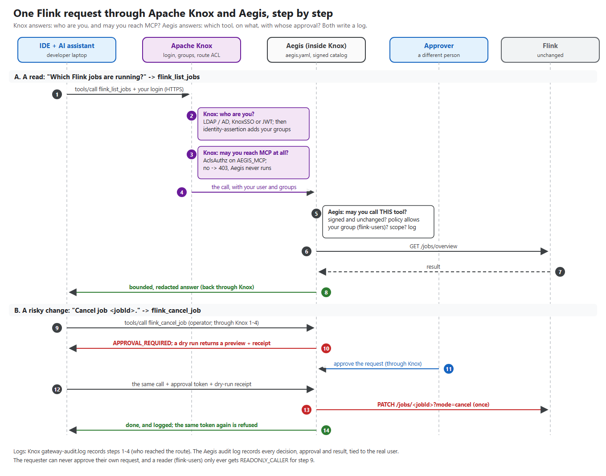

<!--
  Copyright 2026 Viquar Khan and the Aegis MCP Gateway contributors

  Licensed under the Apache License, Version 2.0 (the "License");
  you may not use this file except in compliance with the License.
  You may obtain a copy of the License at

      http://www.apache.org/licenses/LICENSE-2.0

  Unless required by applicable law or agreed to in writing, software
  distributed under the License is distributed on an "AS IS" BASIS,
  WITHOUT WARRANTIES OR CONDITIONS OF ANY KIND, either express or implied.
  See the License for the specific language governing permissions and
  limitations under the License.
-->
# Apache Flink break-glass MCP server



The picture is [`diagram.png`](diagram.png); its editable source is [`diagram.svg`](diagram.svg).

## In plain words

**Flink does not change at all.** Nothing is added to the JobManager, the TaskManagers or your jobs, and no
jar goes on Flink's classpath.

Think of it as a receptionist. Flink already has a front door: the JobManager's REST API (port 8081), the
same one the Flink web UI uses. Aegis sits in front of it:

- the AI assistant talks only to the receptionist, using MCP;
- the receptionist checks who is asking and whether they may do it;
- anything dangerous, such as cancelling or stopping a job, needs a second person's approval first;
- running a jar is treated as running code on the cluster, so only jars on an approved list can run, and
  only with approval;
- everything is written in a logbook;
- only then does it call Flink's normal REST API.

**What you need to create a Flink MCP server**

1. **The Aegis jar**: one ready-made program, the same for every engine. Nobody writes code.
2. **One YAML file**: [`aegis.yaml`](aegis.yaml) in this folder: where the JobManager is, which actions to
   offer, who may do what, and what needs approval.
3. **Start it**: `java -jar aegis-gateway-all.jar --config aegis.yaml`. That process is your Flink MCP server.

**Where it runs:** anywhere that can reach the JobManager's REST port: next to it, on a small separate
server, as its own pod in Kubernetes, or inside Apache Knox. It is a separate process, never inside Flink.

**Who does what**

| Who | What they do |
| --- | --- |
| Aegis project | Builds the jar and ships a ready-made Flink YAML ([`adopters/configurations/flink/flink.yaml`](../../../adopters/configurations/flink/flink.yaml)) |
| Your platform or ops team | Copies the YAML, sets your JobManager address and decides who may do what. That copy is your MCP server |
| Flink project | Nothing required |
| Engineers | Point their IDE or AI assistant at the MCP address and use it |

**What the assistant can do here:** cluster overview, TaskManagers, jobs, job details, exceptions,
metrics, configuration and checkpoints. These are reads. Triggering a savepoint or rescaling a job needs an
independent approval. Cancelling or stopping a job, or running a jar, is DESTRUCTIVE: it needs approval and
a dry-run receipt.

**Break-glass, in plain words:** if the cluster is compromised during an incident, a responder signs a short
order (valid for at most 24 hours) with a separate emergency key, saying "turn Flink off". This server has
only one source, so the gateway refuses to start at all rather than run with nothing reviewed. The order can
only switch things off, never on.

## Risks if an AI assistant talks to Flink without Aegis

Connecting an assistant straight to Flink's REST API, or to an MCP server without these controls, usually means
the assistant holds one powerful credential and can call anything. What could go wrong, and what this server
does about it:

| Risk | Without Aegis, with Flink | With this MCP server | OWASP MCP Top 10 |
| --- | --- | --- | --- |
| One powerful credential | The assistant (or its config file) holds access to the JobManager REST API, which has no per-user login: anyone who can reach it can call it. A leaked config or a confused agent can use all of it | The assistant only has its own token. Any Flink credential is configured in the gateway, never in the assistant, and the caller's token is never forwarded to Flink | MCP01 |
| Anyone can do anything | The assistant can call any JobManager endpoint for any job | Each tool is classified READ, MUTATE or DESTRUCTIVE, and `policy` says which group may call which class. Everything else is denied | MCP02, MCP07 |
| One prompt causes damage | Prompt injection: an exception message the assistant reads says "cancel job ..."; the assistant does it. Or a plain mistake: the assistant decides to cancel or stop running streaming jobs (`flink_cancel_job`, `flink_stop_job`), or run an uploaded jar, which runs code on your cluster (`flink_run_jar`) | A reader cannot change anything. A change needs an independent approval from a different person, and a destructive one also needs a dry run first. Nobody can approve their own request | MCP06 |
| Tools change silently | A new endpoint or a changed tool definition is offered to agents without anyone noticing | The signed server catalog pins every tool. A changed tool is quarantined, and an edited source stops the server from starting | MCP03 |
| Secrets in answers | `flink_get_flink_config` returns the jobmanager configuration, which can contain credentials (here only operators see it) | Answers are bounded and common secret shapes are redacted before the model sees them | MCP01, MCP10 |
| Calls go somewhere else | A crafted argument or redirect makes calls to other hosts, such as cloud metadata addresses | `egress` allows only the configured hosts; redirects are not followed | (SSRF) |
| Nobody knows who did what | Flink's own logs show one service account | Every decision is in a hash-chained audit log, tied to the real person, before the call runs | MCP08 |
| No emergency stop | When the cluster is compromised and you need every agent off it immediately, you have to revoke credentials or take Flink offline | A break-glass order, signed with a separate incident key, takes the contained source out when the server restarts with it; it can only switch things off | |

What Aegis does **not** remove, so it stays your job: prompt injection is contained, not prevented. A user who
receives data can still copy it. MCP servers deployed outside Aegis are not seen. Credentials and group
membership are managed in your identity provider. The full list is in
[SECURITY.md](../../../docs/SECURITY.md#mcp-threat-coverage).

## How Apache (ASF) governance fits

There are three separate layers, and none of them requires a change to Apache Flink.

**1. Apache Flink itself.** The Apache Flink PMC owns Flink's code, releases and security process. Running this MCP
server changes nothing there: there is no patch, plugin or dependency in Flink, so there is nothing for the Flink
project to vote on or review. If the Flink community wants, it can publish or review a recommended profile YAML
through its normal process (discussion on its dev list, consensus, Apache License 2.0, release vote). That is
optional and the community's choice. Report Flink security issues through Flink's own security process, not here.

**2. Aegis, the gateway.** How Aegis itself is contributed to, reviewed, released and voted on is described in
[docs/GOVERNANCE.md](../../../docs/GOVERNANCE.md), where applicable ASF and Incubator policy takes precedence over
repository procedures. Report Aegis security issues as described in [SECURITY.md](../../../SECURITY.md).

**3. Your organisation's rules for AI agents on Flink.** This is what the MCP server enforces. The decisions map to
people like this:

| Governance question | Who decides | Where it lives here |
| --- | --- | --- |
| Which Flink servers and tools may agents use at all? | Reviewers who hold the review key | `run/servers.json`, signed; the gateway verifies it with `review.pub` |
| Who may call which tool? | The platform team, through normal change review of the YAML | `policy`, `access` and `host` in `aegis.yaml` (here: `flink-users` read, `flink-operators` change) |
| Who approves a risky call? | A different person in the approver group (`flink-approvers`) | The admin API (`POST /aegis/v1/approvals/<id>/approve`); self-approval is refused |
| Who can switch it off in an incident? | The incident team, with a separate key | `run/order.json` and the `breakGlass` lines in `aegis.yaml` |
| What happened, and who did it? | Anyone with the audit log | `run/audit/*.jsonl`, checked with `--verify-audit` |
| What changes inside Flink? | The Apache Flink PMC | Nothing here: this server never modifies Flink |

The signing step works much like an Apache release. A release is a signed artifact, approved by a vote of the
project's PMC, and checked against a published public key. Here the server catalog is signed by a reviewer, checked
by the gateway against `review.pub`, and the private key never sits on the server.

If you want an extra rule such as "every destructive call must name an issue or ticket", the repository has an
illustrative profile, [apache-project-governance.example.yaml](../../../adopters/profiles/apache-project-governance.example.yaml),
using the `project-governance` hook. It is an example for a community to adapt, not an ASF policy, and it is not
enabled in this server.

## What is what in this folder

| Piece | What it is | Who makes it | Needed in production? |
| --- | --- | --- | --- |
| **The engine** | Your Flink cluster's JobManager (its REST API, the one the Flink web UI uses). In this example, [`engine/FlinkCluster.java`](engine/FlinkCluster.java) starts a real Flink 1.20.1 MiniCluster (REST on 18081) with one running job, so the example runs without a cluster. | Already yours | Yes, your real one |
| **The jar** (`aegis-gateway-all.jar`) | The Aegis program that turns `aegis.yaml` into an MCP server. Built by `mvn -B -Preal-engines -DskipTests install` at `aegis-gateway/target/aegis-gateway-2.0.0-SNAPSHOT-all.jar` | Aegis project, ready-made | Yes |
| **[`aegis.yaml`](aegis.yaml)** | The MCP server definition: tools, rules, approvals, identity | You copy and adjust it | Yes, this is the one file you own |
| What I added to the shipped profile | Only the end of `aegis.yaml`: `catalog` (nothing trusted until signed), `serverCatalog` (signed file of allowed sources and tools), the commented `breakGlass` block, and `host` (listener, tokens, and `stdio` for IDEs). Engine addresses point at the local engine | This example | Same sections, your values |
| `run/` | Generated: signed catalog, break-glass order, public keys, audit log, logs, and `run/keys/` with private keys and tokens | Created when you sign or run | Signed files and audit log yes; keep private keys off the server |
| `Run-EndToEnd.ps1` | Proves the whole story on this machine: starts the engine, reviews, signs, serves `aegis.yaml`, tampers, applies break-glass, checks the audit log | This example | No, it is a test |
| `Start-McpServer.ps1` / `Stop-McpServer.ps1` | Start the engine and this MCP server and leave them running for your IDE; stop them again | This example | No, use a service manager (systemd, Windows service, container) |
| [`diagram.png`](diagram.png), [`diagram.svg`](diagram.svg) | The picture above, and its editable source | This example | No |

## Every file explained

```
flink/
  aegis.yaml            the MCP server definition (the one file you own)
  README.md             this file
  diagram.png           the picture at the top (diagram.svg is its editable source)
  engine/               a launcher for a real local Flink (demo only)
  Run-EndToEnd.ps1      full check of this server
  Start-McpServer.ps1   start the engine and this MCP server, leave them running
  Stop-McpServer.ps1    stop what the scripts started
  run/                  generated by the scripts and by signing (ignored by Git)
```

### `engine/`: the real engine for the demo

[`engine/FlinkCluster.java`](engine/FlinkCluster.java) is a small Java program that starts a real Apache Flink
1.20.1 cluster on this machine (a MiniCluster: one JobManager and one TaskManager with two slots) with the
JobManager REST API on `127.0.0.1:18081`, the same API a standalone cluster serves, and submits one endless
streaming job so there is something to list and cancel.

The scripts compile it into `run/_launchers/` and run it with the exact Flink jars the repository tests use (the
classpath is cached in `run/_classpath/`). In production you delete this: `aegis.yaml` points at your real
JobManager.

### `aegis.yaml`: what this example added

It starts as the shipped profile [`adopters/configurations/flink/flink.yaml`](../../../adopters/configurations/flink/flink.yaml).
Nothing in its tools, policy or approvals was changed. Only these lines differ:

| In the shipped profile | In this `aegis.yaml` |
| --- | --- |
| `http://flink-jobmanager:8081` | `http://127.0.0.1:18081` |
| `allowCidrs: [10.0.0.0/8]` | `allowCidrs: [127.0.0.0/8]` (egress to loopback only) |
| `file: audit/aegis-flink.jsonl` | `file: ./run/audit/aegis-flink.jsonl` |

A comment block at the top says what the file is. This block is appended at the end, copied here from the file:

```yaml
# =================================================================================================
# Appended for the break-glass MCP server
# =================================================================================================

# Nothing is trusted on first sight: every tool definition must be pinned, here only by the
# signed server catalog. Run-time acceptance is refused while a server catalog is in force.
catalog:
  mode: REQUIRE_PINS

# The offline, Ed25519-signed register of which sources above may start, with each source's
# configuration digest and its exact tool pins. Created by Run-EndToEnd.ps1 (or by hand with
# --server-catalog-create and --manifest-sign); the private review key stays in ./run/keys.
serverCatalog:
  file: ./run/servers.json
  publicKeyFile: ./run/review.pub
  # BREAK-GLASS. During an incident, a responder signs a contain-only order with a SEPARATE incident key
  # (--break-glass-create, --manifest-sign) and enables these three lines. The order can only
  # quarantine or revoke servers, for at most 24 hours; an expired order stops the gateway from starting.
  # Start-McpServer.ps1 -Mode break-glass serves a copy of this file with them enabled.
  # breakGlass:
  #   file: ./run/order.json
  #   publicKeyFile: ./run/incident.pub

# Aegis's own MCP server on loopback. One static bearer token per person; the values come from the
# environment (the scripts generate them into ./run/keys/tokens.json). Use JWT and TLS outside a demo.
host:
  listen: {host: 127.0.0.1, port: 18801}
  identity:
    type: static
    static:
      tokens:
        - {tokenEnv: AEGIS_BG_READER, actor: reader, groups: [flink-users]}
        - {tokenEnv: AEGIS_BG_OPERATOR, actor: operator, groups: [flink-operators]}
        - {tokenEnv: AEGIS_BG_APPROVER, actor: approver, groups: [flink-approvers]}
        - {tokenEnv: AEGIS_BG_OUTSIDER, actor: outsider, groups: []}
  # For an IDE that launches the server itself (java ... --config aegis.yaml --stdio): there is no
  # network listener and no token; every call runs as this fixed, read-only identity.
  stdio: {actor: developer, groups: [flink-users]}
```

- `catalog: mode: REQUIRE_PINS`: no tool is trusted until it is signed.
- `serverCatalog`: the signed list of which sources may start and their exact tools (`run/servers.json`), checked
  with the review public key (`run/review.pub`).
- `breakGlass` (commented out): enabled only during an incident. `Start-McpServer.ps1 -Mode break-glass` serves a copy
  with these lines switched on.
- `host`: the loopback listener on port 18801, the demo bearer tokens per person (values from environment
  variables), and `stdio` for an IDE that starts the server itself.

### `run/`: generated files

Created by `Run-EndToEnd.ps1` and the gateway; ignored by Git and by the license check. Delete it any time; the
next run recreates it.

| File or folder | What it is | Secret? |
| --- | --- | --- |
| `servers.json`, `servers.json.sig`, `review.pub` | The signed server catalog that `aegis.yaml` points at, its signature, and the review public key | No |
| `order.json`, `order.json.sig`, `incident.pub` | The break-glass order (valid 60 minutes after the run), its signature, and the incident public key | No |
| `catalog.json` | The reviewed `GET /aegis/v1/catalog` reply the catalog was signed from | No |
| `keys/review.key`, `keys/incident.key` | The two **private** signing keys | **Yes**: never copy to a gateway host |
| `keys/tokens.json` | The demo bearer tokens for reader, operator, approver and outsider | **Yes** |
| `audit/aegis-flink.jsonl` | The hash-chained audit log of every decision | No, but keep it |
| `aegis-review.yaml` | `aegis.yaml` without `serverCatalog`: what the reviewer starts to read the tools | No |
| `aegis-break-glass.yaml` | `aegis.yaml` with the `breakGlass` lines switched on | No |
| `aegis-review-key.yaml`, `aegis-tampered.yaml` | Copies the test expects to be refused: an order checked with the review key, and a source pointed elsewhere | No |
| `logs/` | Output of the engine, every MCP server start (`aegis-<step>.out.log` / `.err.log`) and every gateway command (`cli-<step>.log`) | No |
| `engine-<date-time>/` | The engine's own data for that run: `flink.args` (the Java options and classpath used to start Flink) | No |
| `pids.txt` | The processes the scripts started; `Stop-McpServer.ps1` reads it | No |
| `RESULT.md` | Every check of the last end-to-end run, PASS or FAIL | No |

- `_classpath/` and `_launchers/`: the cached engine classpath and the compiled launcher, so the next run starts faster.

### The scripts

All three are short. They load the shared module [`../lib/BreakGlassMcp.psm1`](../lib/BreakGlassMcp.psm1), which
holds the real steps, so the four servers behave the same way.

| Script | What it does |
| --- | --- |
| [`Run-EndToEnd.ps1`](Run-EndToEnd.ps1) | Starts the engine, then: reviews (serves `aegis-review.yaml`; every tool is quarantined), signs with the gateway jar (`--manifest-keygen`, `--server-catalog-create`, `--manifest-sign`, `--server-catalog-verify`), serves `aegis.yaml` itself and makes real MCP calls, checks that a tampered source is refused, signs a break-glass order with a separate key (and checks that an order signed with the review key is refused), checks that start-up is then refused because this server's only source is contained, and verifies the audit log. Writes `run/RESULT.md`, stops everything, exits 0 only if every check passed |
| [`Start-McpServer.ps1`](Start-McpServer.ps1) | Starts the engine and this MCP server and **leaves them running** for your IDE. `-Mode signed` (default) serves `aegis.yaml`; `-Mode break-glass` serves it with the break-glass lines on. Needs one `Run-EndToEnd.ps1` first, for the signed files and tokens. Prints the URL and an IDE entry |
| [`Stop-McpServer.ps1`](Stop-McpServer.ps1) | Stops only the processes listed in `run/pids.txt`, and only while they are still Java processes started from this repository |

In the parent folder, [`../Run-All.ps1`](../Run-All.ps1) runs all four servers' `Run-EndToEnd.ps1` one after another,
and [`../Stop-All.ps1`](../Stop-All.ps1) runs all four `Stop-McpServer.ps1`. None of the scripts is needed in
production: there you run the jar as a service, and sign with the same gateway-jar commands by hand.

## How a developer adds a Flink MCP server for their team

You do not touch Flink. You run one more small process next to it.

1. **Get the jar.** Build this repository once (`mvn -B -Preal-engines -DskipTests install`) and take
   `aegis-gateway/target/aegis-gateway-2.0.0-SNAPSHOT-all.jar`. Put it on the machine, container or pod that will run the MCP server. That machine only needs
   network access to Flink.
2. **Copy `aegis.yaml`** next to the jar, for example `/opt/aegis/flink/aegis.yaml`.
3. **Point it at your Flink.** Change `baseUrl: http://127.0.0.1:18081`. Set `egress.allowCidrs` to your network.
4. **Choose who may do what.** The policy uses the groups `flink-users, flink-operators, flink-approvers`. Map them to your teams, or rename
   them in `policy`, `access` and `host`.
5. **Use real identity.** Replace the demo `host.identity` static tokens with your company's identity provider:
   `identity: {type: jwt, jwt: {issuer: ..., audience: ..., jwksUri: ...}}` (see
   [CONFIGURATION.md](../../../docs/CONFIGURATION.md)). Users then sign in with their normal account, and their
   groups come from the token.
6. **Review and sign the tool list once.** Start the server with the `serverCatalog:` section commented out,
   read `GET /aegis/v1/catalog` as an approver, review the tools, then sign:
   `--manifest-keygen`, `--server-catalog-create aegis.yaml catalog.json run/servers.json`, `--manifest-sign`.
   Copy only `run/servers.json`, `run/servers.json.sig` and `run/review.pub` to the server. The private key stays
   with the reviewer. [`Run-EndToEnd.ps1`](Run-EndToEnd.ps1) does exactly these steps, so read it as a recipe.
7. **Run it as a service** with `java -jar aegis-gateway-all.jar --config aegis.yaml` and the environment variables it
   names (`AEGIS_SIGNING_KEY`, the identity settings).
8. **Tell developers the URL**, for example `https://aegis-flink.your-company.example/mcp`, and how to get a token.
   They only change their IDE settings (next section).

If someone edits the `sources:` part of `aegis.yaml` later, the server refuses to start until it is signed
again. That is on purpose: nobody can quietly add a tool or point it somewhere else.

## Use it from your IDE's AI assistant

Start the server (`.\Start-McpServer.ps1` here, or your team's service), then add it to your IDE. Each person
uses their own token; the reader token in `run/keys/tokens.json` can only read. Keep tokens out of Git: use your
user-level settings, or a password prompt where the IDE supports one.

**Kiro**: `.kiro/settings/mcp.json` in the workspace, or `~/.kiro/settings/mcp.json` for all workspaces:

```json
{
  "mcpServers": {
    "aegis-flink": {
      "url": "http://127.0.0.1:18801/mcp",
      "headers": { "Authorization": "Bearer <your token>" },
      "disabled": false,
      "autoApprove": []
    }
  }
}
```

**VS Code** (GitHub Copilot agent mode): `.vscode/mcp.json`. VS Code asks for the token and does not store it in
the file:

```json
{
  "inputs": [{ "type": "promptString", "id": "aegis-token", "description": "Aegis token", "password": true }],
  "servers": {
    "aegis-flink": {
      "type": "http",
      "url": "http://127.0.0.1:18801/mcp",
      "headers": { "Authorization": "Bearer ${input:aegis-token}" }
    }
  }
}
```

**Cursor**: `.cursor/mcp.json` or `~/.cursor/mcp.json`, with the same `url` and `headers` as Kiro under `mcpServers`.

**Without a network listener (stdio):** the IDE starts the MCP server itself. Every call then runs as the
read-only `developer` identity set in `host.stdio`. Flink must already be running, and do not run this
alongside the HTTP server: both would write the same audit log, and the second one is refused. Works in Kiro,
Cursor and Claude Desktop:

```json
{
  "mcpServers": {
    "aegis-flink-stdio": {
      "command": "java",
      "args": ["-jar", "<repo>/aegis-gateway/target/aegis-gateway-2.0.0-SNAPSHOT-all.jar",
               "--config", "<repo>/examples/break-glass-mcp-servers/flink/aegis.yaml", "--stdio"],
      "env": {
        "AEGIS_SIGNING_KEY": "<at least 32 bytes>",
        "AEGIS_BG_READER": "<token>", "AEGIS_BG_OPERATOR": "<token>",
        "AEGIS_BG_APPROVER": "<token>", "AEGIS_BG_OUTSIDER": "<token>"
      }
    }
  }
}
```

Then ask the assistant something like *"Which Flink jobs are running, and when was each one's last checkpoint?"*. It calls `flink_list_jobs` through Aegis, and the answer comes
from your real Flink. Ask it to delete or kill something and it gets `READONLY_CALLER` with a reader token,
or `APPROVAL_REQUIRED` with an operator token until a different person approves the request in the admin API.

## If you go with Apache Knox



The picture is [`knox-diagram.png`](knox-diagram.png); its editable source is [`knox-diagram.svg`](knox-diagram.svg).

**In plain words:** if your company already uses Apache Knox as the front gate for its data platform, Knox stays
the building's main entrance and security desk. It checks who you are (LDAP or Active Directory, KnoxSSO or JWT)
and which groups you are in, and decides who may reach the MCP door at all. Aegis then works inside Knox as the
receptionist for that door. It decides per tool and per call, asks for approvals and keeps the decision log.
Flink still does not change.

| | Own host (the rest of this README) | Inside Knox |
| --- | --- | --- |
| Who runs it | A separate `java -jar` process | The Knox gateway process: Aegis is a Knox service (`AEGIS_MCP`) |
| Login | Tokens or JWT configured in `aegis.yaml` `host:` | Knox's providers (LDAP / AD, KnoxSSO, JWT federation); Knox ignores the `host:` section |
| Who may reach MCP | Aegis `policy` and `host.routes` | Knox `AclsAuthz` on the topology first, then Aegis `policy` per tool |
| MCP address | `http://127.0.0.1:18801/mcp` | `https://<knox>:8443/gateway/aegis-flink/aegis-mcp/v1/mcp` |
| Admin API (approvals, catalog) | `.../aegis/v1/...` | `https://<knox>:8443/gateway/aegis-flink/aegis-mcp/v1/admin/...` |
| Audit | Aegis log | Knox's own audit log (who reached the route) and the Aegis log (what each call did) |
| `aegis.yaml`, signed catalog, break-glass | Yes | The same files, unchanged |

### One request through Knox, step by step



The picture is [`knox-flow.png`](knox-flow.png); its editable source is [`knox-flow.svg`](knox-flow.svg). It follows
one real question from the IDE to Flink and back, and then one risky change.

**A. A read.** You ask the assistant "Which Flink jobs are running?" and it picks the tool `flink_list_jobs`.

1. **IDE to Knox.** The assistant sends an MCP `tools/call` for `flink_list_jobs` over HTTPS to Knox, with your
   login (a JWT, an SSO session, or Basic credentials for the demo LDAP).
2. **Knox: who are you?** Knox's authentication provider checks the login against LDAP or Active Directory,
   KnoxSSO or JWT. The identity-assertion provider then adds your groups, for example `flink-users`.
3. **Knox: may you reach MCP at all?** `AclsAuthz` checks the topology ACL for the `AEGIS_MCP` service. If you are
   not on it, Knox answers 403 and Aegis never runs.
4. **Knox to Aegis.** Knox hands the call, with your user name and groups, to the Aegis service running inside the
   same Knox process.
5. **Aegis: may you call this tool?** Aegis checks that `flink_list_jobs` is in the signed server catalog and unchanged,
   that `policy` lets your group call a READ tool, and that the resource (if any) is in your scope. It writes the
   decision to its audit log before anything else happens.
6. **Aegis to Flink.** Aegis makes the one call the tool is defined as: `GET /jobs/overview`, using the gateway's own
   Flink access, never your login.
7. **Flink answers** with its normal result.
8. **Answer to the IDE.** Aegis bounds the answer and redacts secret-looking values, logs the result, and returns it
   through Knox. The assistant shows you the answer.

**B. A risky change.** You ask "Cancel job <jobId>." and the assistant picks `flink_cancel_job`, a DESTRUCTIVE tool.

9. **The call** goes through steps 1 to 4 again, as an operator (`flink-operators`). A reader would stop here with
   `READONLY_CALLER`.
10. **Aegis: approval required.** Aegis refuses with `APPROVAL_REQUIRED` and opens an approval request. A dry run
    returns a preview of what would happen and a single-use receipt. Flink is not touched.
11. **A different person approves.** Someone in `flink-approvers` approves the request through the admin API, also through
    Knox (`.../aegis-mcp/v1/admin/approvals/<id>/approve`). Approving your own request is refused.
12. **The same call again**, now carrying the approval token and the dry-run receipt.
13. **Aegis to Flink, once:** `PATCH /jobs/<jobId>?mode=cancel`. This is the only point where Flink changes.
14. **Done, and logged.** Aegis records the result. Sending the same token again is refused: each approval works
    exactly once.

**Who logs what:** Knox's `gateway-audit.log` records steps 1 to 4: who reached the route, and whether login and the
ACL allowed it. The Aegis audit log records steps 5 to 14: every decision, approval and result, tied to the real
user, in a hash chain you can verify with `--verify-audit`.

**With break-glass on**, step 5 changes: a contained server's tools are not exposed (`NOT_EXPOSED`), and if no
source is left, the Aegis route answers 503 while the rest of Knox keeps working.

**What a developer or Knox admin does**

1. **Build once** (`mvn -B -Preal-engines -DskipTests install`) and copy one jar into Knox's `ext/` folder:
   `aegis-knox3-extension/target/aegis-knox3-extension-2.0.0-SNAPSHOT-knox-bundle.jar`. It contains Aegis only:
   no Knox, servlet, JAX-RS, Jersey or Jackson classes.
2. **Put the configuration where Knox can read it**, for example `<knox>/conf/aegis/flink/`: this folder's
   `aegis.yaml`, plus `run/servers.json`, `run/servers.json.sig` and `run/review.pub` in a `run/` folder next to
   it (the YAML refers to `./run/...`). Never copy `run/keys/`.
3. **Add a topology**, for example `<knox>/conf/topologies/aegis-flink.xml`. Your Knox admins choose the login
   provider. A complete topology that ran against stock Knox 3.0.0 (ShiroProvider, identity assertion,
   `AclsAuthz` and the service) is [examples/adopters/flink/aegis/knox-topology.xml](../../adopters/flink/aegis/knox-topology.xml).
   The providers go inside `<gateway>`, the `<service>` after it. The parts that matter for Aegis are:

   ```xml
   <provider>
     <role>identity-assertion</role><name>Default</name><enabled>true</enabled>
     <!-- with LDAP or AD groups this mapping is not needed; it is how the demo LDAP gets groups -->
     <param><name>group.principal.mapping</name><value>alice=...;bob=...;carol=...</value></param>
   </provider>
   <provider>
     <role>authorization</role><name>AclsAuthz</name><enabled>true</enabled>
     <param><name>AEGIS_MCP.acl</name><value>alice,bob,carol;*;*</value></param>
   </provider>
   <service>
     <role>AEGIS_MCP</role>
     <param><name>aegis.config</name><value>/path/to/knox/conf/aegis/flink/aegis.yaml</value></param>
   </service>
   ```

   Use the groups the policy expects (`flink-users, flink-operators, flink-approvers`), from your directory or the mapping.
4. **Give Knox the secrets** the YAML names: `AEGIS_SIGNING_KEY`, set in the Knox process environment.
   The static tokens in `host:` are not used under Knox.
5. **Point the IDE at Knox.** For example in Kiro:

   ```json
   { "mcpServers": { "aegis-flink-knox": {
       "url": "https://<knox>:8443/gateway/aegis-flink/aegis-mcp/v1/mcp",
       "headers": { "Authorization": "Bearer <a JWT Knox accepts>" } } } }
   ```

   With the demo LDAP, use `Basic <base64 of user:password>` instead. Knox must present a certificate your IDE trusts.

**Break-glass with Knox** works the same way: sign an order with the incident key, enable the `breakGlass` lines,
then redeploy the topology or restart Knox. Knox reloads Aegis on redeploy. If the Aegis configuration is
refused, for example because every source is contained, only the Aegis route answers 503. The rest of the Knox
topology keeps working, and nothing falls back to ungoverned access.

**Limits with Knox**

- Knox **3.0.0** only. Knox 3.1 moves to the Jakarta namespace and is not supported yet; see
  [KNOX-EXTENSION.md](../../../docs/KNOX-EXTENSION.md).
- Per-user backend token exchange is not available under Knox. Tools with `actionScopes` are denied there,
  because Knox identities carry no OAuth scopes.
- The scripts in this folder start the own host only, not Knox. The Knox path for this engine, with a signed
  catalog and a break-glass order, ran in the repository's real-engine tests on 2026-10-06 (`FlinkFrontDoorsTest`,
  Knox 3.0.0, passing). See [VALIDATION.md](../../../docs/VALIDATION.md).

## Technical details

An independent MCP server: [`aegis.yaml`](aegis.yaml) in this folder **is** the server. The Aegis gateway jar
serves every tool it declares as a governed MCP tool at `http://127.0.0.1:18801/mcp`, in front of
Flink 1.20.1 cluster started by [`engine/FlinkCluster.java`](engine/FlinkCluster.java): a MiniCluster with the JobManager REST API on `127.0.0.1:18081` and one endless job.

| | |
| --- | --- |
| Configuration | [`aegis.yaml`](aegis.yaml): the shipped [flink profile](../../../adopters/configurations/flink/flink.yaml) with local addresses, plus `catalog`, `serverCatalog` (and the commented `breakGlass` block) and `host` at the end |
| Sources | `flink` (Flink REST API) |
| Gateway jar | `aegis-gateway/target/aegis-gateway-2.0.0-SNAPSHOT-all.jar` |
| MCP endpoint | `http://127.0.0.1:18801/mcp` (Streamable HTTP, MCP 2026-07-28 and 2025 revisions) |
| Admin API | `http://127.0.0.1:18801/aegis/v1/` (approvals, `catalog`) |
| Break-glass order | `flink=QUARANTINED`. The only source is contained, so nothing is left to serve: the gateway refuses to start. |

## What each part of `aegis.yaml` does

- `gateway`, `access`, `approval`, `policy`, `egress`, `audit`, `sources`: the profile, unchanged apart from
  addresses. The `sources:` section declares every tool, its class (READ, MUTATE or DESTRUCTIVE), its
  typed resources and its dry-run mode.
- `catalog: {mode: REQUIRE_PINS}`: nothing is trusted on first sight.
- `serverCatalog`: points at `run/servers.json`, the signed register of which sources may start, with
  each source's configuration digest and exact tool pins. Edit `sources:` and the gateway refuses to start
  until you re-sign.
- `breakGlass` (commented): enable it during an incident, with an order signed by a separate incident key.
  It can only contain.
- `host`: loopback listener on port 18801, static bearer tokens per person (reader, operator,
  approver, outsider) read from the environment.

## Run

Build once from the repository root: `mvn -B -Preal-engines -DskipTests install`. Then, in this folder:

```powershell
.\Run-EndToEnd.ps1                 # full check: review, sign, serve, tamper, break-glass, audit
.\Start-McpServer.ps1              # engine + MCP server, left running (serves aegis.yaml)
.\Start-McpServer.ps1 -Mode break-glass
.\Stop-McpServer.ps1
```

The end-to-end run checks that `flink_list_jobs` returns the running job, that an outsider is refused, that no run-time acceptance can
re-trust a tool, that an edited source and an order signed with the review key are refused, that the
break-glass order behaves as described above, and that the audit journal verifies. The result is
`run/RESULT.md`.

To serve it by hand after a run, from this folder (the gateway reads its tokens and signing key from the
environment; the values are in `run/keys/tokens.json`):

```powershell
$env:AEGIS_SIGNING_KEY = '<at least 32 bytes>'
$env:AEGIS_BG_READER = '<token>'; $env:AEGIS_BG_OPERATOR = '<token>'
$env:AEGIS_BG_APPROVER = '<token>'; $env:AEGIS_BG_OUTSIDER = '<token>'
java -jar ..\..\..\aegis-gateway\target\aegis-gateway-2.0.0-SNAPSHOT-all.jar --config aegis.yaml
```

`run/` is generated (signed catalog, order, public keys, audit journal, logs) and ignored by Git.
`run/keys/` holds the private review and incident keys and the tokens: never copy it to a gateway host.
