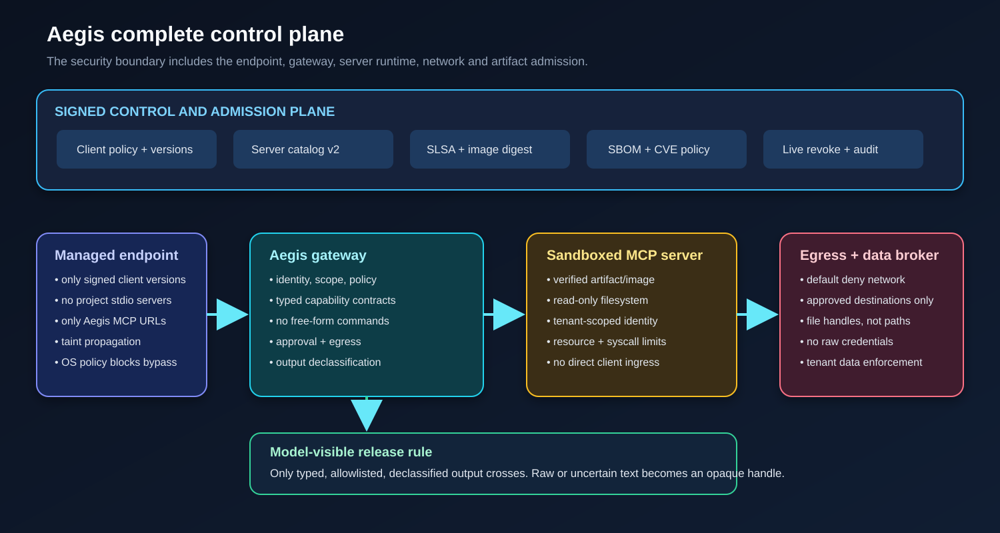

# Aegis Complete Control Exploration

## Decision

There is a practical way to close most of Part I, but it requires expanding Aegis from one gateway process into a controlled system boundary:

1. a managed endpoint that prevents local MCP bypass;
2. the existing Aegis semantic gateway;
3. signed admission for every client, server artifact, plug-in and policy;
4. a sandboxed server runtime with default-deny network and filesystem access;
5. a data broker that gives tools handles and tenant-scoped credentials instead of raw paths and shared credentials;
6. an output declassification gate that releases only typed, allowlisted results to the model;
7. live revocation and retained evidence.

Under that boundary, I can make a precise claim: **no unadmitted tool request and no raw, untrusted tool result crosses the Aegis-controlled boundary**. I still cannot claim that admitted software has no vulnerability. Known-vulnerability scans, signatures and provenance cannot prove the absence of an unknown defect. Isolation and least privilege make such a defect unable to escape its assigned capability.



## Why the gateway alone reaches a hard limit

The existing request path begins at `McpServerHandler`. A client exploit that executes before the HTTP request does not enter that path. The path ends after `GovernanceEngine` returns a guarded result. A backend opening its own socket or resolving a symlink happens in another process. No additional condition inside `GovernanceEngine` can observe either event.

The current tree already has useful seams:

- `StdioMcpClient.ensureStarted` is the process-launch seam. It uses `ProcessBuilder`, clears most inherited environment variables and restarts a dead child. It does not isolate users, mounts, networks, syscalls or process trees.
- `GatewayFactory.source` constructs HTTP and stdio MCP sources and loads `ToolSourceFactory` plug-ins.
- `SignedServerCatalog` verifies reviewed source configuration and exact tool-definition pins before a source starts. It does not verify executable, JAR or image bytes.
- `GovernanceHook` can deny before execution and transform or withhold results after execution.
- `GovernedTool` now holds trusted operator input policy separately from an upstream descriptor.
- `ToolDescriptor.outputSchema` is pinned and advertised, but no runtime code validates `structuredContent` against it.
- The Helm chart already defaults the gateway pod to a non-root user, read-only root filesystem, dropped capabilities and `RuntimeDefault` seccomp. Its NetworkPolicy is optional and applies only to the gateway pod.
- The Python, Node and Rust clients under `adopters/clients` intentionally contain no policy. They prove that policy is server-side, but they cannot enforce endpoint integrity.

The design below uses these seams rather than moving backend behavior into the gateway.

## Control levels

### Level G1: semantic gateway

This is the current hardened profile: authentication, policy, resource scope, operator schema, approval, egress checks, catalog pins, audit, rate limits, result screening and redaction. It controls MCP traffic that reaches it.

### Level G2: admitted and isolated servers

G2 adds artifact admission, process isolation, backend network policy, tenant-scoped credentials, and removal of direct client-to-server routes. This contains backend-internal defects and malicious unchanged behavior.

### Level G3: managed endpoints and declassified output

G3 adds endpoint policy, client admission, bypass prevention, taint propagation and a strict output release rule. This is the complete-control mode. Arbitrary backend text does not enter model context. It is either transformed into a typed allowlisted object or retained behind an opaque handle for human inspection.

A deployment may call itself `COMPLETE_CONTROL` only at G3 and only while all mandatory controls report healthy. A missing endpoint attestation, stale vulnerability receipt, disabled NetworkPolicy, unavailable declassifier or unsigned catalog must make admission fail.

## How each Part I item becomes controllable

### Client-side command injection, WebFetch and project MCP auto-execution

**Closure mechanism:** Aegis Endpoint Guard plus operating-system policy.

The Endpoint Guard is a local broker/launcher, not a library an agent may choose to skip. It should:

- accept only an administrator-signed endpoint policy;
- allow only approved client executable digests and minimum versions;
- reject workspace MCP files that contain stdio commands or non-Aegis URLs;
- expose one loopback MCP endpoint that forwards only to the enterprise Aegis gateway;
- set `autoApprove` to empty in generated IDE configuration;
- record the client identity, version and policy digest in each request;
- refuse OAuth flows that do not meet MCP requirements for HTTPS, PKCE S256, exact redirect handling and audience restriction.

The MCP authorization guidance requires PKCE and resource-bound tokens, and it prohibits using the inbound token as the upstream API token. Those requirements are described in the official [MCP authorization security considerations](https://modelcontextprotocol.io/specification/draft/basic/authorization/security-considerations).

A local broker alone is bypassable by another process. Enterprise deployment must pair it with WDAC or AppLocker on Windows, managed application controls on macOS, or executable and network policy on Linux. The host policy denies direct network access to MCP servers and denies unapproved interpreters from starting workspace-supplied MCP commands. In an unmanaged personal device, this residual cannot be called closed.

**Aegis implementation:** new companion module `aegis-endpoint-guard`, signed endpoint-policy format, a config scanner for `.kiro/settings/mcp.json`, `.vscode/mcp.json` and `.cursor/mcp.json`, and request metadata verification in the gateway. The gateway must not trust metadata without an endpoint-held key or mutually authenticated channel.

### Filesystem symlink escape and backend tenant-isolation defects

**Closure mechanism:** remove ambient filesystem and tenant authority from the backend.

For file tools, a secure data broker should open the approved object itself and pass an opaque handle or already-open stream. The backend should receive neither a host path nor a broad mount. On Linux, the broker should resolve beneath a configured root with kernel-enforced no-symlink/no-magic-link semantics, then pass a file descriptor or copy into a per-call sandbox. On Kubernetes, mount only the required data read-only into the server pod. A server that does not need files gets no data mount.

For tenant data, token exchange should issue a backend credential whose scope is one tenant and one operation. Database row-level security, storage prefixes or per-tenant service identities enforce the boundary even when the MCP server forgets its own tenant check. A shared privileged backend credential cannot meet complete-control mode.

**Aegis implementation:** add `ResourceBroker` and `CredentialLease` SPIs. `GovernanceEngine` already extracts typed resources and resolves credentials after all denials. The broker should consume that trusted `Action`, return an opaque handle and short-lived credential, and bind both to `requestId`, caller, resource and expiry. The backend sandbox gets only those call-scoped capabilities.

**Admission rule:** a tool declaring `riskSurface: FILESYSTEM` or `riskSurface: TENANT_DATA` is refused unless the source uses the appropriate broker and the server runtime declares no ambient equivalent authority.

### Malicious behavior behind an unchanged definition

**Closure mechanism:** verify what runs, then contain what it can do.

Definition pinning proves what the server advertised. It does not prove the bytes or behavior. `SignedServerCatalog` should gain a version 2 record with:

```json
{
  "artifact": {
    "kind": "oci-image",
    "digest": "sha256:...",
    "provenancePredicate": "https://slsa.dev/provenance/v1",
    "builderIdentity": "...",
    "sbomDigest": "sha256:...",
    "vulnerabilityReceiptDigest": "sha256:..."
  },
  "runtimeProfile": "aegis-restricted-v1",
  "sourceDigest": "sha256:...",
  "pins": {"tool": "sha256:..."}
}
```

Verification must occur before `GatewayFactory.source` constructs a source or `ServiceLoader` initializes a plug-in. For stdio, hash the resolved executable and reviewed package files before `StdioMcpClient` starts them. Shell indirection (`sh -c`, `cmd /c`, PowerShell command strings) is prohibited in complete-control mode. For plug-ins, verify the code-source JAR before provider creation and load it in a dedicated classloader.

SLSA verification ties provenance to the artifact digest and a configured builder identity, as described by [SLSA artifact verification](https://slsa.dev/spec/v1.0/verifying-artifacts). Kubernetes admission can verify image signatures and attestations and resolve tags to the admitted image using the [Sigstore policy-controller](https://docs.sigstore.dev/policy-controller/overview/). Image and SBOM vulnerability evidence can be generated without running container code using [OSV-Scanner image scanning](https://google.github.io/osv-scanner/usage/scan-image).

A signed, scanned image can still contain malicious logic or a zero-day. The sandbox below ensures that unchanged malicious behavior has no undeclared network, file, secret or tenant capability. Output declassification ensures it cannot send raw instructions or credentials to the model.

### Backend outbound exfiltration

**Closure mechanism:** infrastructure-enforced default deny, not an in-process Java check.

Every MCP server runs in its own pod or sandbox. Its network namespace has no egress by default. A generated policy allows only reviewed destinations and ports. Client ingress to the server is allowed only from Aegis. The server cannot reach the internet, cloud metadata, another tenant or the client directly.

Kubernetes permits default-deny ingress and egress with NetworkPolicy, but enforcement depends on a supporting network plug-in and is primarily layer 4. The official behavior and limitations are in [Kubernetes Network Policies](https://kubernetes.io/docs/concepts/services-networking/network-policies/). Complete-control readiness must test that the cluster actually enforces the policy instead of assuming the YAML is sufficient.

The server pod should also use the Restricted Pod Security Standard, no service-account token, no privilege escalation, read-only root filesystem, dropped capabilities, explicit CPU/memory/process limits and a restrictive seccomp profile. Kubernetes describes the policy levels in [Pod Security Standards](https://kubernetes.io/docs/concepts/security/pod-security-standards/) and syscall restriction in [Seccomp and Kubernetes](https://kubernetes.io/docs/reference/node/seccomp/).

For untrusted third-party servers, use a stronger runtime boundary. gVisor is an application-kernel sandbox intended for untrusted containers; its model and limits are described in the [gVisor security architecture](https://gvisor.dev/docs/architecture_guide/intro/). A microVM runtime is the stronger option where overhead is acceptable.

**Aegis implementation:**

- Add a `ProcessLauncher` SPI to `StdioMcpClient`, with `DIRECT` retained only for compatibility and `SANDBOX_REQUIRED` mandatory in complete-control mode.
- Kill the whole process tree on timeout or shutdown and add restart backoff.
- Add a chart/operator mode that deploys one server workload per source, generates the default-deny NetworkPolicy, sets `runtimeClassName`, and refuses readiness until an active network probe proves forbidden egress fails.
- Bind the runtime profile and its policy digest into the signed server catalog.

### Shell or SQL concatenation after approval

**Closure mechanism:** do not admit free-form execution tools.

Approval does not make string concatenation safe. Complete-control mode needs an execution contract per tool:

```yaml
tools:
  run_report:
    executionContract:
      kind: TYPED_OPERATION
      operationId: report.monthly
  query_orders:
    executionContract:
      kind: SQL_READ
      functions: DENY_UNLISTED
  run_shell:
    executionContract:
      kind: FREE_FORM
      state: PROHIBITED
```

`UNKNOWN` and `FREE_FORM` are denied in complete-control mode. `TYPED_OPERATION` takes enum-like operation IDs and typed parameters. The adapter builds an argument vector or API request without a shell. `SQL_READ` requires the function allowlist, one statement and a read-only database credential. A general shell, script, code, expression or arbitrary SQL tool is not exposed, even to an approver.

**Aegis implementation:** add trusted `ExecutionContract` to `GovernedTool`; parse it in `GatewayFactory.toolSettings`; validate it in `SourceBuild.bind`; include its digest in action binding and signed server catalog. This belongs in catalog admission, not only a hook that can be set to AUDIT or OFF.

For an existing server that exposes only a free-form command tool, the secure answer is a typed `ToolSourceFactory` adapter or refusal to admit that server. There is no parser that can make arbitrary shell text safe.

### Novel prompt injection

**Closure mechanism:** prevent untrusted text from becoming authority.

A better classifier lowers false negatives but cannot prove intent. Complete-control mode therefore changes the release contract:

- Every backend result starts as `UNTRUSTED_BACKEND_OUTPUT`.
- `output.mode: STRUCTURED_ALLOWLIST` releases only fields named by an operator output schema. It validates `structuredContent`, reconstructs text from the released object, and removes upstream extension fields.
- `output.mode: HANDLE_ONLY` releases only an opaque result ID, media type, size and digest. Raw text is retained in a controlled store for a human or separate analysis service. It never enters model context.
- `output.mode: DECLASSIFY` calls an enforcing hook and releases only the hook's transformed result. Timeout, error, unavailable classifier or ambiguous verdict withholds the result.
- Every released result carries gateway-owned provenance metadata: source, tool, definition digest, result digest, transformation list and trust label.

Taint propagation then connects output to the next action. A managed client must return a gateway-issued provenance token when a later tool call was derived from untrusted output. Policy can deny a tainted call or require independent human approval. Without a managed client, a model can copy text and lose provenance, so the endpoint component is mandatory for the G3 claim.

The strictest profile uses `HANDLE_ONLY` for arbitrary text and binary output. This is the only deterministic way to guarantee that a new injection phrase does not pass to the model. It trades model usefulness for the requested guarantee.

**Aegis implementation:** add `OutputPolicy` beside `operatorSchema` in `GovernedTool`; enforce it after `hooks.afterTool` and before `OutputGuard` truncation; validate final `structuredContent` against the trusted operator output schema; add a result store and signed handle; emit reserved `_meta` provenance in `CallOutcome.toMcpResult`. Strict output-schema mode must withhold rather than truncate into a shape that violates its schema.

### Secrets with no recognizable shape

**Closure mechanism:** declassification or handle-only output, not more regex.

A short lower-case secret is indistinguishable from an ordinary word without context. No universal detector can solve that. The deterministic choices are:

1. do not release arbitrary strings;
2. release only fields the operator has classified as public;
3. replace sensitive fields with references;
4. require an organization DLP hook to transform the result, with failure closed;
5. give the backend no secret that it does not need.

`STRUCTURED_ALLOWLIST` can release numeric counts, booleans, enums and explicitly public fields while withholding all other strings. `HANDLE_ONLY` releases no backend content. These modes close the gateway crossing even when the secret has no pattern. They do not remove the secret from the backend process, so sandbox and credential minimization still matter.

### Non-MCP CVEs and direct server traffic

**Closure mechanism:** admission plus route closure.

Aegis does not become a Kafka, SQL or arbitrary protocol proxy. Instead, complete-control deployment denies direct client routes to servers and permits only narrow, typed Aegis adapters. Known-vulnerable artifacts fail admission based on a signed vulnerability policy receipt tied to the image or binary digest. The receipt has a short validity period so a newly published CVE forces re-evaluation. If a required fixed version does not exist, the source remains quarantined unless a signed, time-limited exception and stronger sandbox profile are present.

This does not patch a Kafka or Flink defect. It prevents an artifact that violates policy from entering the controlled environment and prevents direct paths from bypassing the semantic gateway. Unknown vulnerabilities are contained by isolation.

## Required components

### Admission Controller

Add `aegis-admission` with:

- `ArtifactVerifier` SPI for OCI image, executable, JAR and directory artifacts;
- signed `ServerCatalogV2` with artifact, SBOM, provenance, vulnerability receipt and runtime-policy digests;
- host-side `AEGIS_REQUIRE_ADMISSION_POLICY_KEY`, which configuration cannot disable;
- strict unknown-field rejection, signed serial rollback protection and expiry;
- pre-ServiceLoader plug-in verification;
- live signed-catalog reload using build-then-swap: verify the whole next state, construct quarantined sources, then atomically publish it; any error leaves the prior state active;
- break-glass live quarantine that can only remove authority.

### Managed Runtime

Add `aegis-runtime` with:

- `ProcessLauncher` and `SandboxProfile` SPIs;
- Linux container/gVisor implementation first; Windows sandbox launcher as a separate implementation;
- process-tree termination, restart backoff, per-source CPU/memory/process bounds;
- read-only mounts and a per-call scratch directory;
- no network by default; reviewed destinations through an egress broker;
- runtime attestation returned to admission before a source becomes ACTIVE.

### Endpoint Guard

Add `aegis-endpoint-guard` as a separately installable component:

- signed policy and binary update channel;
- approved client version/digest list;
- IDE configuration scanner and generated safe configuration;
- local proxy to the central gateway only;
- endpoint identity and attestation;
- taint/provenance token propagation;
- operating-system enforcement integration documented as mandatory, because the daemon cannot prevent bypass by itself.

### Capability and Data Broker

Add trusted `ExecutionContract`, `ResourceBroker`, `CredentialLease` and `OutputPolicy` objects:

- unknown execution kind denied in complete-control mode;
- free-form command/script/code prohibited;
- file and tenant data reached only through call-scoped handles;
- backend credentials scoped to one source, tenant, action and short lifetime;
- operator output schema enforced at runtime;
- model-visible release is structured allowlist, declassified transformation or handle only;
- policy digests included in catalog pins, approval binding and audit.

### Deployment Operator

Extend the Helm chart or add an operator that owns server workloads as well as the gateway:

- image digest required, tags refused in complete-control mode;
- Sigstore signature and attestation policy required at admission;
- default-deny ingress and egress for every server pod;
- gateway-only ingress;
- explicit server destination allowlist;
- Restricted Pod Security Standard and sandbox runtime class;
- no service-account token, no shared host mounts, no shared process namespace;
- readiness proves policy enforcement with negative network and filesystem probes.

## Fail-closed contracts

The design is secure only if these are requirements, not recommendations:

- An unsigned client, server, plug-in, policy, SBOM, scan receipt or exception is rejected.
- A tag without an immutable digest is rejected.
- A stale vulnerability receipt is rejected.
- An artifact with a policy-blocking CVE is quarantined.
- A source without a verified runtime profile never reaches ACTIVE.
- A NetworkPolicy or sandbox probe that cannot prove denial makes readiness fail.
- A tool without an execution contract is not exposed in complete-control mode.
- A free-form execution contract is not approvable. It is prohibited.
- Output without a trusted release policy is handle-only.
- Declassifier error, timeout or ambiguity withholds output.
- Missing client provenance on a taint-sensitive action denies or requires human approval.
- Direct network access to MCP and backend services is blocked outside the managed path.
- Catalog and break-glass changes are accepted only when signed, newer and within validity.

## Prioritized implementation roadmap

### Priority 0: deployment profile with existing mechanisms

Create a `complete-control` reference profile that turns on every existing strict control: `REQUIRE_PINS`, host-required signed server catalog, durable state, `strictProperties`, result screening ENFORCE, high-entropy redaction, SQL `DENY_UNLISTED`, `unlistedTools: HIDE`, TLS/JWT, mandatory NetworkPolicy, image digest and single-tenant credentials. Close direct client-to-server routes. This is useful now, but it is G1 plus part of G2, not the final claim.

### Priority 1: output release and execution contracts

Implement `OutputPolicy` and `ExecutionContract` first. They close the two semantic gaps that isolation alone does not: arbitrary backend text reaching the model and approved free-form execution. Add output-schema validation, strict field allowlisting, handle-only mode and reserved provenance metadata. Refuse unknown/free-form execution kinds in complete-control mode.

### Priority 2: catalog v2 and artifact admission

Implement `ServerCatalogV2`, `ArtifactVerifier`, host-required admission policy, plug-in JAR verification and stdio artifact verification. Add signed vulnerability receipts tied to immutable digests. Preserve version 1 reading for ordinary mode; require version 2 for complete-control mode.

### Priority 3: managed server runtime

Add `ProcessLauncher`, sandbox profiles and the deployment operator. Start with Linux/Kubernetes, because its isolation and admission mechanisms can be tested consistently. Keep direct `ProcessBuilder` for compatibility outside complete-control mode. Add live quarantine and whole-process-tree termination.

### Priority 4: endpoint guard

Build the endpoint component after server/runtime enforcement exists. Otherwise the endpoint can prove that traffic went through Aegis but cannot prove the destination was isolated. Integrate enterprise OS policy and test that project MCP files, direct server URLs and unapproved client binaries are blocked.

### Priority 5: conformance and evidence

Extend the current vulnerable-server harness into a G3 suite. It should prove negative properties, not just successful startup:

- an unsigned and a signed-but-wrong artifact do not start;
- a stale or policy-failing vulnerability receipt does not start;
- a plug-in JAR mismatch fails before provider initialization;
- a stdio server cannot connect to the internet, cloud metadata, the gateway secret store or another source;
- a server cannot read outside its mount through `..`, symlink, junction, hard link or alternate data stream where applicable;
- a remote client cannot reach the server directly;
- a project MCP file cannot start a local command on a managed endpoint;
- arbitrary output is returned only as a handle;
- a declassifier outage withholds output;
- a tainted result cannot trigger a write without a new independent approval;
- break-glass quarantine removes a source without a restart;
- every denial and admission decision is linked to client, artifact, policy and runtime digests in the audit chain.

## Acceptance criteria for the complete-control claim

The product may claim complete control of the managed MCP path when all of these are demonstrated in one retained run:

1. The endpoint is managed and direct MCP/stdio bypass fails.
2. Every admitted artifact, plug-in and image matches a signed digest and trusted provenance.
3. Known-vulnerability policy is current and bound to those digests.
4. Every server runs in an enforced sandbox with default-deny network and least-privilege data access.
5. No client route reaches the server except through Aegis.
6. Every tool has a trusted execution contract; free-form execution is absent.
7. Every model-visible result passed a deterministic release policy; arbitrary text is handle-only.
8. Tenant and file access use call-scoped credentials or handles.
9. Live revocation and rollback resistance work without weakening authority.
10. The adversarial suite proves the negative paths above and the evidence is bound to the tested revision.

The claim must remain scoped: **complete control of the managed path**, not absence of vulnerabilities in all software.

## CVE census this design must close

The dated census in [`cve-census/MCP-CVE-CENSUS.md`](cve-census/MCP-CVE-CENSUS.md) contains 561 unique NVD CVEs discovered by seven recorded queries as of `2026-11-07T06:02:03Z`: 22 `FULL_GATEWAY_PATH`, 297 `FULL_MANAGED_PATH`, and 242 `EXTERNAL_REQUIRED`. The CSV gives every row's product, affected versions, CWE, CVSS, attack boundary, Aegis protection and required external control. No row has an ambiguous closure state. A `FULL_MANAGED_PATH` row remains quarantined until the corresponding component in this design is implemented and proven.

## Sources

- [MCP authorization security considerations](https://modelcontextprotocol.io/specification/draft/basic/authorization/security-considerations)
- [Sigstore policy-controller](https://docs.sigstore.dev/policy-controller/overview/)
- [SLSA artifact verification](https://slsa.dev/spec/v1.0/verifying-artifacts)
- [OSV-Scanner image scanning](https://google.github.io/osv-scanner/usage/scan-image)
- [Kubernetes Network Policies](https://kubernetes.io/docs/concepts/services-networking/network-policies/)
- [Kubernetes Pod Security Standards](https://kubernetes.io/docs/concepts/security/pod-security-standards/)
- [Seccomp and Kubernetes](https://kubernetes.io/docs/reference/node/seccomp/)
- [gVisor security architecture](https://gvisor.dev/docs/architecture_guide/intro/)

Content from external sources was rephrased for compliance with licensing restrictions.
